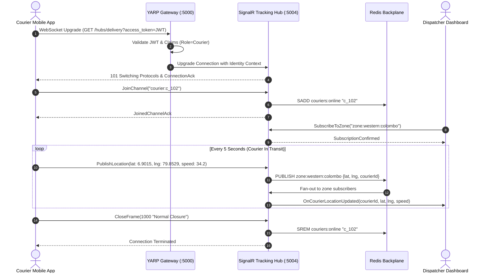

# WebSocket & Real-Time Protocol Specification

> **Status:** Draft  
> **Version:** 1.0  
> **Last Updated:** October 2026  

---

## 1. Overview

SwiftDrop provides a bidirectional **WebSocket / SignalR Core Hub** protocol for high-frequency, low-latency state synchronization. While unidirectional customer status updates can utilize Server-Sent Events (SSE), high-throughput mobile courier telemetry, live dispatcher GPS tracking, and instant delivery dispatching require full-duplex WebSocket connections.

- **Hub Endpoint:** `wss://api.swiftdrop.io/hubs/delivery` (Local: `ws://localhost:5000/hubs/delivery`)
- **Transport Support:** WebSockets (primary), Long Polling (fallback)
- **Message Format:** JSON frames (SignalR JSON Hub Protocol v1)
- **Underlying Technology:** ASP.NET Core SignalR with Redis Backplane for multi-node horizontal scale

---

## 2. Connection Lifecycle & Authentication

### 2.1. Handshake & Authentication

Because standard browser WebSocket APIs do not allow custom HTTP request headers during the opening handshake, authentication is performed via a **query string access token** during the initial HTTP upgrade request:

```http
GET /hubs/delivery?access_token=eyJhbGciOiJSUzI1NiIsInR5cCI6IkpXVCJ9... HTTP/1.1
Host: api.swiftdrop.io
Upgrade: websocket
Connection: Upgrade
Sec-WebSocket-Key: dGhlIHNhbXBsZSBub25jZQ==
Sec-WebSocket-Version: 13
```

The YARP Gateway inspects the `access_token` query parameter, validates the JWT signature, extracts user claims, and forwards the upgraded TCP stream to the real-time tracking service with claims injected into internal headers.

### 2.2. Connection Lifecycle Sequence



---

## 3. Protocol Message Frames & Schemas

Messages exchanged over the WebSocket connection adhere to the SignalR JSON protocol specification. Each frame terminates with the record separator ASCII character `0x1E` (`\u001e`).

### 3.1. Handshake Protocol

Immediately upon TCP upgrade, the client must initiate the protocol handshake:

**Client Handshake Request:**
```json
{"protocol": "json", "version": 1}
```

**Server Handshake Response:**
```json
{}
```

---

### 3.2. Courier Location Telemetry (Client -> Server)

Published by the courier's mobile application every 5 to 10 seconds while on active duty or during a delivery run.

- **Target / Action:** `PublishLocation`
- **Arguments:** Geo-telemetry object

**Frame Payload:**
```json
{
  "type": 1,
  "target": "PublishLocation",
  "arguments": [
    {
      "courierId": "c_2209a311-b1e8-48b2-b4c9-881239aa8123",
      "activeDeliveryId": "del_10293847-5647-3829-1029-384756102938",
      "latitude": 6.901524,
      "longitude": 79.852931,
      "accuracyMeters": 4.5,
      "headingDegrees": 182.4,
      "speedKph": 32.8,
      "batteryLevelPercent": 84,
      "timestamp": "2026-10-15T13:45:00.120Z"
    }
  ]
}
```

---

### 3.3. Dispatcher Fleet Broadcast (Server -> Client)

Broadcasted in real time to connected dispatchers observing a specific regional hub or operational zone.

- **Target / Action:** `OnCourierLocationUpdated`
- **Invocation Type:** Broadcast to Group (`zone:{zoneId}`)

**Frame Payload:**
```json
{
  "type": 1,
  "target": "OnCourierLocationUpdated",
  "arguments": [
    {
      "courierId": "c_2209a311-b1e8-48b2-b4c9-881239aa8123",
      "fullName": "Nuwan Fernando",
      "latitude": 6.901524,
      "longitude": 79.852931,
      "heading": 182.4,
      "speed": 32.8,
      "activeDeliveriesCount": 2,
      "updatedAt": "2026-10-15T13:45:00.120Z"
    }
  ]
}
```

---

### 3.4. Parcel Real-Time Location Update (Server -> Client)

Sent to customers viewing the live map tracking view for an active order.

- **Target / Action:** `OnParcelLocationUpdated`
- **Invocation Type:** Targeted Group (`tracking:{trackingNumber}`)

**Frame Payload:**
```json
{
  "type": 1,
  "target": "OnParcelLocationUpdated",
  "arguments": [
    {
      "trackingNumber": "TRK-202610-A9B8C7",
      "status": "InTransit",
      "currentCourierCoordinates": {
        "latitude": 6.901524,
        "longitude": 79.852931
      },
      "estimatedArrivalMinutes": 18,
      "remainingStopsCount": 1
    }
  ]
}
```

---

## 4. Channel & Group Subscription Model

Clients join specific interest groups using invocation methods exposed on the hub:

| Channel Pattern | Description | Permitted Roles | Hub Method |
|---|---|---|---|
| `tracking:{trackingNumber}` | Live tracking updates for a specific parcel | Any (Public or Auth) | `SubscribeToTracking(trackingNumber)` |
| `zone:{zoneId}` | Regional courier positions for dispatch operations | `Dispatcher`, `Admin` | `SubscribeToZone(zoneId)` |
| `courier:{courierId}` | Private channel for direct courier job offers | Specific `Courier` | Automatically joined on connect |
| `merchant:{merchantId}` | Live merchant store dispatch status feed | Specific `Merchant` | Automatically joined on connect |

---

## 5. Keepalive & Reconnection Strategy

### 5.1. Heartbeat Ping / Pong
- **Server Keepalive Interval:** The server emits a SignalR ping frame (`{"type": 6}`) every **15 seconds**.
- **Client Inactivity Timeout:** If the client fails to receive a ping within **30 seconds**, it treats the connection as dead and terminates the socket.

### 5.2. Client Exponential Backoff Reconnection
Client libraries (Flutter, React `@microsoft/signalr`) must configure automatic reconnection with progressive jittered backoff:

```typescript
import * as signalR from "@microsoft/signalr";

const connection = new signalR.HubConnectionBuilder()
  .withUrl("https://api.swiftdrop.io/hubs/delivery", {
    accessTokenFactory: () => localStorage.getItem("access_token") ?? ""
  })
  .withAutomaticReconnect({
    nextRetryDelayInMilliseconds: (retryContext) => {
      // 0s, 2s, 5s, 10s, 30s max backoff
      const delays = [0, 2000, 5000, 10000, 30000];
      return delays[retryContext.previousRetryCount] ?? 30000;
    }
  })
  .configureLogging(signalR.LogLevel.Information)
  .build();
```
