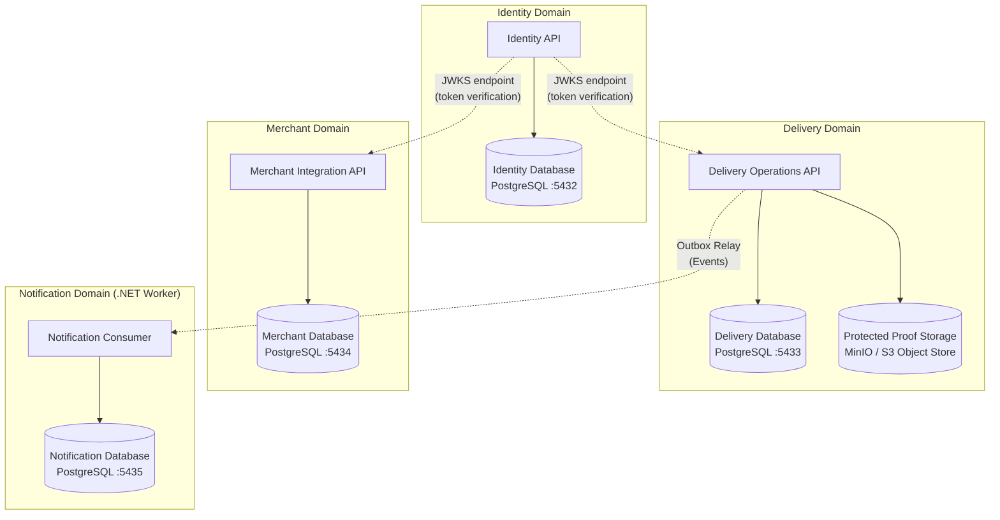
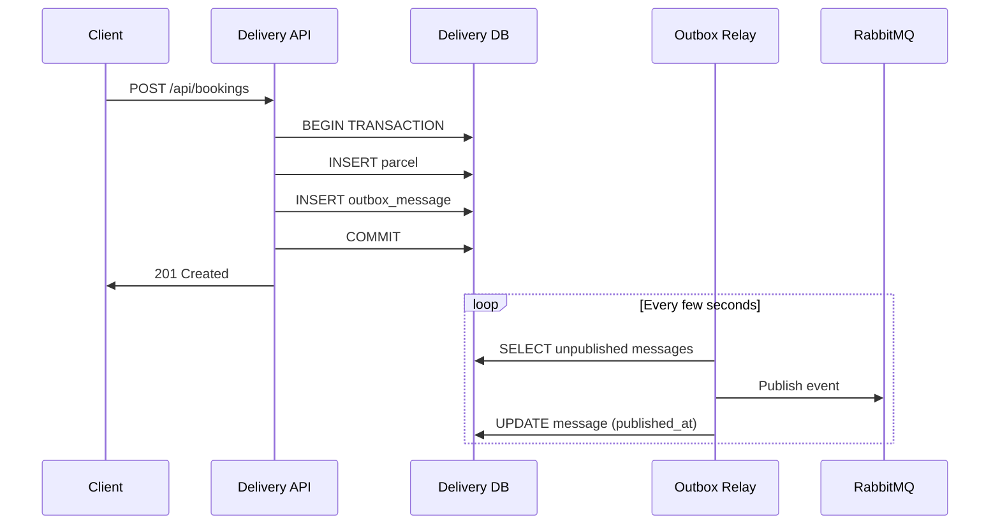

# Data Architecture

> **Status:** Draft  
> **Version:** 1.0  
> **Last Updated:** October 2026

---

## 1. Overview

SwiftDrop follows a **database-per-service** pattern where each capability API owns and manages its own PostgreSQL database. No service reads from or writes to another service's database directly. Cross-domain data access occurs exclusively through synchronous API calls or asynchronous events.

This isolation ensures:

- **Independent deployability** — schema changes in one service do not affect others.
- **Clear data ownership** — each domain has a single source of truth.
- **Encapsulated evolution** — services can optimize their storage independently.

---

## 2. Data Ownership Map

> **Rule:** Data flows between domains through APIs and events — never through shared database access. Four private PostgreSQL databases run on one server with complete schema and user isolation.

---

## 3. Database & Storage Inventory

| Database / Store | Owning Component | Port (dev) | Schema Prefix | Purpose & Migration Tool |
|---|---|:---:|---|---|
| `swiftdrop_identity` | Identity API | 5432 | `identity` | Users, roles, external identities, refresh sessions, audit logs (EF Core) |
| `swiftdrop_delivery` | Delivery Operations API | 5433 | `delivery` | Parcels, assignments, price snapshots, history, outbox (EF Core) |
| `swiftdrop_merchant` | Merchant Integration API | 5434 | `merchant` | Businesses, keys, subscriptions, encrypted secrets, inbox (EF Core) |
| `swiftdrop_notifications` | Notification Consumer (.NET Worker) | 5435 | `notifications` | Inbound notification events, dispatch jobs, delivery attempts (EF Core) |
| **Protected Proof Storage** | Delivery Operations API | 9000 | `/proofs` | Encrypted object storage for delivery photos and customer signature curves |

---

## 4. Domain Schemas

### 4.1 Identity Database

| Table                   | Description                                                    | Key Columns                                          |
| ----------------------- | -------------------------------------------------------------- | ---------------------------------------------------- |
| `users`                 | Registered user accounts                                       | `id`, `email`, `name`, `phone`, `is_active`, `created_at` |
| `roles`                 | System roles                                                   | `id`, `name` (Customer, Courier, Merchant, Dispatcher, Admin) |
| `user_roles`            | User-to-role assignments                                       | `user_id`, `role_id`                                 |
| `external_identities`   | Linked external provider accounts (Google)                     | `id`, `user_id`, `provider`, `provider_subject`      |
| `refresh_sessions`      | Active refresh tokens for session management                   | `id`, `user_id`, `token_hash`, `expires_at`, `revoked` |
| `audit_logs`            | Record of authentication and admin actions                     | `id`, `user_id`, `action`, `resource`, `timestamp`   |

### 4.2 Delivery Database

| Table                   | Description                                                    | Key Columns                                          |
| ----------------------- | -------------------------------------------------------------- | ---------------------------------------------------- |
| `parcels`               | Registered parcels for delivery                                | `id`, `customer_id`, `status`, `size`, `weight`, `pickup_address`, `dropoff_address` |
| `assignments`           | Courier-to-parcel assignment records                           | `id`, `parcel_id`, `courier_id`, `assigned_at`, `status` |
| `price_snapshots`       | Fee calculation snapshots at booking time                       | `id`, `parcel_id`, `zone_id`, `base_fee`, `weight_fee`, `total` |
| `booking_history`       | State transition history for each parcel                       | `id`, `parcel_id`, `from_status`, `to_status`, `changed_by`, `timestamp` |
| `idempotency_keys`      | Client-provided keys for idempotent booking                    | `key`, `parcel_id`, `created_at`                     |
| `outbox_messages`       | Transactional outbox for reliable event publishing              | `id`, `event_type`, `payload`, `created_at`, `published_at` |
| `proof_metadata`        | Delivery proof records (photo, signature reference)             | `id`, `parcel_id`, `type`, `storage_ref`, `uploaded_at` |
| `delivery_zones`        | Geographic zone definitions                                    | `id`, `name`, `boundaries`, `is_active`              |
| `pricing_tiers`         | Zone and size-based pricing rules                              | `id`, `zone_id`, `size_category`, `base_rate`, `per_kg_rate` |

### 4.3 Merchant Database

| Table                   | Description                                                    | Key Columns                                          |
| ----------------------- | -------------------------------------------------------------- | ---------------------------------------------------- |
| `businesses`            | Registered merchant businesses                                 | `id`, `user_id`, `business_name`, `status`, `approved_at` |
| `api_keys`              | Merchant-scoped API keys                                       | `id`, `business_id`, `key_hash`, `prefix`, `scopes`, `is_active`, `created_at` |
| `webhook_subscriptions` | Registered webhook endpoint URLs and events                    | `id`, `business_id`, `url`, `events`, `secret_hash`, `is_active` |
| `encrypted_secrets`     | Encrypted merchant secrets for webhook signing                 | `id`, `business_id`, `encrypted_value`, `key_version` |
| `inbox_jobs`            | Inbound order processing queue                                 | `id`, `business_id`, `order_payload`, `status`, `received_at`, `processed_at` |
| `delivery_attempts`     | Webhook delivery attempt records with response tracking         | `id`, `subscription_id`, `event_id`, `attempt_number`, `status_code`, `attempted_at` |

### 4.4 Notification Database (.NET Worker Host)

| Table                   | Description                                                    | Key Columns                                          |
| ----------------------- | -------------------------------------------------------------- | ---------------------------------------------------- |
| `inbox_messages`        | Deduplicated incoming notification events from RabbitMQ        | `id`, `event_id`, `event_type`, `payload`, `received_at`, `processed_at` |
| `notification_jobs`     | Asynchronous dispatch jobs for email and mock SMS delivery     | `id`, `recipient`, `channel`, `template_id`, `status`, `created_at` |
| `delivery_attempts`     | Outbound transmission attempts with provider response logging  | `id`, `job_id`, `attempt_number`, `status`, `error_message`, `attempted_at` |
| `notification_logs`     | Audit log of delivered customer and courier alerts             | `id`, `job_id`, `recipient`, `channel`, `status`, `sent_at` |

### 4.5 Protected Proof Storage (Object Store)

| Storage Bucket / Prefix | Description                                                    | Access Control & Security                            |
| ----------------------- | -------------------------------------------------------------- | ---------------------------------------------------- |
| `/proofs/signatures`    | Captured customer signature curve PNGs                         | Private bucket; 15-minute expiring pre-signed URLs   |
| `/proofs/photos`        | Package drop-off photographic evidence                         | Private bucket; authorized access through Delivery Ops |
| `/proofs/receipts`      | Generated digital PDF receipt documents                        | Read-only by parcel creator and system admin        |

---

## 5. Data Integrity Patterns

### 5.1 Transactional Outbox

Domain events are written to an `outbox_messages` table within the same database transaction as the business state change. A background relay process reads unpublished messages and forwards them to RabbitMQ, then marks them as published.

This pattern guarantees **at-least-once delivery** — the consumer must handle duplicates idempotently.

### 5.2 Idempotent Bookings

Clients provide an `Idempotency-Key` header on booking requests. The API checks the `idempotency_keys` table before processing:

- If the key exists → return the original response without re-processing.
- If the key is new → process the booking and store the key atomically.

### 5.3 Soft Deletes

User accounts, merchant businesses, and API keys use soft deletes (`is_active = false`) to preserve referential integrity and audit history.

---

## 6. Migration Strategy

| Concern               | Approach                                                          |
| ---------------------- | ----------------------------------------------------------------- |
| Migration tool         | Entity Framework Core Migrations (code-first)                    |
| Migration execution    | Applied automatically on service startup in development          |
| Version tracking       | EF Core `__EFMigrationsHistory` table per database               |
| Backward compatibility | Additive migrations preferred; breaking changes require coordination |
| Seed data              | Admin user, default roles, and sample zones seeded on first run  |

---

## 7. Data Access Patterns

| Pattern              | Usage                                                              |
| -------------------- | ------------------------------------------------------------------ |
| Repository pattern   | Encapsulates data access behind domain-oriented interfaces         |
| Unit of Work         | EF Core `DbContext` scoped per request, committed at handler level |
| Read projections     | Optimized queries for dashboards and reporting (CQRS-lite)         |
| Pagination           | Cursor-based or offset pagination on list endpoints                |
| Connection pooling   | Npgsql connection pooling with configurable pool sizes             |

---

## References

- [Architecture Diagram](../design/diagrams/architecture/architecture.md)
- [Technical Design](technical-design.md)
- [Service Catalog](service-catalog.md)
- [ER Diagrams](../design/diagrams/er/README.md)
- [Integration Design](../integration/integration-design.md)
