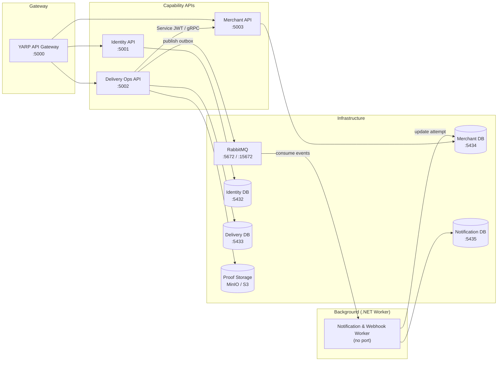

# Service Catalog and Ownership

> **Status:** Draft  
> **Version:** 1.0  
> **Last Updated:** October 2026

This document provides the complete inventory of SwiftDrop services, their responsibilities, boundaries, data ownership, and inter-service dependencies.

---

## 1. Service Overview

---

## 2. Service Inventory

### 2.1 API Gateway

| Property           | Details                                                                     |
| ------------------ | --------------------------------------------------------------------------- |
| **Name**           | API Gateway                                                                 |
| **Technology**     | ASP.NET Core + YARP                                                         |
| **Port (dev)**     | 5000 (HTTP) / 5443 (HTTPS)                                                 |
| **Responsibilities** | Reverse proxy routing, TLS termination, request forwarding, rate limiting |
| **Data Owned**     | None — stateless proxy                                                      |
| **Depends On**     | Identity API, Delivery Operations API, Merchant Integration API            |
| **Clients**        | React SPA, Flutter App, Merchant Systems                                    |

### 2.2 Identity API

| Property           | Details                                                                     |
| ------------------ | --------------------------------------------------------------------------- |
| **Name**           | Identity API                                                                |
| **Technology**     | ASP.NET Core 8                                                              |
| **Port (dev)**     | 5001                                                                        |
| **Responsibilities** | User registration, Google OIDC login, JWT issuance, JWKS, refresh sessions, role management, audit logging |
| **Data Owned**     | Users, Roles, User-Role assignments, External Identities, Refresh Sessions, Audit Logs |
| **Database**       | `swiftdrop_identity` (PostgreSQL :5432)                                     |
| **Depends On**     | Google OIDC (external)                                                      |
| **Consumed By**    | API Gateway, Delivery Ops API (JWKS), Merchant API (JWKS)                  |
| **Key Endpoints**  | `/api/auth/*`, `/api/users/*`, `/.well-known/jwks.json`                    |

### 2.3 Delivery Operations API

| Property           | Details                                                                     |
| ------------------ | --------------------------------------------------------------------------- |
| **Name**           | Delivery Operations API                                                     |
| **Technology**     | ASP.NET Core 8                                                              |
| **Port (dev)**     | 5002                                                                        |
| **Responsibilities** | Parcel booking, fee estimation, courier assignment, status tracking, proof of delivery, receipts, reporting, dispatch management |
| **Data Owned**     | Parcels, Assignments, Price Snapshots, Booking History, Idempotency Keys, Outbox Messages, Proof Metadata, Delivery Zones, Pricing Tiers |
| **Database**       | `swiftdrop_delivery` (PostgreSQL :5433)                                     |
| **Depends On**     | Merchant Integration API (gRPC), RabbitMQ (outbox publish)                 |
| **Consumed By**    | API Gateway                                                                 |
| **Key Endpoints**  | `/api/bookings/*`, `/api/tracking/*`, `/api/parcels/*`, `/api/dispatch/*`, `/api/admin/zones/*`, `/api/admin/pricing/*` |

### 2.4 Merchant Integration API

| Property           | Details                                                                     |
| ------------------ | --------------------------------------------------------------------------- |
| **Name**           | Merchant Integration API                                                    |
| **Technology**     | ASP.NET Core 8                                                              |
| **Port (dev)**     | 5003                                                                        |
| **Responsibilities** | Merchant onboarding, admin approval, API key management, order ingestion, webhook subscriptions, merchant dashboard, delivery queue processing |
| **Data Owned**     | Businesses, API Keys, Webhook Subscriptions, Encrypted Secrets, Inbox Jobs, Delivery Attempts |
| **Database**       | `swiftdrop_merchant` (PostgreSQL :5434)                                     |
| **Depends On**     | RabbitMQ (consume webhook events)                                           |
| **Consumed By**    | API Gateway, Delivery Operations API (gRPC), Background Worker             |
| **Key Endpoints**  | `/api/merchants/*`, `/api/merchant-orders/*`, `/api/webhooks/*`            |

### 2.5 Background Worker

| Property           | Details                                                                     |
| ------------------ | --------------------------------------------------------------------------- |
| **Name**           | Worker Host                                                                 |
| **Technology**     | ASP.NET Core 8 (BackgroundService / MassTransit consumers)                  |
| **Port (dev)**     | None — no HTTP listener                                                     |
| **Responsibilities** | Notification consumption & delivery (Email/mock SMS), merchant webhook delivery with retry, inbox processing |
| **Data Owned**     | **Notification Database (`swiftdrop_notifications`)** — owns notification inbox, jobs, delivery attempts, and logs |
| **Depends On**     | RabbitMQ (`notifications`, `merchant.webhooks`), Merchant DB (read-only for signing secrets) |
| **Consumed By**    | External Notification Providers, Merchant Webhook Endpoints                 |

---

## 3. Infrastructure Services

| Service          | Technology       | Port (dev)    | Purpose                                                |
| ---------------- | ---------------- | ------------- | ------------------------------------------------------ |
| **RabbitMQ**     | RabbitMQ 3.13    | 5672 / 15672  | AMQP message broker (`swiftdrop.events` topic exchange) |
| **Identity DB**  | PostgreSQL 16    | 5432          | Private database for Identity domain                   |
| **Delivery DB**  | PostgreSQL 16    | 5433          | Private database for Delivery domain                   |
| **Merchant DB**  | PostgreSQL 16    | 5434          | Private database for Merchant domain                   |
| **Notification DB**| PostgreSQL 16  | 5435          | Private database for Worker notification domain        |
| **Proof Storage**| MinIO / AWS S3   | 9000 / 9001   | Protected object storage for delivery photos & receipts|

---

## 4. Service Communication Matrix

| Source                   | Target                    | Protocol    | Auth               | Pattern            |
| ------------------------ | ------------------------- | ----------- | ------------------- | ------------------ |
| API Gateway              | Identity API              | HTTP        | —                   | Reverse proxy      |
| API Gateway              | Delivery Operations API   | HTTP        | —                   | Reverse proxy      |
| API Gateway              | Merchant Integration API  | HTTP        | —                   | Reverse proxy      |
| Delivery Operations API  | Merchant Integration API  | gRPC        | Service JWT         | Request/Response   |
| Delivery Operations API  | RabbitMQ                  | AMQP        | —                   | Publish (outbox)   |
| RabbitMQ                 | Background Worker         | AMQP        | —                   | Consume            |
| Background Worker        | Merchant Webhooks (ext.)  | HTTPS       | HMAC-SHA256         | Outbound webhook   |
| Identity API             | Google OIDC               | HTTPS/OIDC  | Client credentials  | Token exchange     |

---

## 5. Service Boundary Rules

1. **No shared databases.** Each service has exclusive read/write access to its own PostgreSQL database.
2. **No direct database queries across services.** Cross-domain data access uses gRPC or REST APIs.
3. **Asynchronous when possible.** Non-blocking operations use RabbitMQ pub/sub via MassTransit.
4. **Synchronous when necessary.** gRPC is used for real-time cross-service queries (e.g., Delivery → Merchant for booking validation).
5. **Service JWT for internal auth.** Inter-service calls are authenticated with short-lived JWTs verified against the Identity API's JWKS endpoint.
6. **Independent deployability.** Each service can be built, tested, and deployed independently.
7. **Separate health endpoints.** Each service exposes `/health` and `/ready` endpoints for infrastructure monitoring.

---

## 6. Port Allocation Summary

| Port   | Service                            |
| ------ | ---------------------------------- |
| 5000   | API Gateway (HTTP)                 |
| 5443   | API Gateway (HTTPS)                |
| 5001   | Identity API                       |
| 5002   | Delivery Operations API            |
| 5003   | Merchant Integration API           |
| 5432   | Identity PostgreSQL                |
| 5433   | Delivery PostgreSQL                |
| 5434   | Merchant PostgreSQL                |
| 5672   | RabbitMQ (AMQP)                    |
| 15672  | RabbitMQ (Management UI)           |

---

## References

- [Architecture Diagram](../design/diagrams/architecture/architecture.md)
- [Technical Design](technical-design.md)
- [Data Architecture](data-architecture.md)
- [Integration Design](../integration/integration-design.md)
