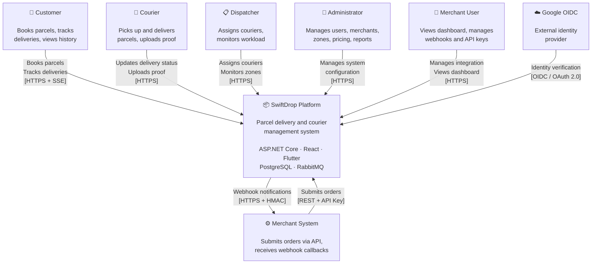

# System Context

> **Status:** Proposed baseline 2.0
> **Version:** 1.0
> **Last Updated:** October 2026

This document describes the SwiftDrop system context using the [C4 model](https://c4model.com/) Level 1 perspective. It identifies the system boundary, external actors, and integration points.

---

## 1. C4 System Context Diagram

The System Context diagram shows SwiftDrop as a single system box surrounded by its users and the external systems it interacts with.

---

## 2. Actors

### 2.1 Human Actors

| Actor           | Role                                                                                              |
| --------------- | ------------------------------------------------------------------------------------------------- |
| **Customer**    | End user who registers, books parcel deliveries, tracks shipments, and views delivery history.     |
| **Courier**     | Delivery person who views assigned parcels, updates delivery status, and uploads proof of delivery.|
| **Dispatcher**  | Operations user who assigns couriers to parcels, monitors workload, and manages delivery zones.    |
| **Administrator** | System manager who handles user accounts, merchant approvals, pricing, zones, and reports.       |
| **Merchant User** | Business representative who manages their merchant account, API keys, webhooks, and dashboard.   |

### 2.2 System Actors

| Actor                  | Type       | Description                                                                     |
| ---------------------- | ---------- | ------------------------------------------------------------------------------- |
| **Merchant System**    | External   | Automated e-commerce platform that submits orders and receives webhook callbacks |
| **Google OIDC**        | External   | Identity provider for user authentication via OpenID Connect                    |

---

## 3. External Dependencies

| Dependency             | Protocol        | Direction   | Purpose                                                     |
| ---------------------- | --------------- | ----------- | ----------------------------------------------------------- |
| Google OIDC Provider   | HTTPS / OIDC    | Bidirectional | User identity verification, ID token exchange              |
| Merchant Systems       | REST / HTTPS    | Inbound      | Order submission via scoped API keys                        |
| Merchant Webhooks      | HTTPS           | Outbound     | Delivery status notifications (signed with HMAC-SHA256)     |

---

## 4. System Boundary

### 4.1 What Is Inside

| Component                     | Responsibility                                                             |
| ----------------------------- | -------------------------------------------------------------------------- |
| React SPA                     | Web interface for all user roles                                           |
| Flutter Mobile App            | Mobile interface for customers and couriers                                |
| YARP API Gateway              | Single entry point, reverse proxy, TLS termination                        |
| Identity API                  | User accounts, authentication, JWT issuance, JWKS, roles, audit           |
| Delivery Operations API       | Parcel booking, assignment, tracking, receipts, reporting                  |
| Merchant Integration API      | Merchant onboarding, API keys, order ingestion, webhooks, dashboard       |
| Background Worker             | Notifications, provider jobs and Merchant webhook-dispatch commands                          |
| RabbitMQ                      | Asynchronous message broker for domain events                             |
| PostgreSQL Logical Databases (×4)     | Isolated data stores for Identity, Delivery, Merchant and Notifications domains on one instance         |

### 4.2 What Is Outside

| System                        | Interaction                                                                |
| ----------------------------- | -------------------------------------------------------------------------- |
| Google Cloud (OIDC)           | Provides user identity; SwiftDrop does not manage Google accounts          |
| Merchant e-commerce platforms | Consume webhook notifications; SwiftDrop does not control their behavior   |
| Email / SMS providers         | Notification delivery (mocked for demonstration)                           |
| Payment gateways              | Out of scope — no billing or payment processing                            |

---

## 5. Communication Summary

The following table summarizes all communication paths crossing the system boundary:

| From                  | To                    | Protocol         | Auth Method          | Data Exchanged                         |
| --------------------- | --------------------- | ---------------- | -------------------- | -------------------------------------- |
| React SPA             | API Gateway           | HTTPS + SSE      | Bearer JWT           | All user operations, real-time tracking|
| Flutter App           | API Gateway           | HTTPS + SSE      | Bearer JWT           | All user operations, real-time tracking|
| Merchant System       | API Gateway           | REST / HTTPS     | X-API-Key (hashed at rest)       | Order submission, status queries       |
| API Gateway           | Identity API          | HTTP (internal)  | —                    | Auth, user management                  |
| API Gateway           | Delivery Ops API      | HTTP (internal)  | —                    | Booking, tracking, dispatch            |
| API Gateway           | Merchant API          | HTTP (internal)  | —                    | Merchant routes                        |
| Merchant API          | Delivery Ops API      | gRPC             | Service JWT          | CreateBooking and GetBookingByExternalOrder               |
| Identity API          | Google OIDC           | HTTPS / OIDC     | Public JWKS validation | Validate client SDK ID token              |
| Merchant API          | Merchant Webhooks     | HTTPS            | HMAC-SHA256 signature| Delivery status events                 |
| Services              | RabbitMQ              | AMQP             | —                    | Domain events (publish/subscribe)      |
| Services              | PostgreSQL            | TCP              | Connection string    | Data persistence                       |

---

## References

- [Architecture Diagram](../design/diagrams/architecture/architecture.md)
- [Technical Design](technical-design.md)
- [Service Catalog](service-catalog.md)
- [Integration Design](../integration/integration-design.md)
- [SRS](../requirements/srs.md)

Worker→Merchant uses the scoped DispatchWebhook API, never Merchant SQL or signing secrets. Delivery owns its local outbox relay and authenticated SSE. Flutter Customer and Courier are mandatory client experiences. [Canonical service catalog](service-catalog.md) governs process/network details; [decisions](decisions/README.md) remain Proposed. Redis/GPS/SignalR are deferred; Kubernetes/AI are independent bonuses.
