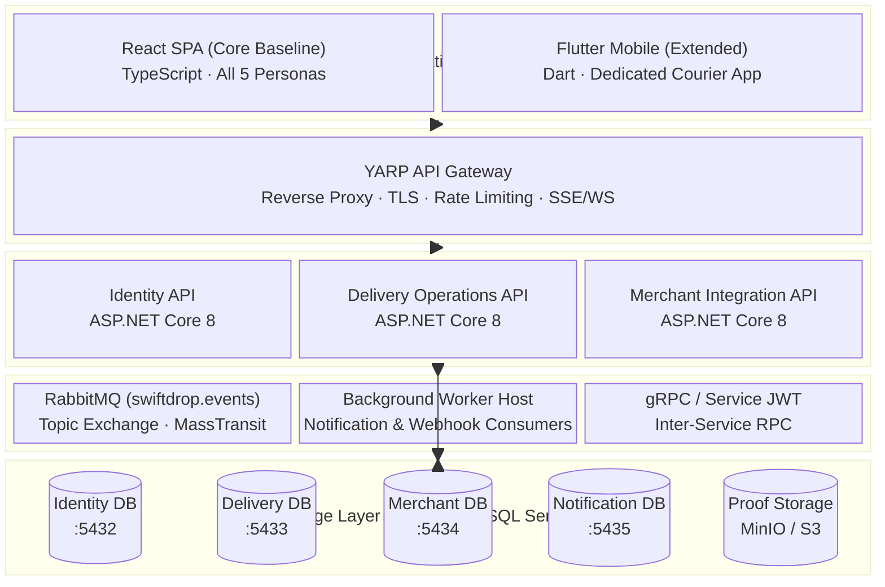
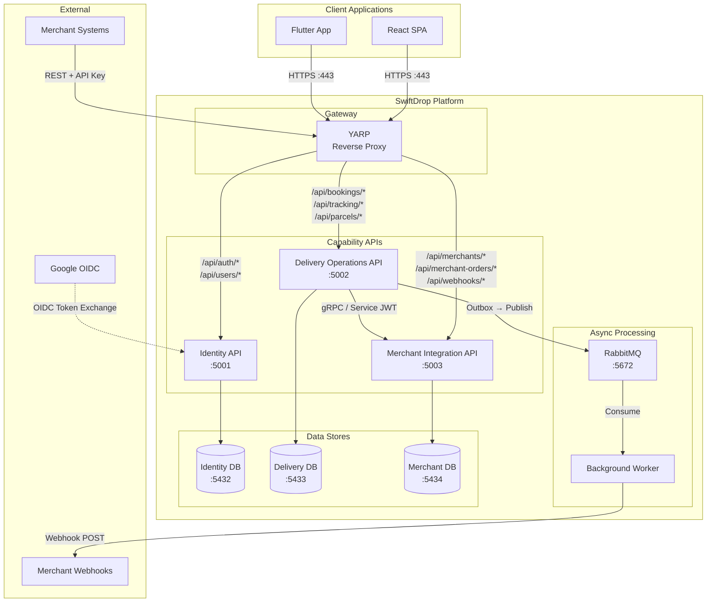
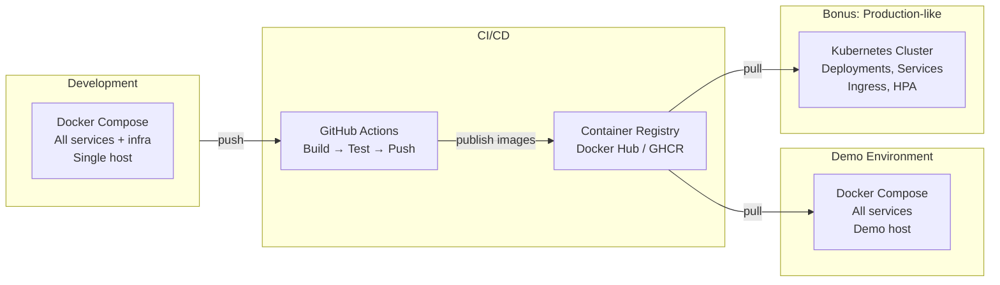

# Technical Design

> **Status:** Draft  
> **Version:** 1.0  
> **Last Updated:** October 2026

---

## 1. Overview

This document describes the technology choices, architectural patterns, and technical rationale underpinning the SwiftDrop platform. It complements the [Architecture Diagram](../design/diagrams/architecture/architecture.md) by providing the reasoning behind the design and linking to supporting decisions.

---

## 2. Architecture Style

SwiftDrop follows a **microservices-based, event-driven architecture** with three independently deployable backend services, a shared API gateway, and asynchronous messaging for cross-service workflows.

### 2.1 Key Architectural Patterns

| Pattern                    | Application in SwiftDrop                                                             |
| -------------------------- | ------------------------------------------------------------------------------------ |
| Microservices              | Three capability APIs, each owning its domain, database, and deployment lifecycle    |
| API Gateway                | YARP reverse proxy as the single external entry point for all clients                |
| Database per Service       | Each service has an isolated PostgreSQL database; no shared schemas                  |
| Event-Driven Messaging     | RabbitMQ pub/sub for asynchronous domain events (delivery status, webhook triggers)  |
| Transactional Outbox       | Domain events are persisted with business data, then relayed to RabbitMQ reliably    |
| CQRS-Lite                  | Write-optimized commands and read-optimized query endpoints where beneficial         |
| Backend for Frontend (BFF) | GraphQL aggregation layer for frontend query flexibility                             |

### 2.2 Layered Architecture

---

## 3. Technology Stack

### 3.1 Backend

| Technology             | Purpose                                  | Rationale                                                                   |
| ---------------------- | ---------------------------------------- | --------------------------------------------------------------------------- |
| **ASP.NET Core 8**     | API framework                            | High performance, mature ecosystem, built-in DI, required by assignment     |
| **C# 12**              | Programming language                     | Strong typing, pattern matching, async/await, records for domain models     |
| **Entity Framework Core** | ORM / data access                     | Code-first migrations, LINQ queries, PostgreSQL provider                    |
| **MassTransit**        | Messaging abstraction                    | Consumer/publisher abstraction over RabbitMQ, saga support, outbox support  |
| **YARP**               | Reverse proxy / API gateway              | Native .NET integration, config-driven routing, middleware pipeline         |
| **FluentValidation**   | Input validation                         | Declarative rules, testable, integrated with ASP.NET model binding          |
| **Serilog**            | Structured logging                       | Correlation IDs, structured output, multiple sinks                          |

### 3.2 Frontend

| Technology         | Purpose                   | Rationale                                                       |
| ------------------ | ------------------------- | --------------------------------------------------------------- |
| **React 18**       | Web SPA framework         | Component model, hooks, large ecosystem, team familiarity       |
| **TypeScript**     | Type-safe JavaScript      | Compile-time safety, better IDE support, refactoring confidence |
| **Apollo Client**  | GraphQL client            | Cache management, query/mutation hooks, SSE subscriptions       |
| **Flutter 3.x**    | Mobile application        | Cross-platform, single codebase for Android, Dart performance   |

### 3.3 Infrastructure

| Technology             | Purpose                   | Rationale                                                       |
| ---------------------- | ------------------------- | --------------------------------------------------------------- |
| **PostgreSQL 16**      | Relational database       | ACID compliance, JSON support, robust ecosystem, required       |
| **RabbitMQ 3.13**      | Message broker            | Reliable delivery, exchange routing, dead letter support        |
| **Docker**             | Containerization          | Reproducible environments, service isolation, required          |
| **Docker Compose**     | Local orchestration       | Multi-container coordination, network configuration             |
| **GitHub Actions**     | CI/CD                     | Native GitHub integration, matrix builds, container publishing  |
| **Kubernetes** *(bonus)* | Container orchestration | Horizontal scaling, health checks, Ingress routing              |

### 3.4 Communication Protocols

| Protocol     | Usage                                 | Direction          |
| ------------ | ------------------------------------- | ------------------ |
| **REST**     | Public APIs, merchant integration     | External inbound   |
| **GraphQL**  | Frontend query aggregation            | Client ↔ Gateway   |
| **gRPC**     | Internal service-to-service RPC       | Service ↔ Service  |
| **AMQP**     | Async event messaging via RabbitMQ    | Service ↔ Broker   |
| **SSE**      | Real-time tracking updates            | Server → Client    |
| **HTTPS**    | Webhook delivery to merchant systems  | Server → External  |

---

## 4. Service Architecture

### 4.1 Container Diagram

### 4.2 Service Responsibilities

Each capability API encapsulates a bounded context with strict data ownership:

- **Identity API** — User identity lifecycle: registration, Google OIDC login, JWT issuance, JWKS, role management, refresh sessions, and audit logging.
- **Delivery Operations API** — Core business operations: parcel booking, fee estimation, courier assignment, status tracking, proof of delivery, receipts, and reporting.
- **Merchant Integration API** — External partner management: merchant onboarding, approval workflow, API key lifecycle, order ingestion, webhook subscriptions, and delivery queue processing.

See [Service Catalog](service-catalog.md) for the complete inventory.

---

## 5. Cross-Cutting Concerns

### 5.1 Authentication and Authorization

| Concern                | Implementation                                                                       |
| ---------------------- | ------------------------------------------------------------------------------------ |
| User authentication    | Google OIDC → Identity API issues application JWT (short-lived) + refresh token      |
| Service authentication | Service JWTs signed by the Identity API, verified via JWKS endpoint                  |
| Merchant authentication| HMAC-signed API keys scoped to a specific merchant                                   |
| Authorization          | RBAC with 5 roles enforced via ASP.NET Core policies on every endpoint               |
| Token refresh          | Sliding refresh sessions stored in the Identity Database                             |

See [Authentication](../security/authentication.md) and [Authorization](../security/authorization.md).

### 5.2 Observability

| Concern                | Implementation                                              |
| ---------------------- | ----------------------------------------------------------- |
| Structured logging     | Serilog with correlation IDs propagated via HTTP headers     |
| Health checks          | ASP.NET Core health check endpoints (`/health`, `/ready`)   |
| Request tracing        | Correlation ID middleware in the API gateway                 |

### 5.3 Error Handling

| Concern                | Implementation                                              |
| ---------------------- | ----------------------------------------------------------- |
| API error responses    | RFC 7807 Problem Details JSON format                        |
| Validation errors      | FluentValidation with structured field-level error responses |
| Unhandled exceptions   | Global exception handler returning 500 with correlation ID  |
| Retry policies         | Polly-based retry and circuit breaker for outbound calls     |

### 5.4 Configuration Management

| Concern                | Implementation                                              |
| ---------------------- | ----------------------------------------------------------- |
| Application config     | `appsettings.json` with environment-specific overrides      |
| Secrets                | Environment variables; Docker secrets in production         |
| Feature flags          | Configuration-based toggles for optional features           |

---

## 6. Deployment Architecture

See [Docker Compose](../deployment/docker-compose.md) and [Kubernetes](../deployment/kubernetes.md).

---

## 7. Key Design Decisions

Significant technical decisions are recorded as Architecture Decision Records (ADRs):

| ADR      | Decision                                           | Status    |
| -------- | -------------------------------------------------- | --------- |
| ADR-001  | Adopt YARP as the API gateway                      | Accepted  |
| ADR-002  | Use database-per-service with PostgreSQL            | Accepted  |
| ADR-003  | Use transactional outbox for event publishing       | Accepted  |
| ADR-004  | Use Google OIDC with application-issued JWTs        | Accepted  |
| ADR-005  | Use MassTransit over RabbitMQ for messaging         | Accepted  |

See the full [ADR Index](decisions/README.md).

---

## References

- [Architecture Diagram](../design/diagrams/architecture/architecture.md)
- [System Context](system-context.md)
- [Service Catalog](service-catalog.md)
- [Data Architecture](data-architecture.md)
- [Integration Design](../integration/integration-design.md)
- [SRS](../requirements/srs.md)
