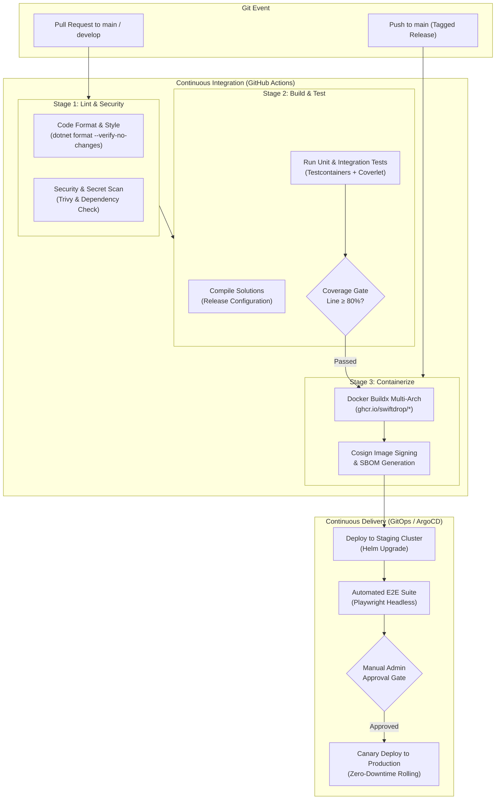

# CI/CD Pipeline & Release Automation Specification

> **Status:** Draft  
> **Version:** 1.0  
> **Last Updated:** October 2026  

---

## 1. Overview

SwiftDrop utilizes **GitHub Actions** for automated continuous integration (CI) and continuous deployment (CD). Every commit and pull request triggers automated validation, static analysis, multi-level testing, and security scanning, culminating in immutable container image generation and staged deployment.



---

## 2. GitHub Actions Workflow Definition (`.github/workflows/ci-cd.yml`)

```yaml
name: SwiftDrop CI/CD Pipeline

on:
  push:
    branches: [ main, develop ]
    tags: [ 'v*.*.*' ]
  pull_request:
    branches: [ main, develop ]

env:
  DOTNET_VERSION: '8.0.x'
  REGISTRY: ghcr.io
  IMAGE_PREFIX: ghcr.io/${{ github.repository }}

jobs:
  # ==========================================
  # Job 1: Linting & Code Quality
  # ==========================================
  lint:
    name: Code Format & Quality Check
    runs-on: ubuntu-latest
    steps:
      - name: Checkout Code
        uses: actions/checkout@v4

      - name: Setup .NET
        uses: actions/setup-dotnet@v4
        with:
          dotnet-version: ${{ env.DOTNET_VERSION }}

      - name: Verify Code Formatting
        run: dotnet format --verify-no-changes --severity warn

  # ==========================================
  # Job 2: Security & Vulnerability Scan
  # ==========================================
  security-scan:
    name: Dependency & Vulnerability Scan
    runs-on: ubuntu-latest
    steps:
      - name: Checkout Code
        uses: actions/checkout@v4

      - name: Run Trivy Vulnerability Scanner
        uses: aquasecurity/trivy-action@master
        with:
          scan-type: 'fs'
          ignore-unfixed: true
          severity: 'CRITICAL,HIGH'

  # ==========================================
  # Job 3: Build & Automated Testing
  # ==========================================
  build-and-test:
    name: Build & Test (with Testcontainers)
    needs: [lint, security-scan]
    runs-on: ubuntu-latest
    steps:
      - name: Checkout Code
        uses: actions/checkout@v4

      - name: Setup .NET
        uses: actions/setup-dotnet@v4
        with:
          dotnet-version: ${{ env.DOTNET_VERSION }}

      - name: Restore NuGet Packages
        run: dotnet restore

      - name: Build Solution
        run: dotnet build --configuration Release --no-restore

      - name: Execute Tests with Code Coverage
        run: |
          dotnet test --configuration Release --no-build \
            --collect:"XPlat Code Coverage" \
            --results-directory ./TestResults

      - name: Enforce Coverage Threshold
        run: |
          dotnet tool install -g dotnet-coverage
          dotnet-coverage verify --threshold 80 ./TestResults/**/coverage.cobertura.xml

  # ==========================================
  # Job 4: Build & Push Container Images
  # ==========================================
  publish-containers:
    name: Containerize & Push (GHCR)
    needs: [build-and-test]
    if: github.ref == 'refs/heads/main' || startsWith(github.ref, 'refs/tags/v')
    runs-on: ubuntu-latest
    permissions:
      contents: read
      packages: write
    strategy:
      matrix:
        service:
          - { name: gateway, dockerfile: src/Gateway/SwiftDrop.Gateway/Dockerfile }
          - { name: identity-api, dockerfile: src/Services/Identity/SwiftDrop.Identity.Api/Dockerfile }
          - { name: delivery-api, dockerfile: src/Services/Delivery/SwiftDrop.Delivery.Api/Dockerfile }
          - { name: merchant-api, dockerfile: src/Services/Merchant/SwiftDrop.Merchant.Api/Dockerfile }
          - { name: webhook-worker, dockerfile: src/Workers/SwiftDrop.WebhookWorker/Dockerfile }
    steps:
      - name: Checkout Code
        uses: actions/checkout@v4

      - name: Set up Docker Buildx
        uses: docker/setup-buildx-action@v3

      - name: Log into GitHub Container Registry
        uses: docker/login-action@v3
        with:
          registry: ${{ env.REGISTRY }}
          username: ${{ github.actor }}
          password: ${{ secrets.GITHUB_TOKEN }}

      - name: Extract Docker Metadata
        id: meta
        uses: docker/metadata-action@v5
        with:
          images: ${{ env.IMAGE_PREFIX }}/${{ matrix.service.name }}
          tags: |
            type=ref,event=branch
            type=semver,pattern={{version}}
            type=sha,format=short

      - name: Build and Push Container Image
        uses: docker/build-push-action@v5
        with:
          context: .
          file: ${{ matrix.service.dockerfile }}
          push: true
          tags: ${{ steps.meta.outputs.tags }}
          labels: ${{ steps.meta.outputs.labels }}
          cache-from: type=gha
          cache-to: type=gha,mode=max

  # ==========================================
  # Job 5: Deploy to Staging & E2E Verification
  # ==========================================
  deploy-staging:
    name: Staging Deployment & Acceptance Tests
    needs: [publish-containers]
    runs-on: ubuntu-latest
    environment: staging
    steps:
      - name: Checkout Infrastructure Manifests
        uses: actions/checkout@v4

      - name: Deploy Staging Helm Release
        run: echo "Executing Helm upgrade on staging namespace..."

      - name: Run Playwright E2E Regression Suite
        run: echo "Executing Playwright E2E smoke tests against staging URL..."
```

---

## 3. Deployment Strategies

### 3.1. Staging Environment
- Deployed automatically upon every merge to `main`.
- Automated Playwright end-to-end tests validate critical flows (Booking → Assign → Deliver).

### 3.2. Production Environment
- **Trigger:** Git semver tags (e.g., `v1.2.0`).
- **Approval Gate:** Requires mandatory sign-off by Project Tech Lead or Architecture Lead in GitHub Environment settings.
- **Canary Rolling Strategy:** 
  1. Initial canary pod deployed receiving 10% of traffic via NGINX ingress canary annotations.
  2. Prometheus error rate and latency monitoring evaluated for 10 minutes.
  3. If error rates remain < 0.1%, full rolling update completes to 100% capacity.
