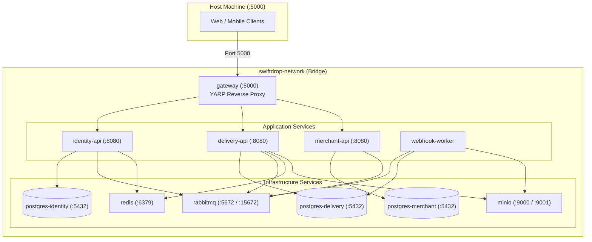

# Docker Compose Deployment Specification

> **Status:** Draft  
> **Version:** 1.0  
> **Last Updated:** October 2026  

---

## 1. Overview

The SwiftDrop local development and integration test environment is orchestrated using Docker Compose. The topology models the complete distributed production stack: YARP Gateway, 3 API microservices, background webhook worker, 3 isolated PostgreSQL databases, RabbitMQ broker, Redis cache, and MinIO object storage.



---

## 2. Docker Compose Specification (`docker-compose.yml`)

```yaml
version: '3.8'

networks:
  swiftdrop-network:
    driver: bridge

volumes:
  pg_identity_data:
  pg_delivery_data:
  pg_merchant_data:
  rabbitmq_data:
  redis_data:
  minio_data:

services:
  # ==========================================
  # 1. YARP API Gateway
  # ==========================================
  gateway:
    image: swiftdrop/gateway:latest
    build:
      context: .
      dockerfile: src/Gateway/SwiftDrop.Gateway/Dockerfile
    container_name: swiftdrop-gateway
    ports:
      - "5000:80"
    environment:
      - ASPNETCORE_ENVIRONMENT=Development
      - ReverseProxy__Clusters__identityCluster__Destinations__dest1__Address=http://identity-api:8080
      - ReverseProxy__Clusters__deliveryCluster__Destinations__dest1__Address=http://delivery-api:8080
      - ReverseProxy__Clusters__merchantCluster__Destinations__dest1__Address=http://merchant-api:8080
    depends_on:
      identity-api:
        condition: service_healthy
      delivery-api:
        condition: service_healthy
      merchant-api:
        condition: service_healthy
    networks:
      - swiftdrop-network
    restart: unless-stopped

  # ==========================================
  # 2. Identity Service
  # ==========================================
  identity-api:
    image: swiftdrop/identity-api:latest
    build:
      context: .
      dockerfile: src/Services/Identity/SwiftDrop.Identity.Api/Dockerfile
    container_name: swiftdrop-identity-api
    environment:
      - ASPNETCORE_ENVIRONMENT=Development
      - ConnectionStrings__IdentityDb=Host=postgres-identity;Port=5432;Database=swiftdrop_identity;Username=postgres;Password=swiftdrop_dev_secret
      - RabbitMq__Host=rabbitmq
      - Redis__ConnectionString=redis:6379
    depends_on:
      postgres-identity:
        condition: service_healthy
      rabbitmq:
        condition: service_healthy
    healthcheck:
      test: ["CMD", "curl", "-f", "http://localhost:8080/health"]
      interval: 10s
      timeout: 5s
      retries: 5
    networks:
      - swiftdrop-network
    restart: unless-stopped

  # ==========================================
  # 3. Delivery Operations Service
  # ==========================================
  delivery-api:
    image: swiftdrop/delivery-api:latest
    build:
      context: .
      dockerfile: src/Services/Delivery/SwiftDrop.Delivery.Api/Dockerfile
    container_name: swiftdrop-delivery-api
    environment:
      - ASPNETCORE_ENVIRONMENT=Development
      - ConnectionStrings__DeliveryDb=Host=postgres-delivery;Port=5432;Database=swiftdrop_delivery;Username=postgres;Password=swiftdrop_dev_secret
      - RabbitMq__Host=rabbitmq
      - Redis__ConnectionString=redis:6379
      - Storage__MinioEndpoint=minio:9000
    depends_on:
      postgres-delivery:
        condition: service_healthy
      rabbitmq:
        condition: service_healthy
    healthcheck:
      test: ["CMD", "curl", "-f", "http://localhost:8080/health"]
      interval: 10s
      timeout: 5s
      retries: 5
    networks:
      - swiftdrop-network
    restart: unless-stopped

  # ==========================================
  # 4. Merchant Integration Service
  # ==========================================
  merchant-api:
    image: swiftdrop/merchant-api:latest
    build:
      context: .
      dockerfile: src/Services/Merchant/SwiftDrop.Merchant.Api/Dockerfile
    container_name: swiftdrop-merchant-api
    environment:
      - ASPNETCORE_ENVIRONMENT=Development
      - ConnectionStrings__MerchantDb=Host=postgres-merchant;Port=5432;Database=swiftdrop_merchant;Username=postgres;Password=swiftdrop_dev_secret
      - RabbitMq__Host=rabbitmq
    depends_on:
      postgres-merchant:
        condition: service_healthy
      rabbitmq:
        condition: service_healthy
    healthcheck:
      test: ["CMD", "curl", "-f", "http://localhost:8080/health"]
      interval: 10s
      timeout: 5s
      retries: 5
    networks:
      - swiftdrop-network
    restart: unless-stopped

  # ==========================================
  # 5. Background Webhook Worker
  # ==========================================
  webhook-worker:
    image: swiftdrop/webhook-worker:latest
    build:
      context: .
      dockerfile: src/Workers/SwiftDrop.WebhookWorker/Dockerfile
    container_name: swiftdrop-webhook-worker
    environment:
      - ASPNETCORE_ENVIRONMENT=Development
      - RabbitMq__Host=rabbitmq
    depends_on:
      rabbitmq:
        condition: service_healthy
    networks:
      - swiftdrop-network
    restart: unless-stopped

  # ==========================================
  # 6. Database Backends (Postgres 16)
  # ==========================================
  postgres-identity:
    image: postgres:16-alpine
    container_name: swiftdrop-db-identity
    environment:
      POSTGRES_DB: swiftdrop_identity
      POSTGRES_USER: postgres
      POSTGRES_PASSWORD: swiftdrop_dev_secret
    volumes:
      - pg_identity_data:/var/lib/postgresql/data
    healthcheck:
      test: ["CMD-SHELL", "pg_isready -U postgres"]
      interval: 5s
      timeout: 5s
      retries: 5
    networks:
      - swiftdrop-network

  postgres-delivery:
    image: postgres:16-alpine
    container_name: swiftdrop-db-delivery
    environment:
      POSTGRES_DB: swiftdrop_delivery
      POSTGRES_USER: postgres
      POSTGRES_PASSWORD: swiftdrop_dev_secret
    volumes:
      - pg_delivery_data:/var/lib/postgresql/data
    healthcheck:
      test: ["CMD-SHELL", "pg_isready -U postgres"]
      interval: 5s
      timeout: 5s
      retries: 5
    networks:
      - swiftdrop-network

  postgres-merchant:
    image: postgres:16-alpine
    container_name: swiftdrop-db-merchant
    environment:
      POSTGRES_DB: swiftdrop_merchant
      POSTGRES_USER: postgres
      POSTGRES_PASSWORD: swiftdrop_dev_secret
    volumes:
      - pg_merchant_data:/var/lib/postgresql/data
    healthcheck:
      test: ["CMD-SHELL", "pg_isready -U postgres"]
      interval: 5s
      timeout: 5s
      retries: 5
    networks:
      - swiftdrop-network

  # ==========================================
  # 7. Message Broker & Caching
  # ==========================================
  rabbitmq:
    image: rabbitmq:3.13-management-alpine
    container_name: swiftdrop-rabbitmq
    ports:
      - "5672:5672"
      - "15672:15672"
    volumes:
      - rabbitmq_data:/var/lib/rabbitmq
    healthcheck:
      test: ["CMD", "rabbitmq-diagnostics", "-q", "ping"]
      interval: 10s
      timeout: 5s
      retries: 5
    networks:
      - swiftdrop-network

  redis:
    image: redis:7.2-alpine
    container_name: swiftdrop-redis
    ports:
      - "6379:6379"
    volumes:
      - redis_data:/data
    networks:
      - swiftdrop-network

  minio:
    image: minio/minio:latest
    container_name: swiftdrop-minio
    command: server /data --console-address ":9001"
    ports:
      - "9000:9000"
      - "9001:9001"
    environment:
      MINIO_ROOT_USER: minioadmin
      MINIO_ROOT_PASSWORD: minioadmin
    volumes:
      - minio_data:/data
    networks:
      - swiftdrop-network
```

---

## 3. Operations & Maintenance Runbook

### 3.1. Build & Start All Services
```bash
docker compose up -d --build
```

### 3.2. Viewing Aggregated Logs
```bash
# Stream logs for all services
docker compose logs -f

# Stream logs for specific microservice
docker compose logs -f delivery-api
```

### 3.3. Tearing Down Environment
```bash
# Stop containers (preserves database volumes)
docker compose down

# Stop containers and wipe volumes (clean slate)
docker compose down -v
```
