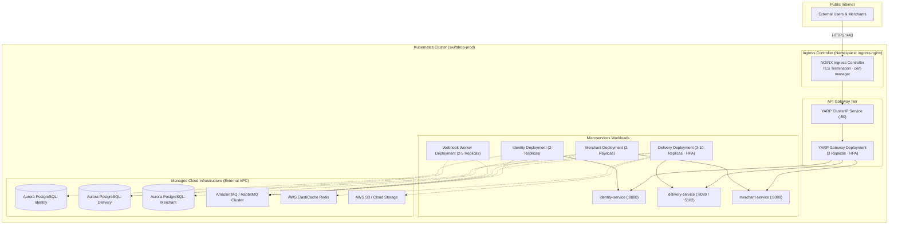

# Kubernetes Production Deployment Architecture

> **Status:** Draft  
> **Version:** 1.0  
> **Last Updated:** October 2026  

---

## 1. Overview

For staging and production environments, SwiftDrop is deployed on a managed Kubernetes cluster (EKS / AKS / GKE). The architecture guarantees zero-downtime rolling updates, automated horizontal pod scaling (HPA), resilient self-healing pods, network policy isolation, and centralized secret management.



---

## 2. Resource Specifications & Pod Architecture

All microservices run as unprivileged container users (`nonroot:65534`) with strict read-only root filesystems and explicit resource requests and limits.

### 2.1. Resource Allocation Matrix

| Service | Minimum Replicas | Max Replicas (HPA) | CPU Request | CPU Limit | Memory Request | Memory Limit | Target CPU % |
|---|:---:|:---:|:---:|:---:|:---:|:---:|:---:|
| **YARP Gateway** | 3 | 8 | 250m | 1000m | 256Mi | 512Mi | 70% |
| **Identity Service** | 2 | 4 | 200m | 500m | 256Mi | 512Mi | 75% |
| **Delivery Operations API** | 3 | 12 | 500m | 2000m | 512Mi | 1.5Gi | 70% |
| **Merchant Service** | 2 | 6 | 250m | 1000m | 256Mi | 512Mi | 70% |
| **Webhook Worker** | 2 | 6 | 200m | 1000m | 256Mi | 512Mi | 80% |

---

## 3. Sample Kubernetes Manifests

### 3.1. Delivery Service Deployment (`delivery-deployment.yaml`)

```yaml
apiVersion: apps/v1
kind: Deployment
metadata:
  name: delivery-service
  namespace: swiftdrop-prod
  labels:
    app.kubernetes.io/name: delivery-service
    app.kubernetes.io/part-of: swiftdrop
spec:
  replicas: 3
  strategy:
    type: RollingUpdate
    rollingUpdate:
      maxSurge: 25%
      maxUnavailable: 0
  selector:
    matchLabels:
      app.kubernetes.io/name: delivery-service
  template:
    metadata:
      labels:
        app.kubernetes.io/name: delivery-service
    spec:
      securityContext:
        runAsNonRoot: true
        runAsUser: 10001
        fsGroup: 10001
      containers:
        - name: api
          image: ghcr.io/swiftdrop/delivery-service:v1.2.0
          imagePullPolicy: IfNotPresent
          ports:
            - name: http
              containerPort: 8080
            - name: grpc
              containerPort: 5102
          envFrom:
            - configMapRef:
                name: delivery-config
            - secretRef:
                name: delivery-secrets
          resources:
            requests:
              cpu: "500m"
              memory: "512Mi"
            limits:
              cpu: "2000m"
              memory: "1536Mi"
          livenessProbe:
            httpGet:
              path: /health/liveness
              port: 8080
            initialDelaySeconds: 15
            periodSeconds: 10
            failureThreshold: 3
          readinessProbe:
            httpGet:
              path: /health/readiness
              port: 8080
            initialDelaySeconds: 5
            periodSeconds: 5
            failureThreshold: 2
```

### 3.2. Horizontal Pod Autoscaler (HPA)

```yaml
apiVersion: autoscaling/v2
kind: HorizontalPodAutoscaler
metadata:
  name: delivery-service-hpa
  namespace: swiftdrop-prod
spec:
  scaleTargetRef:
    apiVersion: apps/v1
    kind: Deployment
    name: delivery-service
  minReplicas: 3
  maxReplicas: 12
  metrics:
    - type: Resource
      resource:
        name: cpu
        target:
          type: Utilization
          averageUtilization: 70
    - type: Resource
      resource:
        name: memory
        target:
          type: Utilization
          averageUtilization: 80
```

---

## 4. Ingress & TLS Management

Edge ingress is managed by `ingress-nginx` with automatic Let's Encrypt certificates provisioned via `cert-manager`.

```yaml
apiVersion: networking.k8s.io/v1
kind: Ingress
metadata:
  name: swiftdrop-gateway-ingress
  namespace: swiftdrop-prod
  annotations:
    cert-manager.io/cluster-issuer: "letsencrypt-prod"
    nginx.ingress.kubernetes.io/proxy-body-size: "10m"
    nginx.ingress.kubernetes.io/proxy-read-timeout: "3600"
    nginx.ingress.kubernetes.io/proxy-send-timeout: "3600"
    nginx.ingress.kubernetes.io/websocket-services: "gateway-service"
spec:
  ingressClassName: nginx
  tls:
    - hosts:
        - api.swiftdrop.io
      secretName: swiftdrop-api-tls
  rules:
    - host: api.swiftdrop.io
      http:
        paths:
          - path: /
            pathType: Prefix
            backend:
              service:
                name: gateway-service
                port:
                  number: 80
```
