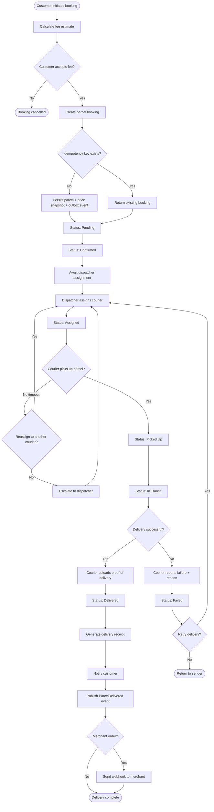
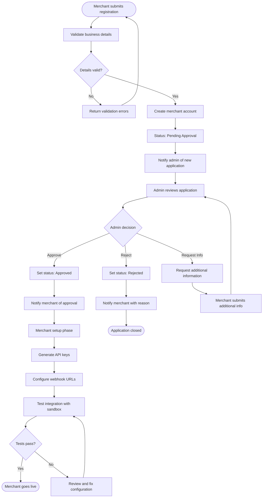
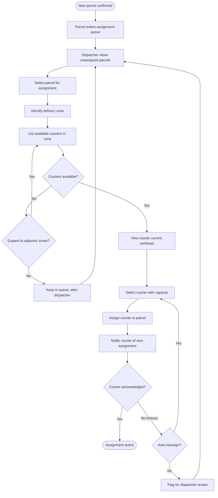
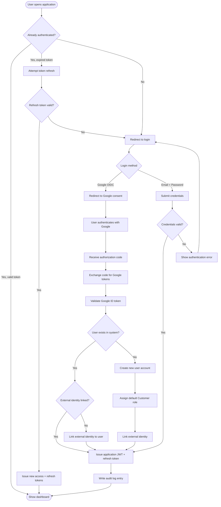

# Activity Diagrams

> **Status:** Draft  
> **Last Updated:** October 2026

This document contains activity diagrams for key business processes in the SwiftDrop system. Activity diagrams model the flow of activities, decision points, and parallel paths within a process.

---

## 1. Parcel Delivery Lifecycle

This diagram models the complete lifecycle of a parcel from booking creation through to delivery completion or failure handling.

---

## 2. Merchant Onboarding and Approval

This diagram models the merchant registration, admin review, and integration setup process.

---

## 3. Courier Assignment and Workload Management

This diagram models how dispatchers manage courier assignments based on workload and zone considerations.

---

## 4. User Authentication Decision Flow

This diagram models the authentication decision process including new user registration vs. existing user login.

---

## References

- [Sequence Diagrams](../sequence/README.md)
- [Use Case Diagrams](../use-cases/README.md)
- [SRS](../../../requirements/srs.md)
- [Architecture Diagram](../architecture/architecture.md)
