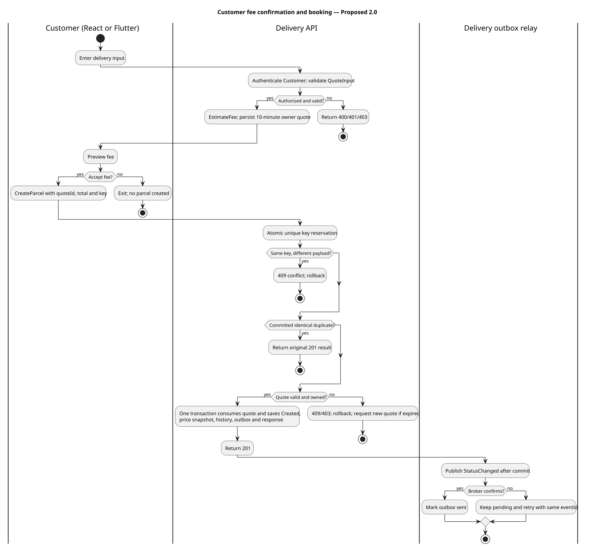
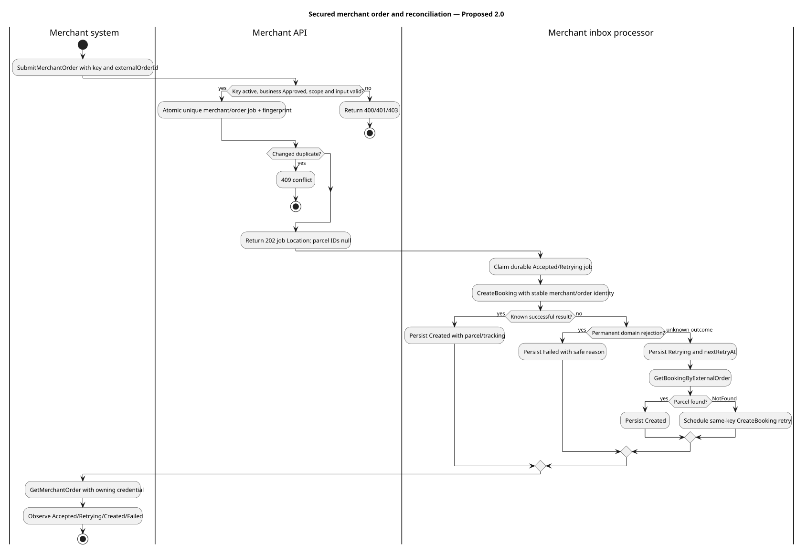
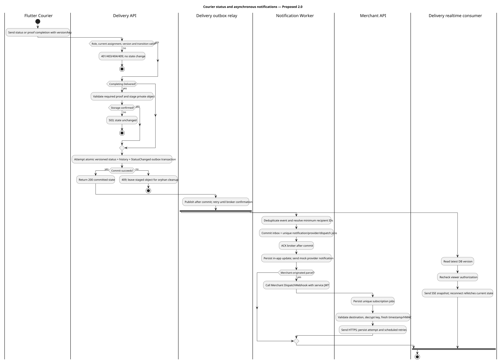
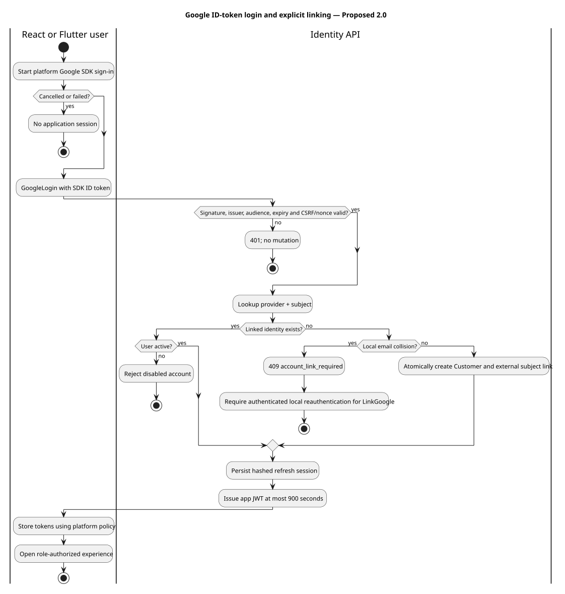
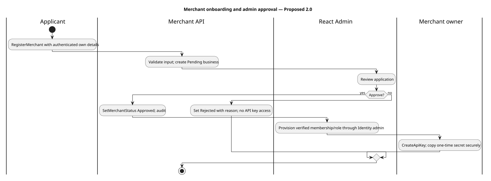
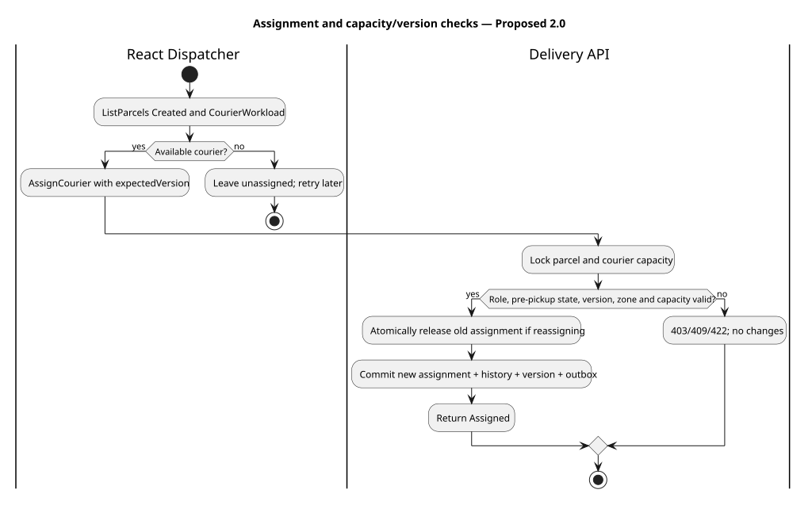

# UML Activity Diagrams

> Status: Proposed baseline 2.0 · Formal PlantUML activities with swimlanes · Owner/review pending

The first four cover required assignment workflows. Swimlanes model actors/processes, guards model alternatives, and the courier activity forks only after the committed outbox is published. See [narratives](../../../requirements/use-case-specifications.md), [contracts](../../../api/rest-api.md) and [index](../README.md).

## Customer fee confirmation and booking

ID: ACT-customer-booking; UC-01; FR-C04 FR-C05 NFR-10 NFR-11. Owner and approval date pending.

[Editable PlantUML](customer-booking.puml) · [Rendered SVG](customer-booking.svg)

## Secured merchant order and reconciliation

ID: ACT-merchant-order; UC-02; FR-M03 FR-M04 FR-M06 FR-M07 NFR-10. Owner and approval date pending.

[Editable PlantUML](merchant-order.puml) · [Rendered SVG](merchant-order.svg)

## Courier status and asynchronous notifications

ID: ACT-courier-status-notification; UC-03; FR-R02 FR-R03 FR-R04 FR-C06 FR-M05 NFR-11. Owner and approval date pending.

[Editable PlantUML](courier-status-notification.puml) · [Rendered SVG](courier-status-notification.svg)

## Google ID-token login and explicit linking

ID: ACT-google-login; UC-04; FR-C02 NFR-05 NFR-08. Owner and approval date pending.

[Editable PlantUML](google-login.puml) · [Rendered SVG](google-login.svg)

## Merchant onboarding and admin approval

ID: ACT-merchant-onboarding; Supporting; FR-M01 FR-M02 FR-A03. Owner and approval date pending.

[Editable PlantUML](merchant-onboarding.puml) · [Rendered SVG](merchant-onboarding.svg)

## Assignment and capacity/version checks

ID: ACT-assignment-workload; Supporting; FR-D01 FR-D02 FR-D03 FR-D04 FR-D05. Owner and approval date pending.

[Editable PlantUML](assignment-workload.puml) · [Rendered SVG](assignment-workload.svg)

