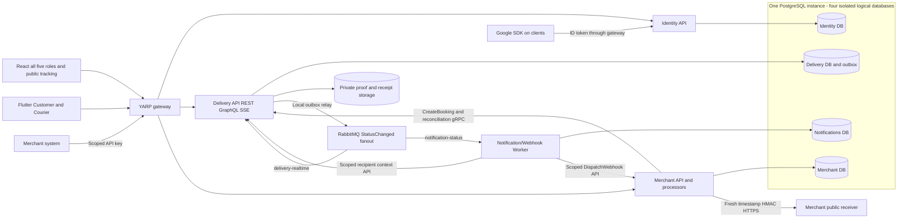

# SwiftDrop Application Architecture

> Status: Proposed baseline 2.0 · 16 October 2026 · DEC-01–DEC-12 sign-off pending

React covers all five roles and mobile-friendly public tracking. Flutter delivers **Customer and Courier** experiences. YARP routes external REST, Delivery GraphQL and authenticated SSE; domain services perform role/ownership checks independently. Three capability APIs plus one Worker are the complete backend process inventory. No separate realtime host or Redis dependency is proposed.

## Component overview

Identity owns users/local passwords/provider subjects/refresh/roles. Delivery owns quotes, parcels, status/history/outbox, assignment, private proof/receipt, reports, GraphQL and SSE. Merchant owns businesses/API keys, durable order inbox/reconciliation, subscriptions, encrypted signing secrets and HTTP webhook attempts. Worker owns notification inbox/jobs/provider attempts and durable commands requesting Merchant dispatch. Worker cannot read Merchant DB or sign webhooks itself.

One PostgreSQL instance at 5432 hosts four isolated logical databases and users; object storage is private to Delivery. Merchant→Delivery CreateBooking/GetBookingByExternalOrder are the only proposed gRPC methods. Google SDK returns an ID token; Identity validates it and issues application tokens, with no automatic email linking. A booking exists only after fee confirmation; status/history/outbox commit before asynchronous notification. SSE runs in a single Delivery instance and heals reconnect through snapshot/version recovery.

## Sources and rendered artifacts

[Editable Mermaid](architecture.mmd) · [Rendered SVG](architecture.svg) · [Regenerated architecture PDF](swiftdrop-architecture.pdf). The previous PDF is preserved in Git history at baseline `63d0de2`; it is superseded by this proposed diagram. PDF render and visual-review evidence appear in [validation results](../../../testing/documentation-validation.md). All approval/implementation claims require separate evidence.

Canonical details: [service inventory](../../../architecture/service-catalog.md), [data ownership](../../../architecture/data-architecture.md), [state machine](../../../architecture/parcel-state-machine.md), [environment matrix](../../../deployment/environments.md), [ADRs](../../../architecture/decisions/README.md) and [diagram index](../README.md). Kubernetes and AI are optional bonuses; GPS/SignalR and bulk ingestion are deferred.
