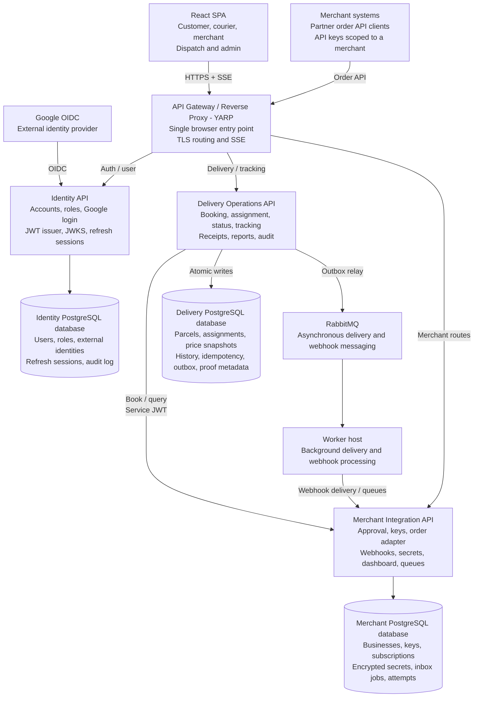

# SwiftDrop Application Architecture

## Source

This document is the text-readable representation of [swiftdrop-architecture.pdf](swiftdrop-architecture.pdf). The PDF is retained as the original visual architecture diagram.

## Technology Context

- **Frontend:** React SPA
- **Backend:** C# and ASP.NET Core
- **API gateway and reverse proxy:** YARP
- **Messaging:** RabbitMQ
- **Database:** PostgreSQL
- **Authentication:** Google OpenID Connect, application JWTs, JWKS, and refresh sessions

## External Systems

### Google OIDC

Google OIDC is the external identity provider. It communicates with the Identity API during user authentication.

### Merchant Systems

Merchant systems are partner order API clients. They use API keys scoped to a merchant and communicate with the API gateway through the merchant order API.

## Frontend

### React SPA

The React SPA supports customer, courier, and merchant workflows, including dispatch and admin functions. It communicates with the API gateway over HTTPS and receives live updates through server-sent events (SSE).

## API Gateway

### API Gateway / Reverse Proxy - YARP

The YARP gateway is the single entry point for the React SPA and merchant systems. It performs reverse proxy routing and forwards requests to the capability APIs.

Gateway responsibilities shown in the diagram:

- Route browser traffic from the React SPA over HTTPS and SSE.
- Route merchant order API requests.
- Route authentication and user requests to the Identity API.
- Route delivery and tracking requests to the Delivery Operations API.
- Route merchant-specific requests to the Merchant Integration API.

## Capability APIs

### Identity API

Responsibilities:

- Account management
- User roles
- Google login
- Application JWT issuance
- JWKS support
- Refresh sessions

The Identity API owns identity-related data, including users, roles, external identities, refresh sessions, and audit logs.

### Delivery Operations API

Responsibilities:

- Booking
- Assignment
- Delivery status
- Tracking
- Receipts
- Reports
- Audit

The Delivery Operations API communicates with the Delivery Database using atomic writes. It owns parcel, assignment, price snapshot, history, booking idempotency, outbox, and proof metadata.

The API also calls the Merchant Integration API for booking and query operations using service JWT authentication.

### Merchant Integration API

Responsibilities:

- Merchant approval
- Merchant keys
- Order adapter
- Webhook subscriptions
- Secrets
- Merchant dashboard
- Delivery queues

The Merchant Integration API owns merchant data, including businesses, keys, subscriptions, encrypted secrets, inbox jobs, and attempts.

## Data Stores

### Identity Database

Stores users, roles, external identities, refresh sessions, and audit logs.

### Delivery Database

Stores parcels, assignments, price snapshots, booking history, idempotency records, outbox messages, and proof metadata.

### Merchant Database

Stores businesses, keys, subscriptions, encrypted secrets, inbox jobs, and delivery attempts.

## Main Request and Data Flows

1. A user authenticates through the React SPA and Google OIDC.
2. Google OIDC communicates with the Identity API.
3. The Identity API creates or validates the user session and issues application credentials.
4. The React SPA sends authenticated requests to the YARP API gateway over HTTPS.
5. The gateway routes requests to the Identity, Delivery Operations, or Merchant Integration API.
6. Merchant systems send order API requests to the gateway using merchant-scoped API keys.
7. The Delivery Operations API handles booking, assignment, tracking, and delivery operations.
8. The Delivery Operations API queries or books through the Merchant Integration API using a service JWT where required.
9. The APIs persist data in their respective PostgreSQL databases.
10. Delivery and tracking updates are returned to the React SPA, including live updates through SSE.

## Mermaid Overview

## Original Diagram

[Open the original Lucidchart PDF](swiftdrop-architecture.pdf)

> The Markdown description is intended for AI and text-based tools. The PDF remains the authoritative visual reference until the architecture is formally approved.
