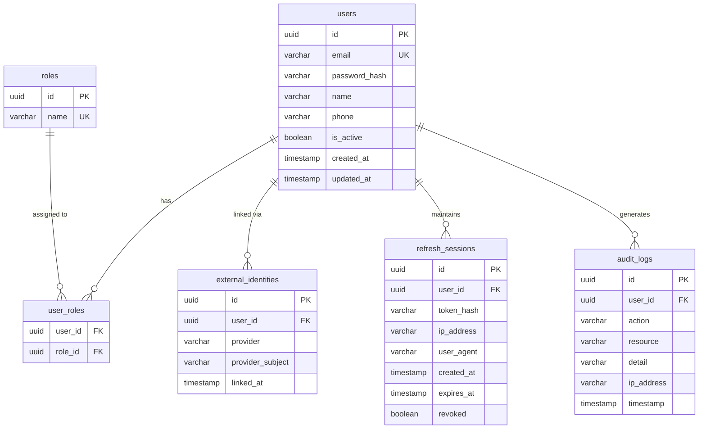
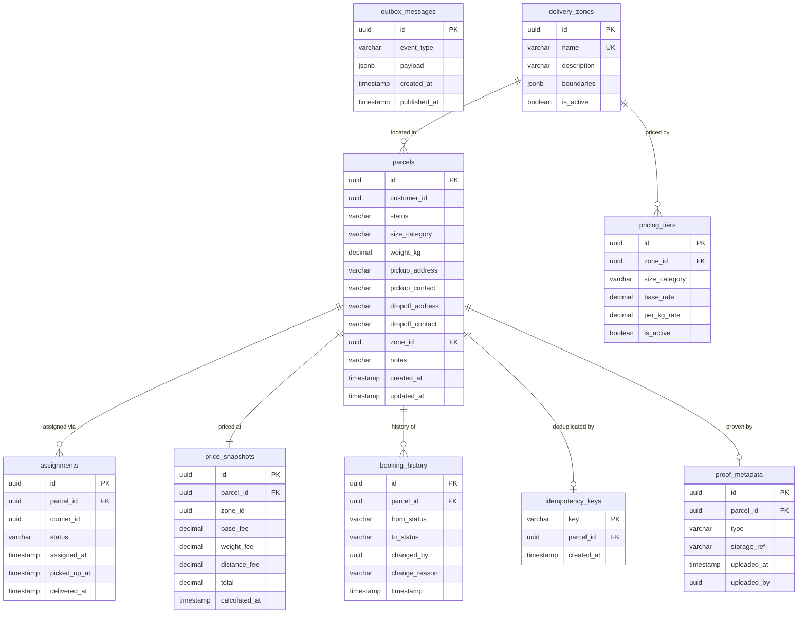
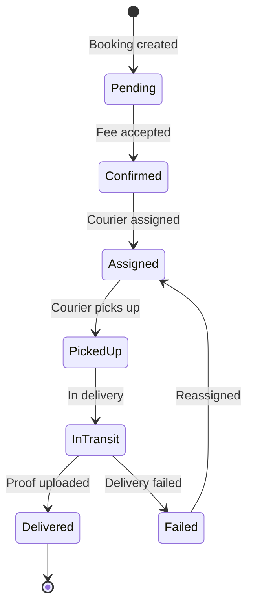
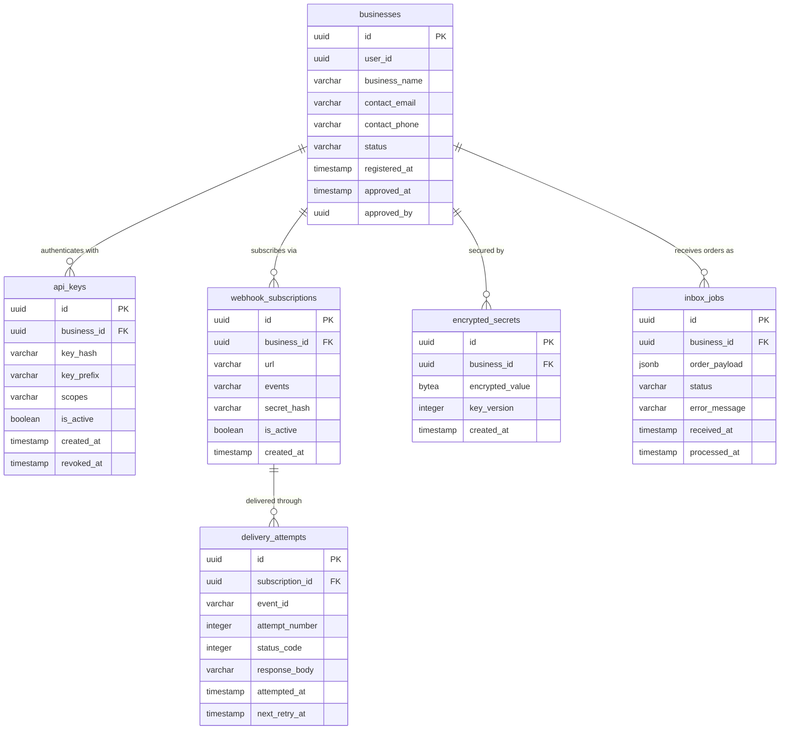
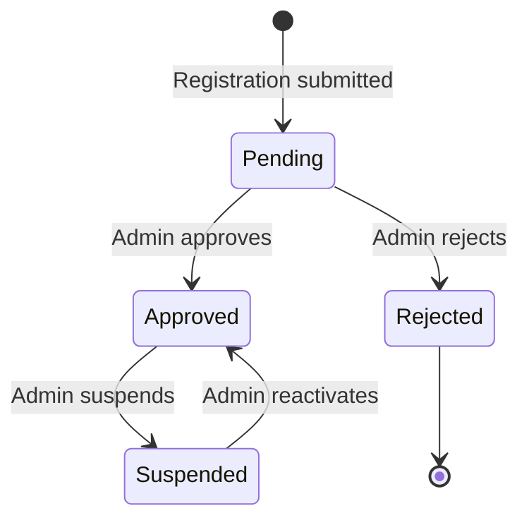
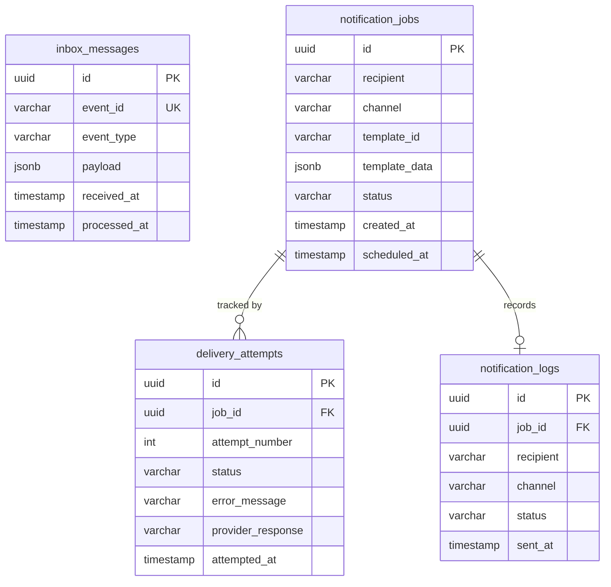
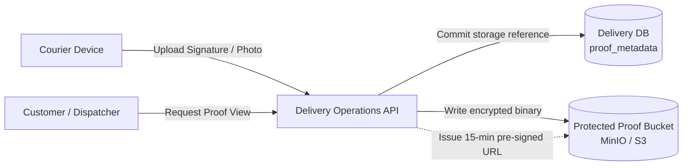

# Entity Relationship Diagrams

> **Status:** Draft  
> **Last Updated:** October 2026

This document contains the Entity Relationship (ER) diagrams for all four SwiftDrop databases and protected proof storage. Each database is owned exclusively by its corresponding bounded context, following the [database-per-service](../../architecture/data-architecture.md) pattern.

---

## 1. Identity Database

The Identity database stores user accounts, roles, external identity provider links, refresh sessions, and audit records.

### Key Relationships

- A **user** can have multiple **roles** (many-to-many via `user_roles`).
- A **user** can have multiple **external identities** (e.g., Google, future providers).
- A **user** can have multiple active **refresh sessions** across devices.
- All significant actions generate **audit log** entries.

---

## 2. Delivery Database

The Delivery database stores the core business data for parcel booking, courier assignment, delivery tracking, pricing, and the transactional outbox.

### Key Relationships

- A **parcel** is the central entity, linked to assignments, pricing, history, and proof.
- Each **parcel** has exactly one **price snapshot** captured at booking time.
- **Assignments** track the courier lifecycle for a parcel (assigned → picked up → delivered).
- **Booking history** records every status transition for audit purposes.
- **Outbox messages** are independent of parcels — they relay domain events to RabbitMQ.
- **Delivery zones** and **pricing tiers** are admin-managed configuration data.

### Parcel Status Lifecycle

---

## 3. Merchant Database

The Merchant database stores merchant business profiles, API credentials, webhook configurations, and delivery attempt tracking.

### Key Relationships

- A **business** (merchant) is the root entity, owning API keys, webhook subscriptions, and secrets.
- **API keys** are stored as hashed values; only the prefix is readable after creation.
- **Webhook subscriptions** define which events trigger notifications to which URLs.
- **Delivery attempts** track each webhook POST, including response codes for retry logic.
- **Inbox jobs** represent inbound merchant orders queued for processing.
- **Encrypted secrets** store HMAC signing keys for webhook payload verification.

### Merchant Status Lifecycle

---

## 4. Notification Database (Worker Host)

The Notification database is owned by the Notification Consumer component running in the .NET Worker host. It records consumed notification events, scheduled alerts (Email and mock SMS), and transmission audit logs.

### Key Responsibilities
- **Inbox Pattern (`inbox_messages`):** Ensures idempotent consumption of notification domain events emitted by Delivery and Merchant services via RabbitMQ.
- **Dispatch Jobs (`notification_jobs`):** Manages asynchronous customer notifications (e.g., booking confirmation, courier arrival) across Email and SMS channels.
- **Reliability (`delivery_attempts`):** Logs delivery status and backoff attempts if third-party notification providers fail.

---

## 5. Protected Proof Storage

Protected Proof Storage is an encrypted object store (MinIO in local development / AWS S3 in cloud deployments) managed with access control exclusively mediated by the Delivery Operations API.

- **Authorized Access:** Direct public access to the storage bucket is permanently disabled.
- **Short-Lived URLs:** Viewing proofs requires requesting a pre-signed, time-limited URL (15-minute expiration) generated by the Delivery Operations API following resource ownership authorization.

---

## References

- [Data Architecture](../../../architecture/data-architecture.md)
- [Service Catalog](../../../architecture/service-catalog.md)
- [Architecture Diagram](../architecture/architecture.md)
