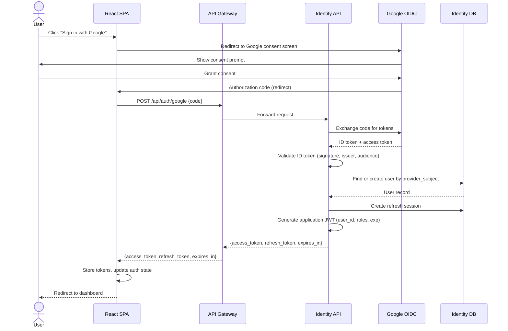
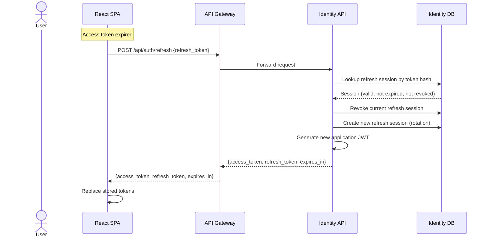
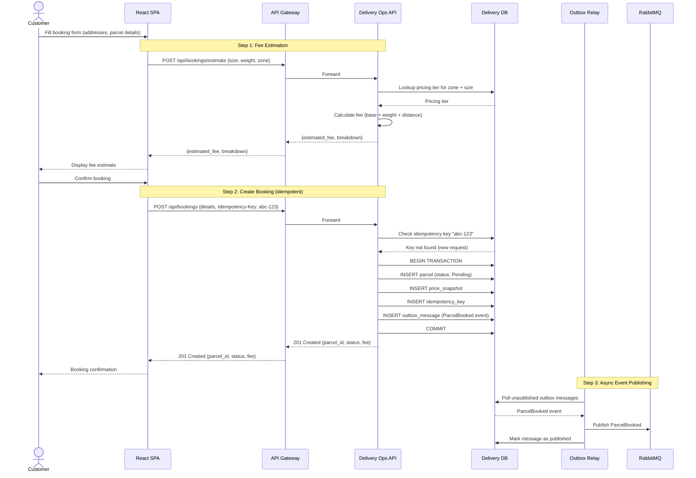
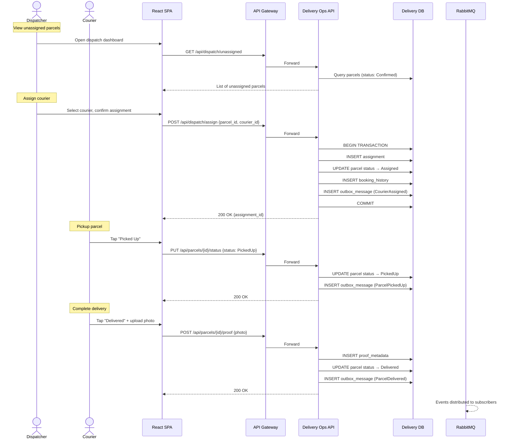
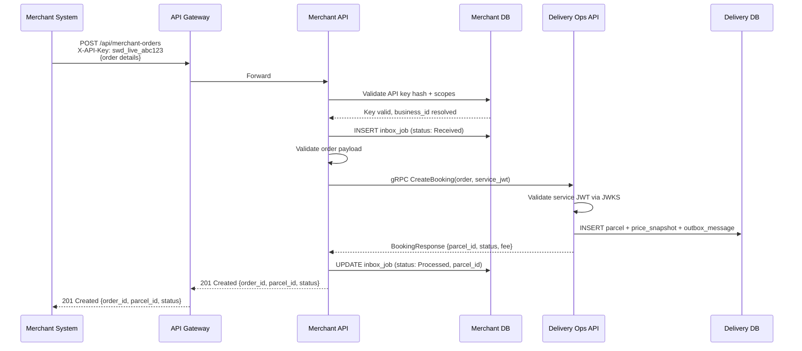
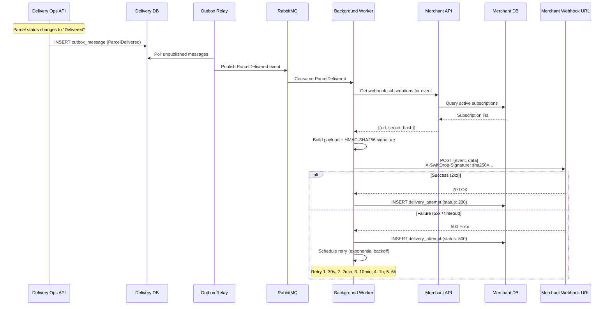

# Sequence Diagrams

> **Status:** Draft  
> **Last Updated:** October 2026

This document contains sequence diagrams for the critical workflows in the SwiftDrop system. Each diagram shows the interaction between actors, services, and infrastructure components for a specific use case.

---

## 1. User Authentication — Google OIDC Login

This sequence shows how a user authenticates through Google OIDC and receives application-specific JWTs from the Identity API.

---

## 2. JWT Token Refresh

This sequence shows how the React SPA refreshes an expired JWT without requiring the user to re-authenticate with Google.

---

## 3. Parcel Booking Flow

This sequence shows the end-to-end flow when a customer creates a new parcel booking, including fee estimation, idempotency, and event publishing via the transactional outbox.

---

## 4. Courier Assignment and Delivery Lifecycle

This sequence shows how a dispatcher assigns a courier and the courier completes the delivery with proof upload.

---

## 5. Merchant Order Submission via API

This sequence shows how an external merchant system submits a delivery order using API key authentication.

---

## 6. Webhook Delivery to Merchant

This sequence shows how delivery status events are propagated to merchant webhook endpoints with retry logic.

---

## References

- [Architecture Diagram](../architecture/architecture.md)
- [Integration Design](../../../integration/integration-design.md)
- [Authentication](../../../security/authentication.md)
- [Merchant Webhooks](../../../integration/merchant-webhooks.md)
- [Data Architecture](../../../architecture/data-architecture.md)
