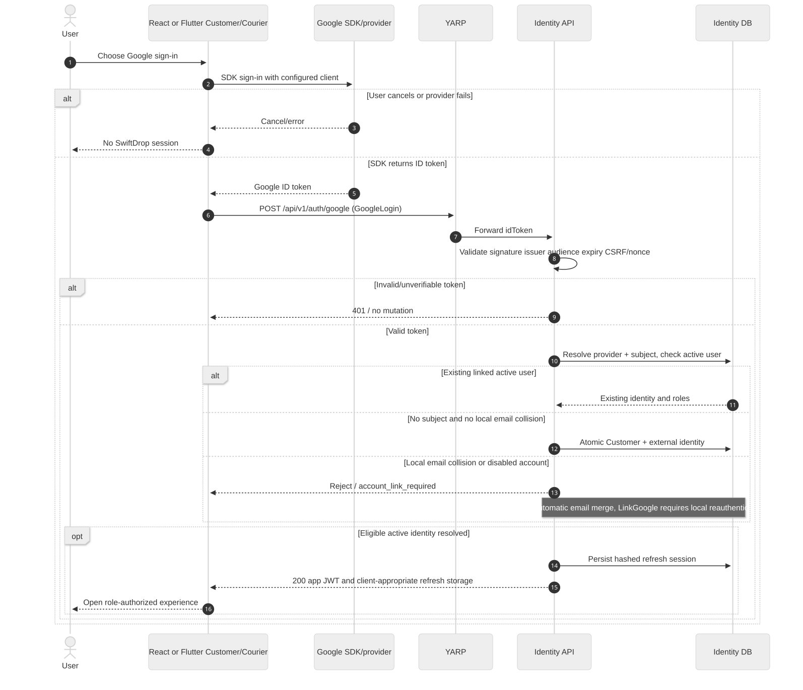
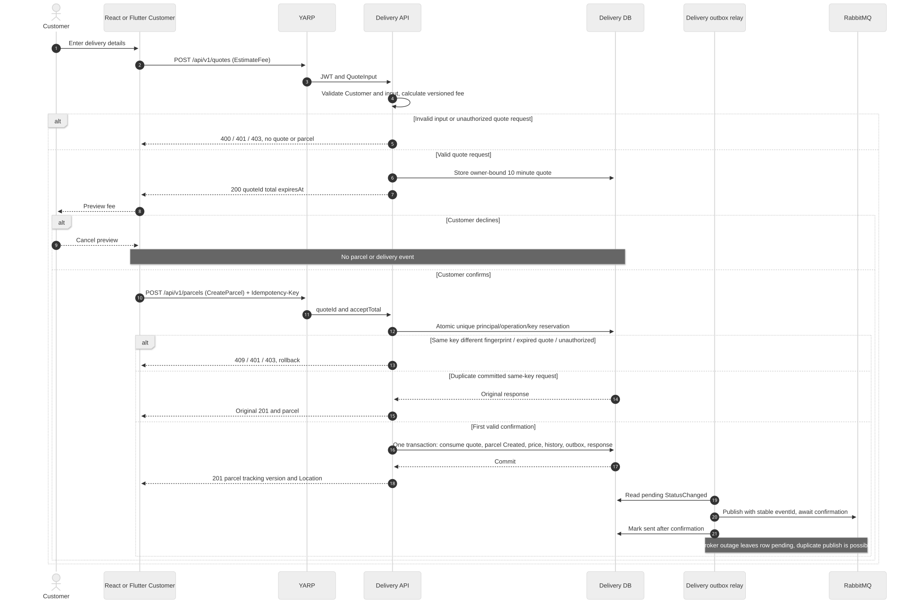
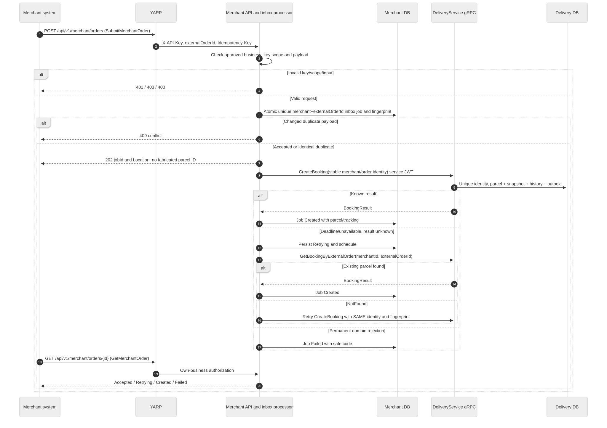
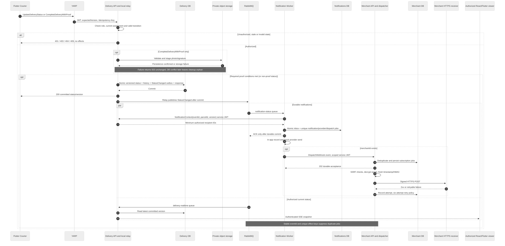
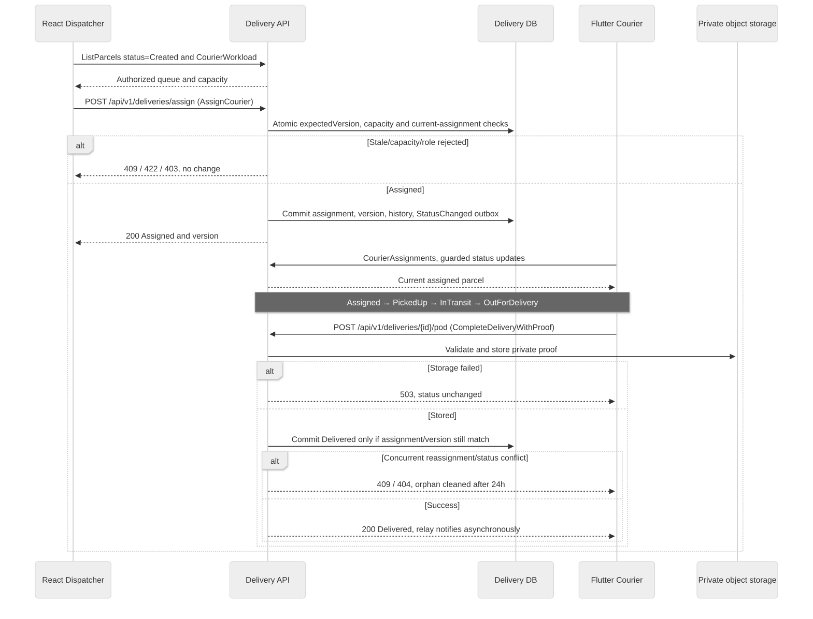
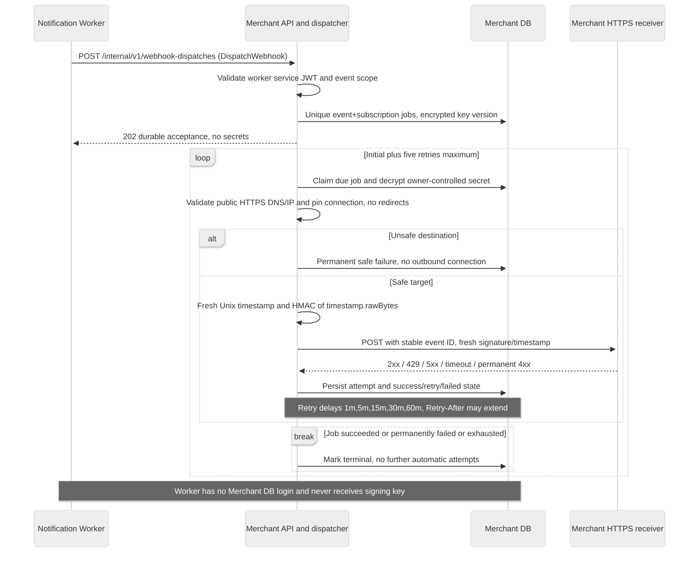
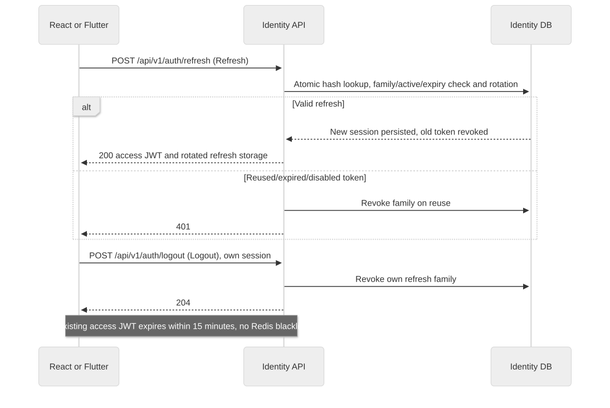

# Sequence Diagrams

> Status: Proposed baseline 2.0 · Reviewer/owner unassigned · 16 October 2026

The first four diagrams cover the mandatory assignment workflows. Exact operation IDs follow [REST](../../../api/rest-api.md), [gRPC](../../../api/grpc-services.md), [events](../../../integration/event-catalog.md) and [use-case narratives](../../../requirements/use-case-specifications.md). All transitions follow the [state matrix](../../../architecture/parcel-state-machine.md). See the [diagram index](../README.md) for source, exports and sign-off.

## Google login

ID: SEQ-google-login; UC-04; FR-C02 NFR-05 NFR-08. Version 2.0, owner/review date pending.

[Editable Mermaid](google-login.mmd) · [Rendered SVG](google-login.svg)

## Customer quote and confirmed booking

ID: SEQ-customer-booking; UC-01; FR-C04 FR-C05 NFR-10 NFR-11. Version 2.0, owner/review date pending.

[Editable Mermaid](customer-booking.mmd) · [Rendered SVG](customer-booking.svg)

## Durable merchant order and recovery

ID: SEQ-merchant-order; UC-02; FR-M03 FR-M04 FR-M06 FR-M07 NFR-10. Version 2.0, owner/review date pending.

[Editable Mermaid](merchant-order.mmd) · [Rendered SVG](merchant-order.svg)

## Courier status to notifications and realtime

ID: SEQ-courier-status-notification; UC-03; FR-R02 FR-R03 FR-R04 FR-C06 FR-M05 NFR-08 NFR-11. Version 2.0, owner/review date pending.

[Editable Mermaid](courier-status-notification.mmd) · [Rendered SVG](courier-status-notification.svg)

## Assignment, version race and proof completion

ID: SEQ-assignment-proof; UC-03; FR-D01 FR-D02 FR-D03 FR-D04 FR-R03. Version 2.0, owner/review date pending.

[Editable Mermaid](assignment-proof.mmd) · [Rendered SVG](assignment-proof.svg)

## Merchant-owned webhook dispatch and retry

ID: SEQ-webhook-delivery; UC-03; FR-M05 NFR-07 NFR-12 NFR-13. Version 2.0, owner/review date pending.

[Editable Mermaid](webhook-delivery.mmd) · [Rendered SVG](webhook-delivery.svg)

## Refresh rotation and bounded logout

ID: SEQ-refresh-session; UC-04; FR-C01 NFR-05. Version 2.0, owner/review date pending.

[Editable Mermaid](refresh-session.mmd) · [Rendered SVG](refresh-session.svg)

