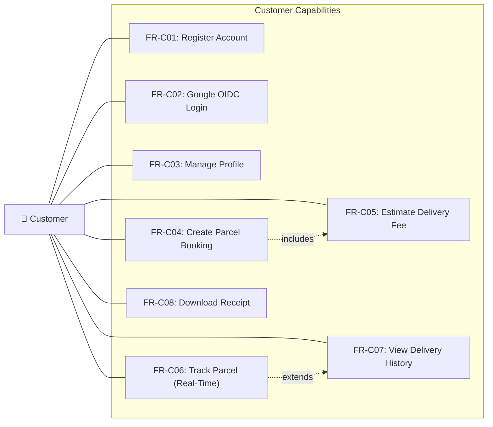
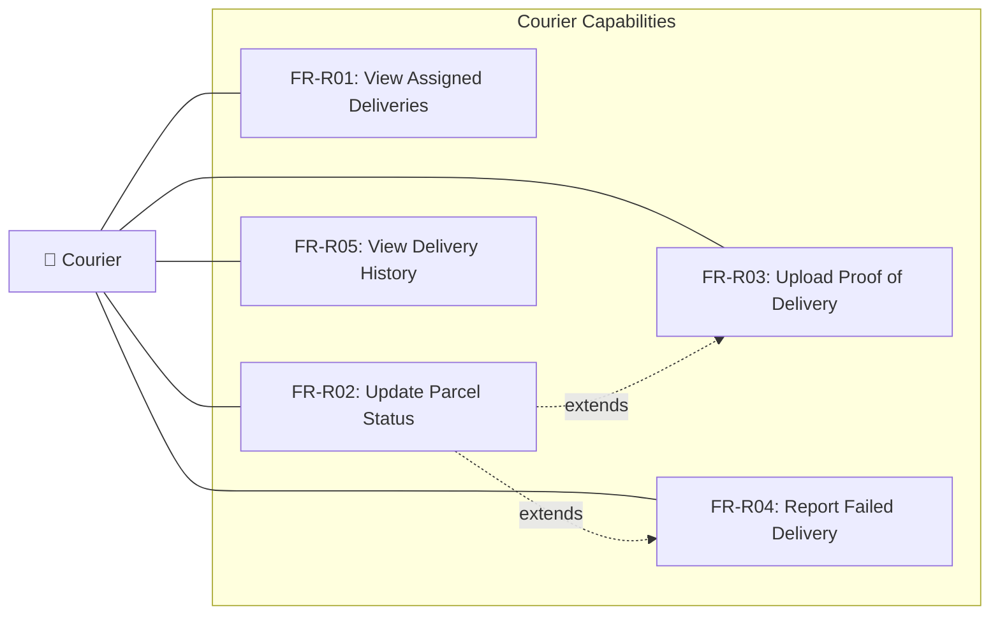
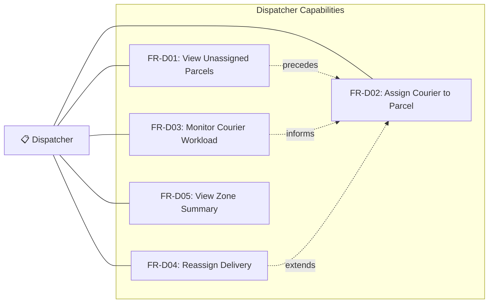
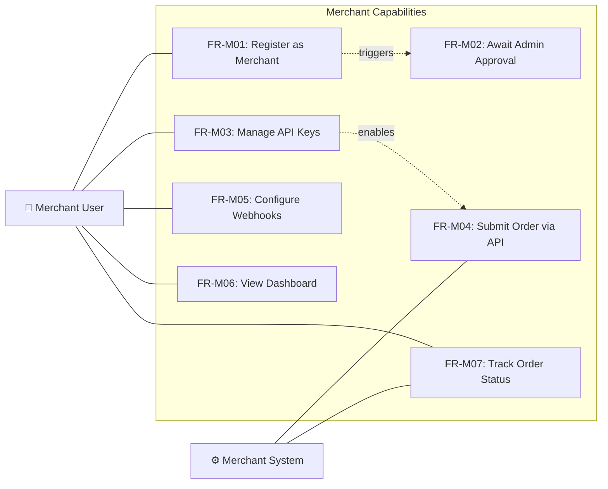
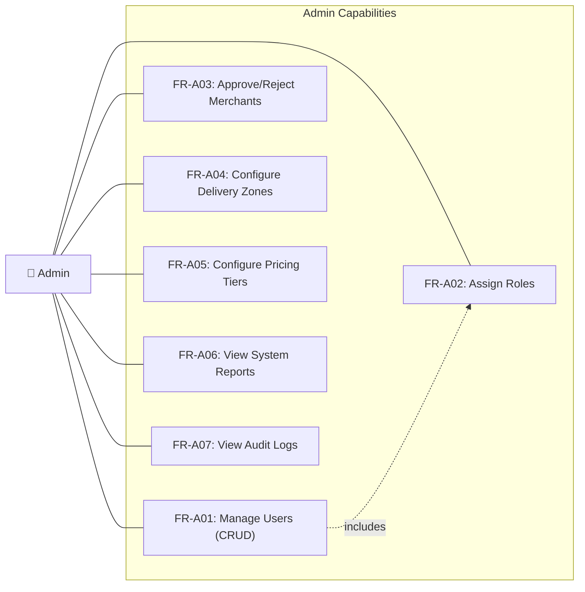

# Use Case Diagrams

> **Status:** Proposed baseline 2.0
> **Last Updated:** October 2026

This document contains use case diagrams for all five system actors in SwiftDrop. Each diagram maps the actor to their available system functions as defined in the [SRS](../../../requirements/srs.md).

---

## 1. System-Wide Use Case Overview

This diagram shows all actors and their primary interactions with the SwiftDrop system.

```mermaid
flowchart LR
    subgraph actors_left["Human Actors"]
        customer["👤 Customer"]
        courier["🚚 Courier"]
        dispatcher["📋 Dispatcher"]
    end

    subgraph system["SwiftDrop Platform"]
        direction TB
        subgraph auth["Authentication"]
            uc_register["Register Account"]
            uc_google["Google OIDC Login"]
            uc_profile["Manage Profile"]
        end
        subgraph booking["Parcel Booking"]
            uc_book["Create Booking"]
            uc_estimate["Estimate Fee"]
            uc_track["Track Parcel"]
            uc_history["View History"]
            uc_receipt["Download Receipt"]
        end
        subgraph delivery["Delivery Operations"]
            uc_viewAssign["View Assignments"]
            uc_updateStatus["Update Parcel Status"]
            uc_proof["Upload Proof"]
            uc_failReport["Report Failed Delivery"]
        end
        subgraph dispatch["Dispatch Management"]
            uc_unassigned["View Unassigned Parcels"]
            uc_assign["Assign Courier"]
            uc_workload["Monitor Workload"]
            uc_reassign["Reassign Delivery"]
            uc_zones["View Zone Summary"]
        end
        subgraph merchantOps["Merchant Integration"]
            uc_mRegister["Register as Merchant"]
            uc_apiKeys["Manage API Keys"]
            uc_submitOrder["Submit Order via API"]
            uc_webhook["Configure Webhooks"]
            uc_mDashboard["View Dashboard"]
            uc_orderStatus["Track Order Status"]
        end
        subgraph admin["Administration"]
            uc_userMgmt["Manage Users"]
            uc_roleAssign["Assign Roles"]
            uc_approve["Approve Merchants"]
            uc_configZones["Configure Zones"]
            uc_configPricing["Configure Pricing"]
            uc_reports["View Reports"]
            uc_audit["View Audit Logs"]
        end
    end

    subgraph actors_right["Merchant Actors"]
        merchantUser["🏪 Merchant"]
        merchantSys["⚙️ Merchant System"]
        adminUser["🔧 Admin"]
    end

    customer --- uc_register
    customer --- uc_google
    customer --- uc_profile
    customer --- uc_book
    customer --- uc_estimate
    customer --- uc_track
    customer --- uc_history
    customer --- uc_receipt

    courier --- uc_google
    courier --- uc_viewAssign
    courier --- uc_updateStatus
    courier --- uc_proof
    courier --- uc_failReport

    dispatcher --- uc_google
    dispatcher --- uc_unassigned
    dispatcher --- uc_assign
    dispatcher --- uc_workload
    dispatcher --- uc_reassign
    dispatcher --- uc_zones

    merchantUser --- uc_mRegister
    merchantUser --- uc_apiKeys
    merchantUser --- uc_webhook
    merchantUser --- uc_mDashboard
    merchantUser --- uc_orderStatus

    merchantSys --- uc_submitOrder
    merchantSys --- uc_orderStatus

    adminUser --- uc_userMgmt
    adminUser --- uc_roleAssign
    adminUser --- uc_approve
    adminUser --- uc_configZones
    adminUser --- uc_configPricing
    adminUser --- uc_reports
    adminUser --- uc_audit
```

---

## 2. Customer Use Cases

| Use Case ID | Name                    | Description                                                              | Service              |
| ----------- | ----------------------- | ------------------------------------------------------------------------ | -------------------- |
| FR-C01      | Register Account        | Create a new account with email and password                             | Identity API         |
| FR-C02      | Google OIDC Login       | Authenticate using Google account                                        | Identity API         |
| FR-C03      | Manage Profile          | View and update personal details                                         | Identity API         |
| FR-C04      | Create Parcel Booking   | Submit a delivery request with parcel and address details                | Delivery Ops API     |
| FR-C05      | Estimate Delivery Fee   | Preview fee based on zone, size, and weight                              | Delivery Ops API     |
| FR-C06      | Track Parcel            | View real-time parcel status via SSE                                     | Delivery Ops API     |
| FR-C07      | View Delivery History   | Browse past and current bookings                                         | Delivery Ops API     |
| FR-C08      | Download Receipt        | Download a digital delivery receipt                                      | Delivery Ops API     |

---

## 3. Courier Use Cases

| Use Case ID | Name                     | Description                                                    | Service              |
| ----------- | ------------------------ | -------------------------------------------------------------- | -------------------- |
| FR-R01      | View Assigned Deliveries | See list of currently assigned parcels                         | Delivery Ops API     |
| FR-R02      | Update Parcel Status     | Change parcel status (Picked Up, In Transit, etc.)             | Delivery Ops API     |
| FR-R03      | Upload Proof of Delivery | Submit photo or signature as delivery evidence                 | Delivery Ops API     |
| FR-R04      | Report Failed Delivery   | Log delivery failure with reason code                          | Delivery Ops API     |
| FR-R05      | View Delivery History    | Browse completed and failed delivery records                   | Delivery Ops API     |

---

## 4. Dispatcher Use Cases

---

## 5. Merchant Use Cases

---

## 6. Admin Use Cases

---

## 7. Actor-to-Service Mapping

| Actor             | Primary Services                                                  |
| ----------------- | ----------------------------------------------------------------- |
| Customer          | Identity API, Delivery Operations API                             |
| Courier           | Identity API, Delivery Operations API                             |
| Dispatcher        | Identity API, Delivery Operations API                             |
| Merchant User     | Identity API, Merchant Integration API                            |
| Merchant System   | Merchant Integration API (API Key auth)                           |
| Admin             | Identity API, Delivery Operations API, Merchant Integration API   |

---

## References

- [Software Requirements Specification](../../../requirements/srs.md)
- [Requirements Traceability](../../../requirements/requirements-traceability.md)
- [Activity Diagrams](../activity/README.md)
- [Sequence Diagrams](../sequence/README.md)

## Narrative, client and mandatory acceptance links

The diagrams above are actor/capability maps; the [standardized use-case specifications](../../../requirements/use-case-specifications.md) govern preconditions, authorization, success, alternatives, exceptions, state and trace IDs. [Diagram index](../README.md) maps the four mandatory scenarios to explicit sequence/activity pairs. Customer booking/tracking/history/receipt run in React and **Flutter Customer**; courier manifest/status/failure/proof run in React and **Flutter Courier**. Dispatcher, Merchant and Admin use React.

FR-C08 receipt, FR-M06 merchant own-order/status dashboard and FR-A06 deliveries/day plus success/failure reports are **Must**. Public tracking is mobile-friendly and privacy-limited. All use-case/implementation approvals remain pending; maps are not proof of delivered functionality. The [permission matrix](../../../security/authorization.md) and [state machine](../../../architecture/parcel-state-machine.md) override broad actor associations where a guard is required.
