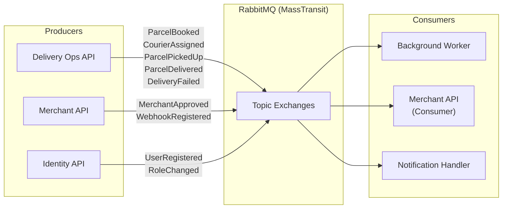

# Event Catalog

> **Status:** Draft  
> **Version:** 1.0  
> **Last Updated:** October 2026

This document catalogs all domain events published and consumed within the SwiftDrop platform. Events are transmitted via RabbitMQ using MassTransit and follow the [transactional outbox](../architecture/data-architecture.md) pattern for reliable delivery.

---

## 1. Event Flow Overview



---

## 2. Event Inventory

### 2.1 Delivery Domain Events

| Event Name              | Producer            | Consumers                          | Trigger                                    |
| ----------------------- | ------------------- | ---------------------------------- | ------------------------------------------ |
| `ParcelBooked`          | Delivery Ops API    | Notification Handler               | Customer or merchant creates a booking     |
| `CourierAssigned`        | Delivery Ops API    | Notification Handler               | Dispatcher assigns a courier to a parcel   |
| `ParcelPickedUp`        | Delivery Ops API    | Background Worker, Notification    | Courier marks parcel as picked up          |
| `StatusChanged`         | Delivery Ops API    | Background Worker, SSE Handler     | Any parcel status transition               |
| `ParcelDelivered`       | Delivery Ops API    | Background Worker, Notification    | Courier completes delivery with proof      |
| `DeliveryFailed`        | Delivery Ops API    | Background Worker, Notification    | Courier reports delivery failure           |

### 2.2 Merchant Domain Events

| Event Name              | Producer            | Consumers                          | Trigger                                    |
| ----------------------- | ------------------- | ---------------------------------- | ------------------------------------------ |
| `MerchantRegistered`    | Merchant API        | Notification Handler               | New merchant submits registration          |
| `MerchantApproved`      | Merchant API        | Notification Handler               | Admin approves a merchant application      |
| `MerchantRejected`      | Merchant API        | Notification Handler               | Admin rejects a merchant application       |
| `WebhookRegistered`     | Merchant API        | —                                  | Merchant configures a webhook endpoint     |
| `OrderIngested`         | Merchant API        | —                                  | Merchant system submits an order           |

### 2.3 Identity Domain Events

| Event Name              | Producer            | Consumers                          | Trigger                                    |
| ----------------------- | ------------------- | ---------------------------------- | ------------------------------------------ |
| `UserRegistered`        | Identity API        | Notification Handler               | New user account created                   |
| `UserDeactivated`       | Identity API        | Delivery Ops API                   | Admin deactivates a user account           |
| `RoleChanged`           | Identity API        | —                                  | Admin assigns or revokes a role            |

---

## 3. Event Schemas

### 3.1 ParcelBooked

```json
{
  "eventId": "550e8400-e29b-41d4-a716-446655440000",
  "eventType": "ParcelBooked",
  "timestamp": "2026-10-15T10:30:00Z",
  "data": {
    "parcelId": "a1b2c3d4-e5f6-7890-abcd-ef1234567890",
    "customerId": "f0e1d2c3-b4a5-6789-0123-456789abcdef",
    "pickupAddress": "123 Main Street, Colombo 03",
    "dropoffAddress": "456 Galle Road, Colombo 06",
    "sizeCategory": "Medium",
    "weightKg": 2.5,
    "estimatedFee": 350.00,
    "zoneId": "zone-colombo-central",
    "merchantOrderId": null
  }
}
```

### 3.2 StatusChanged

```json
{
  "eventId": "660e8400-e29b-41d4-a716-446655440001",
  "eventType": "StatusChanged",
  "timestamp": "2026-10-15T11:15:00Z",
  "data": {
    "parcelId": "a1b2c3d4-e5f6-7890-abcd-ef1234567890",
    "fromStatus": "Assigned",
    "toStatus": "PickedUp",
    "changedBy": "courier-user-id",
    "reason": null
  }
}
```

### 3.3 ParcelDelivered

```json
{
  "eventId": "770e8400-e29b-41d4-a716-446655440002",
  "eventType": "ParcelDelivered",
  "timestamp": "2026-10-15T14:30:00Z",
  "data": {
    "parcelId": "a1b2c3d4-e5f6-7890-abcd-ef1234567890",
    "courierId": "courier-user-id",
    "deliveredAt": "2026-10-15T14:28:00Z",
    "proofType": "Photo",
    "proofRef": "proof/a1b2c3d4/delivery.jpg",
    "merchantOrderId": "merchant-order-123"
  }
}
```

### 3.4 DeliveryFailed

```json
{
  "eventId": "880e8400-e29b-41d4-a716-446655440003",
  "eventType": "DeliveryFailed",
  "timestamp": "2026-10-15T15:00:00Z",
  "data": {
    "parcelId": "a1b2c3d4-e5f6-7890-abcd-ef1234567890",
    "courierId": "courier-user-id",
    "failedAt": "2026-10-15T14:55:00Z",
    "reasonCode": "RECIPIENT_UNAVAILABLE",
    "notes": "No one available at delivery address after two attempts",
    "attemptNumber": 1
  }
}
```

---

## 4. Exchange and Queue Topology

MassTransit automatically manages RabbitMQ exchanges and queues based on consumer registrations.

| Exchange Name                         | Type    | Bound Queues                           |
| ------------------------------------- | ------- | -------------------------------------- |
| `SwiftDrop.Events:ParcelBooked`       | Fanout  | `notification-handler`, `analytics`    |
| `SwiftDrop.Events:StatusChanged`      | Fanout  | `webhook-worker`, `sse-handler`        |
| `SwiftDrop.Events:ParcelDelivered`    | Fanout  | `webhook-worker`, `notification`       |
| `SwiftDrop.Events:DeliveryFailed`     | Fanout  | `webhook-worker`, `notification`       |
| `SwiftDrop.Events:MerchantApproved`   | Fanout  | `notification-handler`                 |

### Error Handling Queues

| Queue                          | Purpose                                              |
| ------------------------------ | ---------------------------------------------------- |
| `{consumer-name}_error`        | Messages that failed all retry attempts               |
| `{consumer-name}_skipped`      | Messages skipped due to deserialization errors         |

---

## 5. Event Conventions

| Convention              | Standard                                                        |
| ----------------------- | --------------------------------------------------------------- |
| Event ID                | UUID v4, globally unique                                        |
| Timestamp               | ISO 8601 in UTC (`Z` suffix)                                    |
| Naming                  | PascalCase, past tense verb (`ParcelBooked`, `CourierAssigned`) |
| Namespace               | `SwiftDrop.Events`                                              |
| Idempotency             | Consumers use `eventId` for deduplication                       |
| Versioning              | Additive changes only; new fields are optional                  |
| Serialization           | JSON via `System.Text.Json`                                     |

---

## References

- [Integration Design](integration-design.md)
- [Merchant Webhooks](merchant-webhooks.md)
- [Data Architecture](../architecture/data-architecture.md)
- [Technical Design](../architecture/technical-design.md)
