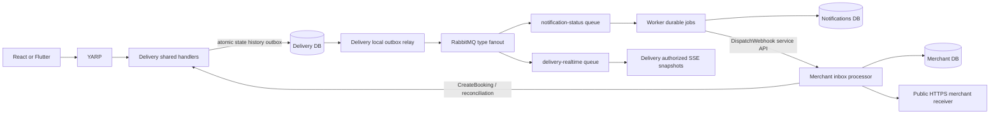

# Integration Design

> Status: Proposed baseline 2.0 · 16 October 2026

The [service call matrix](../architecture/service-catalog.md) governs every synchronous arrow. External clients call YARP; domain services independently enforce credentials, role and resource guards. REST and GraphQL share Delivery command handlers, while Merchant's durable inbox processor calls the two versioned [Delivery gRPC methods](../api/grpc-services.md). Signature validation uses cached JWKS, not an Identity token-validation RPC.

## Reliable request workflows

Customer: EstimateFee → confirm valid quote → CreateParcel. Unique principal/operation/idempotency reservation, parcel, consumed quote, price snapshot, history and outbox commit atomically. A duplicate returns the original response; changed payload gets 409. Courier: check assignment+expectedVersion, validate canonical transition, commit status/history/outbox, then acknowledge. Proof completion confirms private storage before this transaction.

Merchant: validate scoped key and business approval → durable inbox job + unique business/externalOrderId → 202 with job Location → Merchant processor calls CreateBooking → reconciliation on unknown outcome → Created/Retrying/Failed job. Dashboard polls own jobs and reconciles parcel status using GetBookingByExternalOrder, labeling last refresh. No cross-service ACID transaction or false preallocated tracking number is claimed.

## Event workflow

Delivery returns committed business state regardless of later notification delivery. Consumers create durable idempotent jobs; notification provider calls and webhook HTTP attempts occur outside the parcel transaction. Only StatusChanged drives these effects. In-app persistence plus a mock provider is adequate for the academic notification demo; neither counts as an externally delivered SMS/email without provider evidence.

## Failure policy references

| Failure | Durable behavior |
|---|---|
| Booking HTTP response lost | Retry same key; atomic unique reservation returns one stored result |
| Merchant gRPC timeout after Delivery commit | Job Retrying; reconcile external order; never create a second parcel |
| Broker unavailable | Outbox remains pending; bounded backoff relay (1s→60s) until confirmed; alert backlog |
| Broker consumer crash | Inbox+jobs transaction and ACK ordering prevent duplicate effects; initial + 3 immediate retries, then error queue |
| Worker→Merchant timeout | Retain webhook-dispatch job; retry 5s/30s/2m/10m then hourly; duplicate-safe event ID |
| Notification provider failure | Provider job initial attempt + 3 retries (5s/30s/2m); then Failed, inspect/replay with audit; no duplicated in-app record |
| Merchant receiver timeout/429/5xx | Separate HTTP scheduler; initial + 5 retries, fresh attempt timestamp/signature |
| SSE disconnect | Subscribe then fetch current snapshot; ignore older versions; no durable cursor replay promise |

See [event topology](event-catalog.md), [webhook schedule/signature](merchant-webhooks.md), [SSE client/recovery](realtime-tracking.md) and [failure tests](../testing/test-cases.md). Multiple Delivery instances require a new fanout/backplane decision; a shared competing receive queue does not broadcast.
