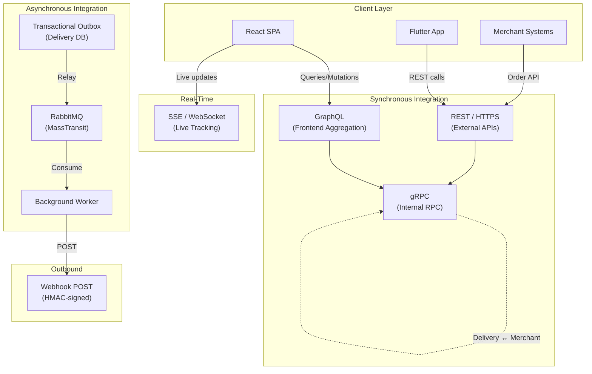
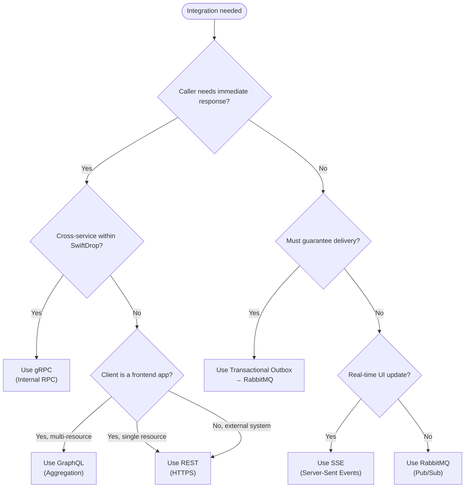
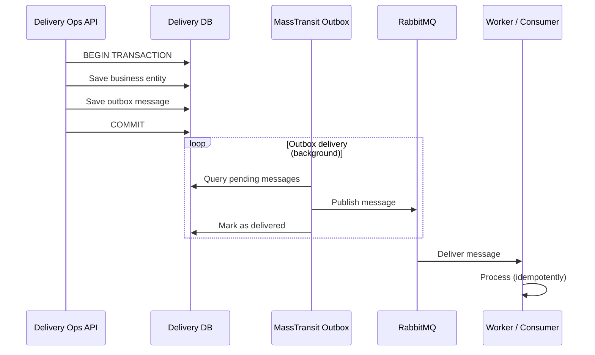

# Integration Design

> **Status:** Draft  
> **Version:** 1.0  
> **Last Updated:** October 2026

---

## 1. Overview

SwiftDrop uses a combination of synchronous and asynchronous integration patterns to connect its services, clients, and external systems. Each pattern is chosen to match the specific requirements of the interaction — latency tolerance, coupling, reliability, and consistency needs.

---

## 2. Integration Topology

---

## 3. Communication Patterns

### 3.1 Pattern Selection Matrix

| Pattern                 | Technology        | When to Use                                              | Coupling   | Consistency    |
| ----------------------- | ----------------- | -------------------------------------------------------- | ---------- | -------------- |
| **Request/Response**    | REST / HTTPS      | External APIs, merchant integration, CRUD operations     | Tight      | Strong         |
| **Frontend Aggregation** | GraphQL          | Frontend needs data from multiple services in one call   | Medium     | Strong         |
| **Internal RPC**        | gRPC              | Synchronous service-to-service with strong typing        | Tight      | Strong         |
| **Publish/Subscribe**   | RabbitMQ          | Domain events, notifications, cross-service workflows    | Loose      | Eventual       |
| **Transactional Outbox** | EF Core + MassTransit | Reliable event publishing within a database transaction | Loose     | Eventual (guaranteed) |
| **Real-Time Push**      | SSE               | Live parcel tracking, status updates to UI               | Loose      | Eventual       |
| **External Callback**   | Webhooks / HTTPS  | Merchant notifications on delivery events                | Loose      | Eventual       |

### 3.2 Decision Flow

---

## 4. Synchronous Integration

### 4.1 REST APIs

REST is used for all externally facing APIs and merchant integrations.

| Aspect                | Convention                                                    |
| --------------------- | ------------------------------------------------------------- |
| Base path             | `/api/{resource}`                                             |
| HTTP methods          | GET (read), POST (create), PUT (update), DELETE (remove)      |
| Status codes          | 200, 201, 204, 400, 401, 403, 404, 409, 422, 500             |
| Error format          | RFC 7807 Problem Details                                      |
| Pagination            | Cursor-based (`?cursor=xxx&limit=20`)                         |
| Versioning            | URL path versioning (`/api/v1/...`) when breaking changes occur |
| Content type          | `application/json`                                            |
| Authentication        | Bearer JWT (users) or API Key (merchants)                     |

### 4.2 GraphQL

GraphQL serves as the frontend aggregation layer, allowing the React SPA and Flutter app to fetch precisely the data they need.

| Aspect                | Convention                                                    |
| --------------------- | ------------------------------------------------------------- |
| Endpoint              | `/graphql`                                                    |
| Operations            | Queries (read), Mutations (write), Subscriptions (real-time)  |
| Schema location       | Maintained in the backend repository                          |
| Auth                  | Bearer JWT in Authorization header                            |
| Error handling        | GraphQL errors array with extensions for codes                |

### 4.3 gRPC (Internal)

gRPC is used for synchronous service-to-service communication where strong typing and performance matter.

| Aspect                | Convention                                                    |
| --------------------- | ------------------------------------------------------------- |
| Transport             | HTTP/2 (internal network)                                     |
| Schema                | Protocol Buffers (`.proto` files)                             |
| Authentication        | Service JWT in metadata (verified via JWKS)                   |
| Error handling        | gRPC status codes + error details                             |
| Use cases             | Delivery Ops → Merchant API (booking, queries)               |

---

## 5. Asynchronous Integration

### 5.1 RabbitMQ with MassTransit

All asynchronous messaging uses MassTransit as the abstraction layer over RabbitMQ.

| Aspect                | Convention                                                    |
| --------------------- | ------------------------------------------------------------- |
| Broker                | RabbitMQ 3.13                                                 |
| Abstraction           | MassTransit (NuGet)                                           |
| Exchange type         | Fanout (MassTransit default for pub/sub)                      |
| Serialization         | System.Text.Json                                              |
| Consumer pattern      | MassTransit `IConsumer<T>` implementations                    |
| Error handling        | Retry → Redelivery → Dead letter queue (DLQ)                 |
| Outbox                | MassTransit EF Core outbox                                    |

### 5.2 Transactional Outbox

The outbox pattern ensures domain events are persisted atomically with business state and then reliably relayed to RabbitMQ.

### 5.3 Message Retry Policy

| Level        | Strategy                  | Attempts | Delay                     |
| ------------ | ------------------------- | -------- | ------------------------- |
| Immediate    | In-memory retry           | 3        | 1s, 5s, 10s              |
| Redelivery   | Delayed redelivery        | 3        | 1min, 5min, 15min         |
| Dead Letter   | Move to error queue      | —        | Manual inspection         |

---

## 6. Real-Time Integration

### 6.1 Server-Sent Events (SSE)

SSE provides one-way real-time updates from the server to connected clients for parcel tracking.

| Aspect                | Convention                                                    |
| --------------------- | ------------------------------------------------------------- |
| Endpoint              | `GET /api/tracking/{parcelId}/events`                         |
| Content-Type          | `text/event-stream`                                           |
| Auth                  | Bearer JWT (query parameter or header)                        |
| Events                | `status_changed`, `location_updated`, `delivery_completed`    |
| Heartbeat             | `:keepalive` comment every 30 seconds                         |
| Reconnection          | `retry:` field with recommended reconnection interval         |

See [Real-Time Tracking](realtime-tracking.md) for full specification.

### 6.2 Webhooks (Outbound)

Webhooks push delivery status updates to registered merchant endpoints.

| Aspect                | Convention                                                    |
| --------------------- | ------------------------------------------------------------- |
| Method                | POST to merchant-registered URL                               |
| Signing               | HMAC-SHA256 with per-merchant secret                          |
| Header                | `X-SwiftDrop-Signature: sha256={hex_digest}`                  |
| Retry policy          | 5 attempts with exponential backoff                           |
| Timeout               | 10 seconds per attempt                                        |
| Idempotency           | `X-SwiftDrop-Event-Id` header for deduplication               |

See [Merchant Webhooks](merchant-webhooks.md) for full specification.

---

## 7. Service-to-Service Communication Map

| Source                  | Target                   | Protocol   | Purpose                                           |
| ----------------------- | ------------------------ | ---------- | -------------------------------------------------- |
| API Gateway             | Identity API             | HTTP       | Auth, user management (reverse proxy)              |
| API Gateway             | Delivery Ops API         | HTTP       | Booking, tracking, dispatch (reverse proxy)        |
| API Gateway             | Merchant API             | HTTP       | Merchant routes (reverse proxy)                    |
| Delivery Ops API        | Merchant API             | gRPC       | Booking validation, merchant queries               |
| Delivery Ops API        | RabbitMQ                 | AMQP       | Publish domain events via outbox                   |
| RabbitMQ                | Background Worker        | AMQP       | Consume events for webhook delivery                |
| Background Worker       | Merchant Webhook URLs    | HTTPS      | Outbound webhook POST                              |
| All APIs                | Identity API JWKS        | HTTP       | JWT token verification                             |

---

## References

- [Event Catalog](event-catalog.md)
- [Merchant Webhooks](merchant-webhooks.md)
- [Real-Time Tracking](realtime-tracking.md)
- [Technical Design](../architecture/technical-design.md)
- [Service Catalog](../architecture/service-catalog.md)
- [API Reference](../api/api-reference.md)
