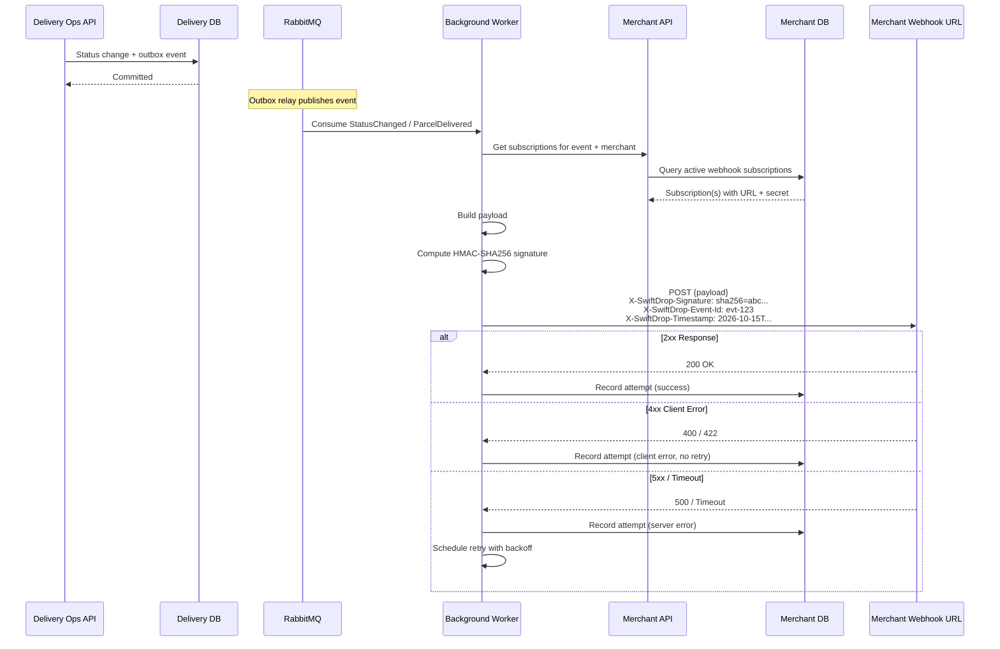
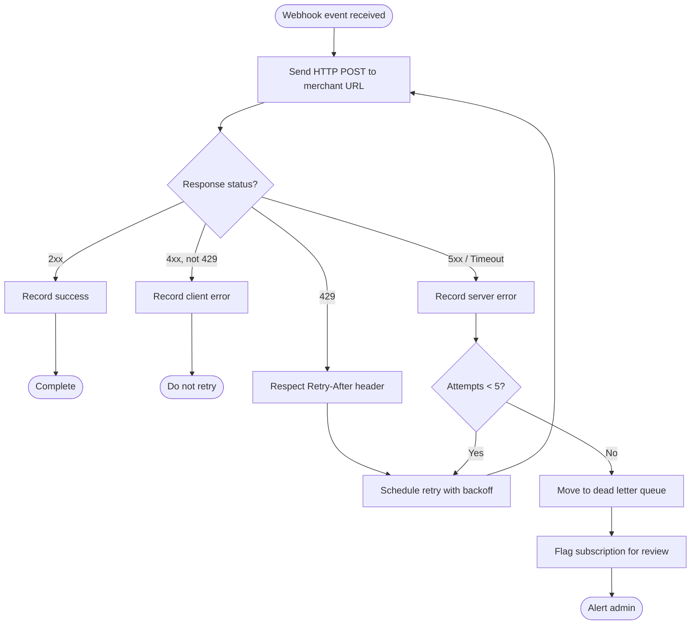

# Merchant Webhooks

> **Status:** Draft  
> **Version:** 1.0  
> **Last Updated:** October 2026

---

## 1. Overview

SwiftDrop delivers real-time delivery status notifications to merchant systems via outbound webhooks. When a delivery event occurs for a merchant-originated order, the system sends a signed HTTP POST request to the merchant's registered webhook URL.

---

## 2. Webhook Delivery Flow



---

## 3. Webhook Subscription

### 3.1 Registration

Merchants register webhook endpoints through the Merchant Integration API.

**Request:**

```http
POST /api/webhooks/subscribe
Authorization: Bearer {jwt}
Content-Type: application/json

{
  "url": "https://merchant.example.com/webhooks/swiftdrop",
  "events": ["StatusChanged", "ParcelDelivered", "DeliveryFailed"],
  "secret": "whsec_merchant_generated_secret_key"
}
```

**Response:**

```json
{
  "subscriptionId": "sub-abc123",
  "url": "https://merchant.example.com/webhooks/swiftdrop",
  "events": ["StatusChanged", "ParcelDelivered", "DeliveryFailed"],
  "status": "Active",
  "createdAt": "2026-10-15T10:00:00Z"
}
```

### 3.2 Subscribable Events

| Event                 | Description                                         |
| --------------------- | --------------------------------------------------- |
| `StatusChanged`       | Any parcel status transition                        |
| `ParcelPickedUp`      | Courier picked up the parcel                        |
| `ParcelDelivered`     | Delivery completed with proof                       |
| `DeliveryFailed`      | Delivery attempt failed                             |

---

## 4. Webhook Payload Format

### 4.1 Payload Structure

```json
{
  "id": "evt-550e8400-e29b-41d4-a716-446655440000",
  "type": "ParcelDelivered",
  "timestamp": "2026-10-15T14:30:00Z",
  "merchantId": "merch-abc123",
  "data": {
    "parcelId": "parcel-def456",
    "orderId": "merchant-order-789",
    "status": "Delivered",
    "previousStatus": "InTransit",
    "deliveredAt": "2026-10-15T14:28:00Z",
    "proofType": "Photo"
  }
}
```

### 4.2 HTTP Headers

| Header                       | Value                                              | Purpose                   |
| ---------------------------- | -------------------------------------------------- | ------------------------- |
| `Content-Type`               | `application/json`                                 | Payload format            |
| `X-SwiftDrop-Signature`      | `sha256={hex_digest}`                              | HMAC signature            |
| `X-SwiftDrop-Event-Id`       | `evt-{uuid}`                                       | Idempotency / dedup key   |
| `X-SwiftDrop-Timestamp`      | ISO 8601 UTC                                       | Signing timestamp         |
| `User-Agent`                 | `SwiftDrop-Webhook/1.0`                            | Identification            |

---

## 5. Signature Verification

### 5.1 Signing Process (SwiftDrop)

1. Construct the signing string: `{timestamp}.{json_payload}`
2. Compute HMAC-SHA256 using the merchant's webhook secret.
3. Hex-encode the digest.
4. Set header: `X-SwiftDrop-Signature: sha256={hex_digest}`

### 5.2 Verification Process (Merchant)

Merchants should verify incoming webhooks to ensure authenticity:

```python
# Example verification (Python)
import hmac
import hashlib

def verify_webhook(payload_body, timestamp, signature_header, secret):
    signing_string = f"{timestamp}.{payload_body}"
    expected = hmac.new(
        secret.encode(),
        signing_string.encode(),
        hashlib.sha256
    ).hexdigest()

    received = signature_header.replace("sha256=", "")
    return hmac.compare_digest(expected, received)
```

### 5.3 Timestamp Tolerance

Merchants should reject webhook payloads where the timestamp is older than **5 minutes** to prevent replay attacks.

---

## 6. Retry Policy

Failed webhook deliveries (5xx responses or timeouts) are retried with exponential backoff.

| Attempt | Delay After Failure | Total Elapsed  |
| ------- | ------------------- | -------------- |
| 1       | Immediate           | 0              |
| 2       | 30 seconds          | 30s            |
| 3       | 2 minutes           | ~2.5 min       |
| 4       | 10 minutes          | ~12.5 min      |
| 5       | 1 hour              | ~1h 12min      |

### Retry Rules

- **5xx responses** and **timeouts** (>10s) trigger retries.
- **4xx responses** (except 429) are **not retried** — they indicate a client-side issue.
- **429 (Too Many Requests)** is retried respecting the `Retry-After` header if present.
- After **5 failed attempts**, the event is moved to a dead letter queue and the subscription is flagged for review.
- The `X-SwiftDrop-Event-Id` header remains the same across retries for merchant-side deduplication.

### Retry Flow



---

## 7. Delivery Attempt Tracking

Every webhook delivery attempt is recorded in the `delivery_attempts` table:

| Field              | Description                                    |
| ------------------ | ---------------------------------------------- |
| `id`               | Unique attempt identifier                      |
| `subscription_id`  | The webhook subscription this attempt belongs to |
| `event_id`         | The event being delivered                      |
| `attempt_number`   | Sequential attempt number (1–5)                |
| `status_code`      | HTTP response status code (or 0 for timeout)   |
| `response_body`    | First 1 KB of response body (for debugging)    |
| `attempted_at`     | Timestamp of the attempt                       |
| `next_retry_at`    | Scheduled time for next retry (null if final)  |

---

## 8. Subscription Management

| Operation                   | Endpoint                                  | Method  |
| --------------------------- | ----------------------------------------- | ------- |
| Register webhook            | `/api/webhooks/subscribe`                 | POST    |
| List subscriptions          | `/api/webhooks/subscriptions`             | GET     |
| Update subscription         | `/api/webhooks/subscriptions/{id}`        | PUT     |
| Deactivate subscription     | `/api/webhooks/subscriptions/{id}`        | DELETE  |
| View delivery attempts      | `/api/webhooks/subscriptions/{id}/attempts` | GET   |
| Retry failed event          | `/api/webhooks/attempts/{id}/retry`       | POST    |

---

## References

- [Event Catalog](event-catalog.md)
- [Integration Design](integration-design.md)
- [Sequence Diagrams — Webhook Delivery](../design/diagrams/sequence/README.md#6-webhook-delivery-to-merchant)
- [Data Architecture](../architecture/data-architecture.md)
