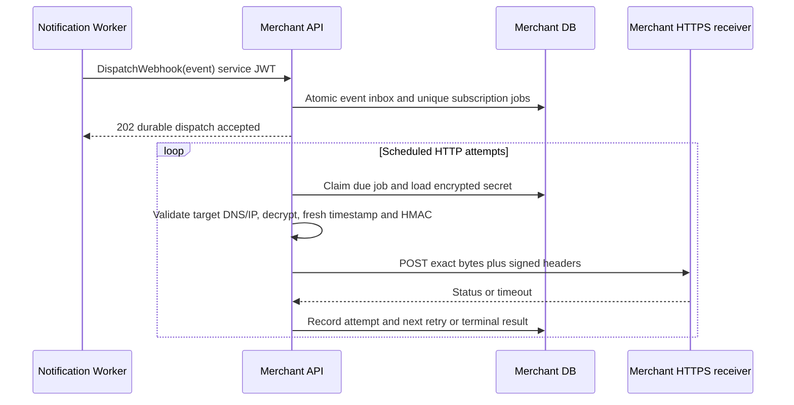

# Merchant Webhooks

> Status: Proposed baseline 2.0 · DEC-10 · MER/MSG/SEC approval pending

Merchant API owns subscriptions, retrievable **encrypted** signing secrets, durable webhook jobs and HTTP attempt records. The Worker owns notification and webhook-dispatch jobs in Notifications DB; it calls Merchant through a scoped internal API. **Worker never reads/writes Merchant DB or receives plaintext signing material.** Merchant's embedded dispatcher performs outbound HTTPS. API-key hashes are unrelated to webhook signing keys and cannot be used for HMAC.

## Dispatch ownership



DispatchWebhook accepts StatusChanged only from worker service JWT aud=merchant-internal, scope=webhooks:dispatch. Verify merchantId against subscription owner and event identity; public clients cannot call it. Store `(eventId,subscriptionId,replayGeneration)` unique, generation=0 for automatic processing. Freeze the event body and subscription secret version for that job. Subscription deletion/suspension cancels unsent jobs. Raw secret is generated with ≥256 random bits, shown once on CreateWebhook, encrypted with AEAD and key version at rest; decryption is limited to Merchant's sender. Logs contain job IDs/statuses, never secret/ciphertext/request headers. Rotation uses a replacement subscription/secret; drain or cancel old jobs explicitly, and receivers retain the old key only through the documented retry horizon.

## External body and event mapping

Body contains eventId, eventType, schemaVersion=1, occurredAt, parcelId, parcelVersion, trackingNumber and status. Merchant resolves trackingNumber through authorized GetBookingByExternalOrder using its persisted job reference; it never expands public data into addresses/contacts/proof. Status maps Created→delivery.created, Assigned→delivery.assigned, PickedUp→delivery.picked_up, InTransit→delivery.in_transit, OutForDelivery→delivery.out_for_delivery, Delivered→delivery.delivered, Failed→delivery.failed, Cancelled→delivery.cancelled. Reassignment uses delivery.assigned and the newer parcelVersion. One canonical transition gives one intended job per subscribed endpoint even under broker retries.

An event may arrive before Merchant records the successful CreateBooking response. If the parcel-to-order mapping is not yet available, persist the webhook job as PendingResolution and reconcile the merchant inbox jobs; do not discard the event, declare it invalid or count a dependency lookup as an HTTP delivery attempt. Start the six-attempt HTTP schedule only once the authorized tracking reference is resolved. Failed resolution remains durable and alerted.

## Exact signing and verification

- `X-SwiftDrop-Event-Id`: stable event UUID on every automatic retry.
- `X-SwiftDrop-Timestamp`: **current attempt time as Unix epoch seconds**, decimal ASCII.
- `X-SwiftDrop-Key-Version`: subscription secret version.
- `X-SwiftDrop-Signature`: `sha256=<lowercase hex HMAC-SHA256(secret, timestamp + "." + raw_body_bytes)>`.
- Content-Type: application/json; raw body is UTF-8 bytes stored for the job. Do not parse/reserialize before verifying.

Receiver rejects timestamps with absolute clock skew >300 seconds, verifies HMAC in constant time, then durably deduplicates eventId for that subscription and applies side effects before 2xx. A duplicate valid event returns 2xx without applying effects again. **Recompute timestamp and signature on every HTTP attempt**, retaining eventId and occurredAt; event age is not signature age. Keep clocks synchronized. Manual replay preserves the original eventId: receivers may intentionally deduplicate it, and replay is not a mechanism for applying a business event twice.

```python
import hashlib, hmac, time

def valid_signature(secret: bytes, body: bytes, timestamp: str, supplied: str) -> bool:
    try:
        if not timestamp.isascii() or not timestamp.isdigit():
            return False
        if abs(int(time.time()) - int(timestamp)) > 300:
            return False
    except (ValueError, OverflowError):
        return False
    expected = "sha256=" + hmac.new(secret, timestamp.encode("ascii") + b"." + body, hashlib.sha256).hexdigest()
    return hmac.compare_digest(expected, supplied)
```

## HTTP retry policy (separate from broker retries)

Maximum **six automatic attempts = one initial + five retries**. Delays are relative to the preceding completed failed attempt, not event age.

| Attempt | Delay after previous failure | Cumulative minimum delay |
|---|---|---|
| 1 | Immediate | 0 |
| 2 | 1 minute | 1 minute |
| 3 | 5 minutes | 6 minutes |
| 4 | 15 minutes | 21 minutes |
| 5 | 30 minutes | 51 minutes |
| 6 | 60 minutes | 111 minutes |

2xx succeeds. Timeout/network failure, 408, 429 and 5xx are retryable. For 429/503 honor valid Retry-After (seconds or HTTP date), using max(schedule, Retry-After) capped at 24h and alert; attempt timestamps remain fresh. Other 4xx, 3xx and unsafe destinations fail permanently; do not follow redirects. Persist claimed attempt, request timestamp, result code, duration, nextRetryAt and safe failure reason; a crash/unknown HTTP outcome is retried and receiver deduplication is required. After six failures mark Failed and expose own attempts for inspection/manual audited replay. Broker error queues are not HTTP webhook retry storage.

## Destination validation and egress

At registration **and every send/retry**, parse an absolute HTTPS URL (port 443 only), reject userinfo, fragments, localhost names and IP literals outside public global unicast. Resolve all A/AAAA answers and reject any loopback/private/link-local/metadata/multicast/reserved/unspecified address, including IPv4-mapped IPv6. Re-resolve on send and bind the connection to the validated public address while retaining original Host/TLS hostname validation, preventing DNS rebinding between check and connect. Disable redirects/proxies that bypass validation; a new URL needs a new validated subscription. Outbound egress blocks internal ranges and cloud metadata independently of app validation. Keep a controlled public receiver for integration tests; local test doubles must use an injected transport in tests rather than weakening production SSRF validation.

Set 10s total deadline, ≤64 KiB response read, ≤64 KiB outgoing body and bounded concurrency. Response bodies and query strings are not logged. Test unsafe DNS answers, redirects, rebinding, IPv6, timeouts, 429, signature freshness, replay and duplicate jobs. See [test catalog](../testing/test-cases.md).

## Security reference

[OWASP SSRF prevention guidance](https://cheatsheetseries.owasp.org/cheatsheets/Server_Side_Request_Forgery_Prevention_Cheat_Sheet.html) informs public destination/DNS/redirect controls. The exact HMAC bytes, retry schedule and Merchant ownership model are SwiftDrop’s proposed contract.
