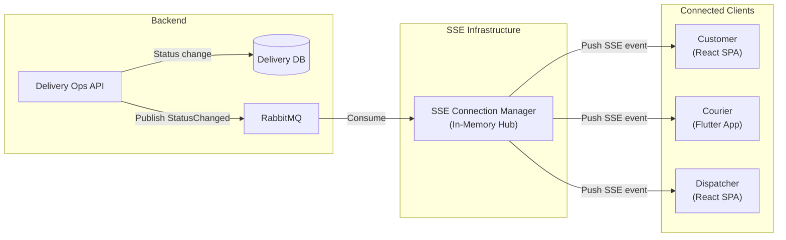
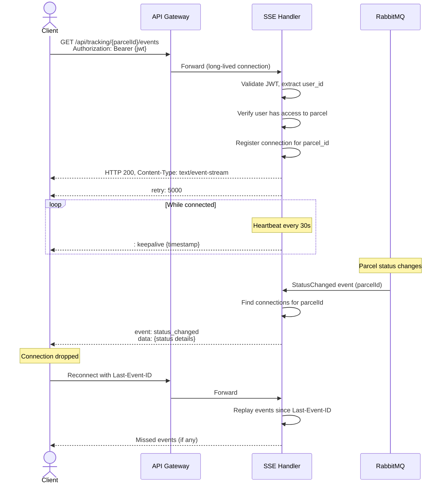

# Real-Time Tracking Integration

> **Status:** Draft  
> **Version:** 1.0  
> **Last Updated:** October 2026

---

## 1. Overview

SwiftDrop provides real-time parcel tracking updates to connected clients using **Server-Sent Events (SSE)**. When a parcel's status changes, the update is pushed to all subscribed clients within seconds, enabling live tracking dashboards for customers, couriers, and dispatchers.

---

## 2. Architecture



---

## 3. SSE Connection Protocol

### 3.1 Establishing a Connection

**Request:**

```http
GET /api/tracking/{parcelId}/events
Authorization: Bearer {jwt}
Accept: text/event-stream
```

**Response Headers:**

```http
HTTP/1.1 200 OK
Content-Type: text/event-stream
Cache-Control: no-cache
Connection: keep-alive
X-Accel-Buffering: no
```

### 3.2 SSE Event Format

Each event follows the SSE specification:

```
id: evt-550e8400-e29b-41d4
event: status_changed
data: {"parcelId":"abc-123","status":"PickedUp","previousStatus":"Assigned","timestamp":"2026-10-15T11:15:00Z","changedBy":"courier-id"}

```

### 3.3 Event Types

| Event Type              | Trigger                                      | Data Fields                                |
| ----------------------- | -------------------------------------------- | ------------------------------------------ |
| `status_changed`        | Parcel status transition                     | parcelId, status, previousStatus, timestamp |
| `courier_assigned`      | Courier assigned to parcel                   | parcelId, courierId, courierName, timestamp |
| `delivery_completed`    | Delivery finished with proof                 | parcelId, deliveredAt, proofType           |
| `delivery_failed`       | Delivery attempt failed                      | parcelId, reasonCode, notes, timestamp     |
| `heartbeat`             | Keepalive (every 30s)                        | timestamp                                  |

### 3.4 Heartbeat

The server sends a comment-based keepalive every 30 seconds to prevent proxy/load balancer timeouts:

```
: keepalive 2026-10-15T11:15:30Z

```

### 3.5 Reconnection

If the connection drops, the SSE specification's built-in reconnection applies:

```
retry: 5000
```

The `retry` field instructs the client to wait 5 seconds before reconnecting. On reconnection, the client sends the last received `id` via the `Last-Event-ID` header, and the server replays any missed events.

---

## 4. Connection Lifecycle



---

## 5. Authorization

| Rule                                      | Enforcement                                           |
| ----------------------------------------- | ----------------------------------------------------- |
| Valid JWT required                         | SSE handler validates token before accepting connection |
| Customer can only track their own parcels  | `parcel.customer_id == jwt.user_id`                   |
| Courier can track their assigned parcels   | `assignment.courier_id == jwt.user_id`                |
| Dispatcher can track all parcels in zone   | Role-based access with zone filtering                 |
| Admin can track any parcel                 | Role-based access, no parcel restriction              |
| Merchant can track their order parcels     | `parcel.merchant_order_id` belongs to merchant        |

---

## 6. Dispatcher Dashboard: Multi-Parcel Tracking

Dispatchers need to monitor multiple parcels simultaneously. A separate SSE endpoint supports zone-level subscriptions:

**Request:**

```http
GET /api/tracking/zones/{zoneId}/events
Authorization: Bearer {jwt}
Accept: text/event-stream
```

This endpoint streams events for all parcels within the specified delivery zone, enabling a real-time dispatch dashboard.

---

## 7. Client Implementation Notes

### 7.1 React SPA (EventSource API)

```javascript
const eventSource = new EventSource(
  `/api/tracking/${parcelId}/events`,
  { headers: { Authorization: `Bearer ${token}` } }
);

eventSource.addEventListener('status_changed', (event) => {
  const data = JSON.parse(event.data);
  updateTrackingUI(data);
});

eventSource.addEventListener('delivery_completed', (event) => {
  const data = JSON.parse(event.data);
  showDeliveryConfirmation(data);
  eventSource.close();
});

eventSource.onerror = () => {
  // Browser handles automatic reconnection via retry field
  console.log('SSE connection lost, reconnecting...');
};
```

### 7.2 Flutter (SSE Client)

```dart
final client = SseClient(
  url: '/api/tracking/$parcelId/events',
  headers: {'Authorization': 'Bearer $token'},
);

client.stream.listen((SseEvent event) {
  if (event.event == 'status_changed') {
    final data = jsonDecode(event.data);
    updateTrackingState(data);
  }
});
```

---

## 8. Scalability Considerations

| Concern                        | Approach                                                          |
| ------------------------------ | ----------------------------------------------------------------- |
| Connection limits              | Each SSE connection holds a TCP connection; monitor connection count |
| Memory                         | In-memory connection registry; bounded by max concurrent users     |
| Multi-instance deployment      | RabbitMQ distributes events to all API instances; each manages its own connections |
| Connection cleanup             | Detect disconnected clients via heartbeat failures                |
| Proxy timeouts                 | Heartbeat keepalive prevents YARP/nginx from closing idle connections |

---

## References

- [Integration Design](integration-design.md)
- [Event Catalog](event-catalog.md)
- [Sequence Diagrams](../design/diagrams/sequence/README.md)
- [WebSocket Protocol](../api/websocket-protocol.md)
