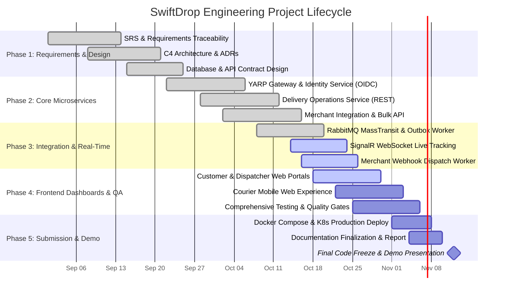

# Project Milestones & Delivery Schedule

> **Status:** Active  
> **Version:** 1.0  
> **Last Updated:** October 2026  
> **Course:** Enterprise Application Development (EAD)  

---

## 1. Timeline & Milestone Gantt Chart

The SwiftDrop engineering schedule spans 10 weeks across 5 distinct execution phases, concluding with code freeze, deployment sign-off, and oral presentation.

---

## 2. Milestone Deliverables & Acceptance Criteria

| Milestone ID | Target Date | Title / Scope | Key Deliverables | Verification Gate | Status |
|---|---|---|---|---|:---:|
| **M1: Inception** | Week 2 (Sep 14) | System Requirements & Boundaries | Functional & Non-Functional SRS, C4 System Context, Traceability Matrix | Architectural sign-off | ✅ Completed |
| **M2: Architecture** | Week 4 (Sep 28) | High-Level & Detailed Design | Component architecture, Database-per-service schemas, 5 core ADRs, Protobuf contracts | Faculty review & approval | ✅ Completed |
| **M3: Alpha Core** | Week 6 (Oct 12) | Core Backend Services | Identity OIDC exchange, Parcel booking CRUD, Merchant API key validation, Docker Compose infra | Unit test coverage ≥ 80% | ✅ Completed |
| **M4: Beta Integration** | Week 8 (Oct 26) | Asynchronous Integration & Real-Time | MassTransit RabbitMQ outbox, SignalR WebSocket telemetry, Merchant Webhook retry worker | Integration test pass rate 100% | 🟡 In Progress |
| **M5: Release Candidate** | Week 9 (Nov 06) | Frontend SPAs & E2E Verification | Vite/React Web Portal, Dispatcher Dashboard, Playwright E2E test suite | Full E2E journey green | ⚪ Scheduled |
| **M6: Final Submission** | Week 10 (Nov 12) | Final Assessment & Live Demo | Deployed cluster, Final Academic Report, Git repo tag, 15-minute viva demo | Faculty panel evaluation | ⚪ Scheduled |

---

## 3. Critical Path & Dependency Management

1. **Identity & JWT Discovery Gate:** Delivery Operations and Merchant services depend on Identity Service JWKS issuance. Mock JWT keys were utilized during Phase 2 to unblock parallel development.
2. **RabbitMQ MassTransit Contract Freeze:** Event schemas in `SwiftDrop.Contracts` required freezing before asynchronous consumer development began.
3. **Database Schema Isolation:** Schema alterations in one microservice DB must not break shared domain assumptions.
