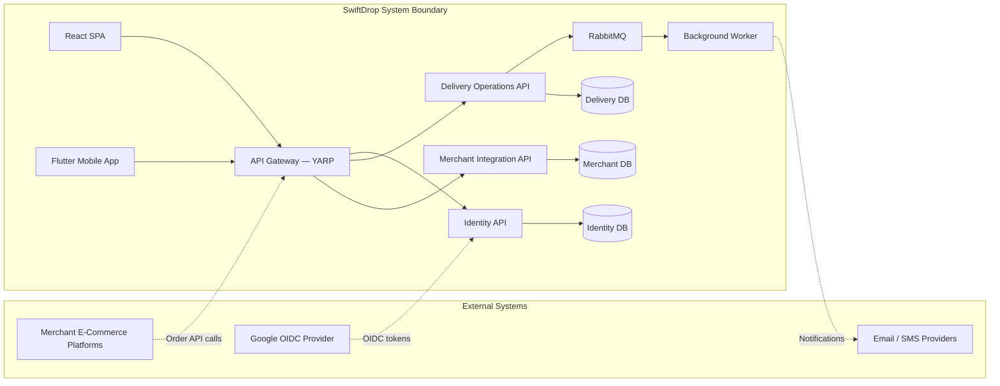

# Scope and Assumptions

> **Status:** Draft  
> **Last Updated:** October 2026

---

## 1. System Boundary

The following diagram illustrates the SwiftDrop system boundary, showing which actors and systems are inside scope and which are external dependencies.

---

## 2. In Scope

The following capabilities are within the scope of the SwiftDrop project:

### 2.1 Core Business Functions

| Area                    | Capabilities                                                                                    |
| ----------------------- | ----------------------------------------------------------------------------------------------- |
| Customer management     | Registration, Google login, profile management                                                  |
| Parcel booking          | Create bookings, fee estimation, parcel size/weight input, pickup and drop-off details           |
| Delivery operations     | Courier assignment, status tracking, proof of delivery, failed delivery handling                 |
| Merchant integration    | Merchant onboarding, approval workflow, API key management, order ingestion, webhook delivery    |
| Dispatch management     | Courier assignment, workload monitoring, zone-based coordination                                |
| Administration          | User management, merchant approvals, pricing configuration, delivery zone management, reporting |
| Shipment tracking       | Real-time parcel status via SSE/WebSocket, delivery history, receipt generation                  |
| Notifications           | Webhook notifications to merchants, in-app status updates                                       |

### 2.2 Technical Functions

| Area                           | Capabilities                                                                          |
| ------------------------------ | ------------------------------------------------------------------------------------- |
| API gateway                    | Reverse proxy routing, TLS termination, request forwarding via YARP                   |
| Authentication                 | Google OIDC login, application JWT issuance, JWKS endpoint, refresh token rotation    |
| Authorization                  | Role-based access control (Customer, Courier, Merchant, Dispatcher, Admin)            |
| Synchronous integration        | REST APIs (external), GraphQL (frontend aggregation), gRPC (internal service calls)   |
| Asynchronous integration       | RabbitMQ pub/sub, transactional outbox, background worker processing                  |
| Real-time communication        | Server-Sent Events or WebSocket for live tracking                                     |
| Data persistence               | PostgreSQL with database-per-service isolation                                        |
| Containerization               | Docker images and Docker Compose orchestration                                        |

### 2.3 Documentation

| Deliverable                     | Description                                                       |
| ------------------------------- | ----------------------------------------------------------------- |
| SRS                             | Functional and non-functional requirements                        |
| Architecture documentation      | Technical design, system context, service catalog, ADRs           |
| Design diagrams                 | ER, sequence, activity, use case, and architecture diagrams       |
| Integration documentation       | Communication patterns, event catalog, webhook specification      |
| API documentation               | REST, GraphQL, gRPC, and WebSocket specifications                 |
| Security documentation          | Authentication, authorization, and data protection design         |
| Testing documentation           | Strategy, test cases, results, and coverage                       |
| Deployment documentation        | Local setup, Docker Compose, CI/CD                                |

---

## 3. Out of Scope

The following items are explicitly excluded from the current project scope:

| Item                                        | Rationale                                                        |
| ------------------------------------------- | ---------------------------------------------------------------- |
| Payment processing and billing              | No payment gateway integration required for the assignment       |
| Turn-by-turn vehicle navigation & hardware telematics | Real-time coordinate updates and status feeds are supported; native GPS turn-by-turn navigation is excluded |
| Multi-tenancy with tenant isolation          | Single-tenant deployment for the academic scope                  |
| Internationalization (i18n) and localization | English-only interface                                           |
| Production-grade infrastructure              | Academic demonstration environment only                          |
| Load testing and performance benchmarking    | Functional correctness is prioritized over performance tuning    |
| Native desktop application                  | Web and mobile clients only                                      |
| Third-party logistics (3PL) integration     | Only direct merchant integration is supported                    |
| Automated route optimization                | Manual courier assignment by dispatchers                         |

---

## 4. Assumptions

| ID    | Assumption                                                                                                     |
| ----- | -------------------------------------------------------------------------------------------------------------- |
| A-01  | All team members have access to the SwiftDrop GitHub organization and required development tools.               |
| A-02  | Google Cloud project credentials for OIDC integration are available in a shared development environment.        |
| A-03  | PostgreSQL, RabbitMQ, and all infrastructure dependencies are run locally via Docker Compose.                   |
| A-04  | The system operates in a single geographic region with no multi-region deployment requirements.                 |
| A-05  | Merchant systems can consume webhooks over HTTPS and validate HMAC signatures.                                  |
| A-06  | Parcel delivery zones and pricing tiers are pre-configured by administrators, not dynamically calculated.       |
| A-07  | The mobile application (Flutter) shares the same backend APIs as the React web application.                     |
| A-08  | All inter-service communication occurs within a trusted internal network (Docker bridge or Kubernetes cluster). |
| A-09  | Email and SMS notification delivery is mocked or stubbed for the academic demonstration.                        |
| A-10  | The system handles moderate concurrent load suitable for demonstration, not production-scale traffic.           |

---

## 5. Dependencies

| Dependency                  | Type       | Description                                                  |
| --------------------------- | ---------- | ------------------------------------------------------------ |
| Google Cloud OIDC           | External   | Identity provider for user authentication                    |
| Docker and Docker Compose   | Tooling    | Local development and deployment orchestration               |
| PostgreSQL 16+              | Runtime    | Primary data store for all services                          |
| RabbitMQ 3.13+              | Runtime    | Message broker for asynchronous communication                |
| .NET 8 SDK                  | Tooling    | Backend service development and build                        |
| Node.js 20+ LTS             | Tooling    | React frontend development and build                         |
| Flutter SDK 3.x             | Tooling    | Mobile application development and build                     |
| GitHub Actions              | CI/CD      | Automated build, test, and deployment pipelines              |

---

## 6. Constraints

| Constraint                              | Impact                                                                       |
| --------------------------------------- | ---------------------------------------------------------------------------- |
| Academic deadline (November 15, 2026)   | Limits scope to features demonstrable within the timeline                    |
| 10-member team with varying expertise   | Requires clear module ownership and coordination                             |
| Required technology stack               | ASP.NET Core, PostgreSQL, and RabbitMQ are mandated                          |
| No production hosting budget            | All demonstrations run on local or free-tier infrastructure                  |
| Single documentation repository         | All project-level docs must reside in `swiftdrop-docs`                       |

---

## References

- [Assignment Overview](assignment-overview.md)
- [Software Requirements Specification](srs.md)
- [Technical Design](../architecture/technical-design.md)
- [Architecture Diagram](../design/diagrams/architecture/architecture.md)
