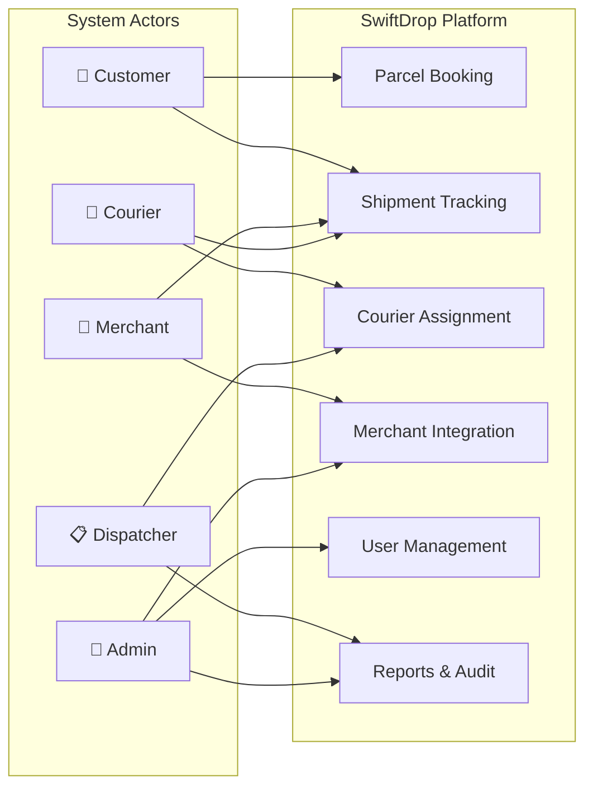
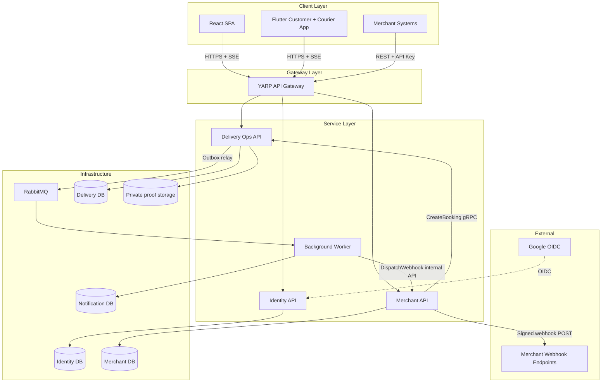

# Software Requirements Specification

> **Status:** Draft
> **Version:** 2.0 (Proposed baseline)
> **Last Updated:** 16 October 2026

---

## 1. Introduction

### 1.1 Purpose

This Software Requirements Specification (SRS) defines the functional and non-functional requirements for the **SwiftDrop Parcel Delivery and Courier Management System**. It serves as the authoritative reference for feature scope, system behavior, and acceptance criteria throughout the development lifecycle.

### 1.2 Scope

SwiftDrop is an enterprise platform that connects customers, merchants, couriers, dispatchers, and administrators to manage end-to-end parcel delivery operations. The system supports parcel booking, real-time tracking, merchant integration via APIs and webhooks, courier assignment, and administrative oversight.

### 1.3 Intended Audience

| Audience           | Usage                                                     |
| ------------------ | --------------------------------------------------------- |
| Development team   | Implementation guidance and feature specifications        |
| Testers            | Test case design and acceptance criteria                  |
| Project assessors  | Evaluation of requirement completeness and traceability   |
| Architecture leads | Service boundary and integration decisions                |

### 1.4 Definitions and Abbreviations

| Term       | Definition                                                                  |
| ---------- | --------------------------------------------------------------------------- |
| Parcel     | A package registered in the system for delivery                             |
| Booking    | A delivery request created by a customer or merchant                        |
| Courier    | A delivery person assigned to transport parcels                             |
| Dispatcher | An operations user who assigns couriers and monitors delivery workload      |
| Merchant   | An external business partner who submits orders through the merchant API    |
| SSE        | Server-Sent Events — one-way real-time push from server to client           |
| OIDC       | OpenID Connect — identity layer on top of OAuth 2.0                         |
| JWKS       | JSON Web Key Set — public key endpoint for JWT verification                 |
| ADR        | Architecture Decision Record                                                |

---

## 2. System Actors

The following diagram shows the primary actors and their high-level interactions with the SwiftDrop system.

---

## 3. Functional Requirements

### 3.1 Customer Requirements

| ID      | Requirement                  | Description                                                                                                    | Priority  |
| ------- | ---------------------------- | -------------------------------------------------------------------------------------------------------------- | --------- |
| FR-C01  | Customer registration        | A new user can register with email and password. The system creates an account with the `Customer` role.        | Must      |
| FR-C02  | Google OIDC login            | A user can authenticate using their Google account via OpenID Connect. First-time login creates a Customer only when no provider subject or local-email collision exists; linking requires reauthentication. | Must      |
| FR-C03  | Profile management           | An authenticated customer can view and update their profile details (name, phone, address).                     | Must      |
| FR-C04  | Create parcel booking        | A customer can create a delivery booking by providing parcel details, pickup address, and drop-off address.     | Must      |
| FR-C05  | Fee estimation               | Before confirming a booking, the customer can preview the estimated delivery fee based on zone and parcel size. | Must      |
| FR-C06  | Real-time parcel tracking    | A customer can track the current status of their parcel with live updates delivered via SSE.                    | Must      |
| FR-C07  | Delivery history             | A customer can view a paginated list of their past and current bookings with status information.                | Must      |
| FR-C08  | Download receipt             | A customer can download a PDF or digital receipt for a completed delivery.                                     | Must    |

### 3.2 Merchant Requirements

| ID      | Requirement                  | Description                                                                                                       | Priority  |
| ------- | ---------------------------- | ----------------------------------------------------------------------------------------------------------------- | --------- |
| FR-M01  | Merchant registration        | A business representative can register as a merchant, providing business name, contact, and integration details.  | Must      |
| FR-M02  | Admin approval workflow      | A registered merchant account remains `Pending` until an admin reviews and approves or rejects the application.   | Must      |
| FR-M03  | API key management           | An approved merchant can generate and revoke scoped API keys and view metadata; raw keys appear only once at creation. | Must |
| FR-M04  | Submit order via API         | A merchant can submit delivery orders programmatically through a REST API authenticated with API keys.            | Must      |
| FR-M05  | Webhook subscription         | A merchant can register webhook URLs to receive delivery status change notifications (picked up, delivered, failed). | Must      |
| FR-M06  | Merchant dashboard           | A merchant can view order statistics, delivery success rates, and pending deliveries through a dashboard.          | Must    |
| FR-M07  | Order status tracking        | A merchant can query the current status of any order they submitted.                                               | Must      |

### 3.3 Courier Requirements

| ID      | Requirement                  | Description                                                                                                       | Priority  |
| ------- | ---------------------------- | ----------------------------------------------------------------------------------------------------------------- | --------- |
| FR-R01  | View assigned deliveries     | A courier can view assigned deliveries for a selected service day (default today), including active overdue work, with pickup and drop-off details.                      | Must      |
| FR-R02  | Update parcel status         | A courier can update each stage of an assigned parcel with a private delivery note; final delivery uses the authorized proof-completion operation.                   | Must      |
| FR-R03  | Upload proof of delivery     | A courier can upload a photo or signature as proof of successful delivery.                                        | Must      |
| FR-R04  | Report failed delivery       | A courier can report a delivery failure with a reason code and optional notes.                                    | Must      |
| FR-R05  | View delivery history        | A courier can view their completed and failed delivery records.                                                   | Should    |

### 3.4 Dispatcher Requirements

| ID      | Requirement                  | Description                                                                                                       | Priority  |
| ------- | ---------------------------- | ----------------------------------------------------------------------------------------------------------------- | --------- |
| FR-D01  | View unassigned parcels      | A dispatcher can view all parcels awaiting courier assignment, filtered by zone or priority.                       | Must      |
| FR-D02  | Assign courier to parcel     | A dispatcher can assign an available courier to an unassigned parcel for delivery.                                | Must      |
| FR-D03  | Monitor courier workload     | A dispatcher can view active courier assignments and their current delivery counts.                               | Must      |
| FR-D04  | Reassign delivery            | A dispatcher can reassign a parcel to a different courier if the original assignment cannot be fulfilled.          | Should    |
| FR-D05  | View delivery zone summary   | A dispatcher can view delivery volume and status aggregations per delivery zone.                                  | Should    |

### 3.5 Admin Requirements

| ID      | Requirement                  | Description                                                                                                       | Priority  |
| ------- | ---------------------------- | ----------------------------------------------------------------------------------------------------------------- | --------- |
| FR-A01  | User management              | An admin can create, view, update, deactivate, and delete user accounts.                                          | Must      |
| FR-A02  | Role assignment              | An admin can assign or revoke roles (Customer, Courier, Merchant, Dispatcher, Admin) for any user.                | Must      |
| FR-A03  | Merchant approval/rejection  | An admin can review pending merchant registrations and approve or reject them with a reason.                      | Must      |
| FR-A04  | Configure delivery zones     | An admin can create and manage delivery zones that determine courier assignment regions.                          | Must      |
| FR-A05  | Configure pricing tiers      | An admin can define and update versioned pricing by parcel size, weight and zone (zones represent distance bands). | Must |
| FR-A06  | View system reports          | An admin can view deliveries per day and success/failure counts and rates for a date range. Revenue reporting is outside the mandatory baseline.                            | Must    |
| FR-A07  | View audit logs              | An admin can view audit logs recording user actions, authentication events, and configuration changes.            | Should    |

---

## 4. Non-Functional Requirements

### 4.1 Performance

| ID      | Requirement                                                                                           |
| ------- | ----------------------------------------------------------------------------------------------------- |
| NFR-01  | API responses must return within 500 ms at the 95th percentile under normal load.                     |
| NFR-02  | Real-time tracking updates must be delivered to subscribed clients within 2 seconds of a status change.|
| NFR-03  | The system must support at least 50 concurrent users for demonstration purposes.                      |

### 4.2 Security

| ID      | Requirement                                                                                           |
| ------- | ----------------------------------------------------------------------------------------------------- |
| NFR-04  | All external API communication must use HTTPS (TLS 1.2+).                                             |
| NFR-05  | User authentication must use Google OIDC with application-issued JWTs (expiry ≤ 15 minutes).          |
| NFR-06  | Merchant API keys must be stored as hashed values; raw keys are shown only at creation time.          |
| NFR-07  | Webhook payloads must be signed with HMAC-SHA256 using per-merchant secrets.                          |
| NFR-08  | Role-based access control must be enforced on every API endpoint.                                     |
| NFR-09  | Merchant secrets and sensitive configuration must be encrypted at rest.                                |

### 4.3 Reliability

| ID      | Requirement                                                                                           |
| ------- | ----------------------------------------------------------------------------------------------------- |
| NFR-10  | Booking operations must be idempotent using client-generated idempotency keys.                         |
| NFR-11  | Events must be published reliably using a transactional outbox pattern, preventing message loss.       |
| NFR-12  | Webhook delivery must retry failed attempts with exponential backoff (one initial attempt plus five retries, per the webhook policy).               |
| NFR-13  | Failed webhook attempts must be logged and available for manual inspection and replay.                 |

### 4.4 Scalability and Maintainability

| ID      | Requirement                                                                                           |
| ------- | ----------------------------------------------------------------------------------------------------- |
| NFR-14  | Each backend service must own its own PostgreSQL database with no shared schemas.                      |
| NFR-15  | Services must communicate asynchronously for non-blocking operations via RabbitMQ.                    |
| NFR-16  | Services must be independently deployable as Docker containers.                                       |
| NFR-17  | The codebase must maintain ≥ 80% unit test coverage for business logic.                               |

### 4.5 Usability

| ID      | Requirement                                                                                           |
| ------- | ----------------------------------------------------------------------------------------------------- |
| NFR-18  | The web application must be responsive across mobile (320px+), tablet and desktop viewports, including the public tracking page.                            |
| NFR-19  | Error responses must return meaningful messages with appropriate HTTP status codes.                    |
| NFR-20  | The mobile application must support Android devices (API level 26+).                                  |

---

## 5. System Interfaces

### 5.1 External Interfaces

| Interface                    | Protocol    | Direction  | Description                                                  |
| ---------------------------- | ----------- | ---------- | ------------------------------------------------------------ |
| Google OIDC Provider         | HTTPS/OIDC  | Client SDK + validation | Client obtains ID token; Identity validates provider signature/claims |
| Merchant Order API           | REST/HTTPS  | Inbound    | Merchant systems submit delivery orders                      |
| Merchant Webhook Endpoint    | HTTPS       | Outbound   | Delivery status notifications pushed to merchant URLs        |

### 5.2 Internal Interfaces

| Interface                           | Protocol     | Description                                                     |
| ----------------------------------- | ------------ | --------------------------------------------------------------- |
| React SPA ↔ API Gateway             | HTTPS + SSE  | Frontend requests and real-time tracking updates                |
| Flutter Customer + Courier App ↔ API Gateway           | HTTPS + SSE  | Mobile requests and real-time tracking updates                  |
| API Gateway ↔ Capability APIs       | HTTP (internal) | YARP reverse proxy routing to backend services               |
| Delivery Operations ↔ Merchant API  | gRPC / REST  | Internal service-to-service calls with service JWT              |
| Services ↔ RabbitMQ                 | AMQP         | Asynchronous event publishing and consumption                  |
| Services ↔ PostgreSQL               | TCP          | Database connections per service                                |

### 5.3 Interface Flow

---

## 6. Data Requirements

### 6.1 Data Domains

| Domain              | Owning Service              | Key Entities                                                        |
| ------------------- | --------------------------- | ------------------------------------------------------------------- |
| Identity            | Identity API                | Users, Roles, External Identities, Refresh Sessions, Audit Logs     |
| Delivery            | Delivery Operations API     | Parcels, Assignments, Price Snapshots, History, Outbox, Proof Data  |
| Merchant | Merchant Integration API | Businesses, API Keys, Webhooks, Encrypted Secrets, Inbox Jobs, Webhook Attempts |
| Notifications | Notification/Webhook Worker | Consumer Inbox, Notification Jobs, Provider Attempts, Webhook Dispatch Jobs |

### 6.2 Data Retention

| Data Type                  | Retention Policy                                     |
| -------------------------- | ---------------------------------------------------- |
| Active user accounts       | Retained while account is active                     |
| Completed delivery records | Retained for the academic demonstration period       |
| Audit logs                 | Retained for the academic demonstration period       |
| Webhook delivery attempts  | Retained for 30 days (configurable)                  |
| Refresh tokens             | Expired tokens are purged on a scheduled basis       |

---

## 7. Acceptance Criteria Summary

The system is considered complete when:

1. All **Must** priority functional requirements are implemented and pass acceptance tests.
2. All non-functional security requirements (NFR-04 through NFR-09) are verified.
3. The transactional outbox pattern reliably publishes events without data loss.
4. Webhook delivery with retry and failure logging operates correctly.
5. Real-time tracking updates are delivered to subscribed clients.
6. The system can be started with a single `docker compose up` command.
7. Test coverage meets the defined thresholds (≥ 80% business-logic unit line coverage; integration scenarios must pass with evidence, with no undefined integration percentage).
8. All five actor workflows are demonstrable end-to-end.

---

## References

- [Assignment Overview](assignment-overview.md)
- [Scope and Assumptions](scope-and-assumptions.md)
- [Requirements Traceability](requirements-traceability.md)
- [Architecture Diagram](../design/diagrams/architecture/architecture.md)
- [Technical Design](../architecture/technical-design.md)

## Baseline 2.0 clarifications

Status is Draft; no approval or implementation evidence is asserted. The [supplied assignment/page comparison](assignment-compliance.md) is verified; design approval is still pending. These requirements include team-selected quality targets beyond the assignment; see [official versus team scope](assignment-overview.md). Numeric coverage/latency/concurrency/Android targets, Flutter scope, strict final photo/signature proof and extra Assigned/Cancelled states are team choices. Responsive web, full-system Docker/Compose, an event-consuming email or mock SMS service, and the short [patterns note](../architecture/design-patterns.md) are official requirements.

- FR-R01/R02: daily Courier assignments use the configured business timezone (proposed Asia/Colombo), with overdue active deliveries visible. PickedUp/InTransit/OutForDelivery updates require a nonblank private delivery note; Failed requires its reason and Delivered uses final proof. The PDF allows a note or proof; requiring photo/signature for final completion is the stronger team policy.
- FR-C04/C05: a quote is not a parcel. Customer confirms an unexpired quote before `Created`; persist its immutable price snapshot. See [parcel state machine](../architecture/parcel-state-machine.md).
- FR-C06/NFR-18: anonymous mobile-friendly tracking exposes only `PublicTrackingSummary`; authenticated owner tracking uses REST and SSE. Public tracking excludes contacts, street addresses, courier identity, precise coordinates and proof files.
- FR-C08 **Must**: owner downloads a receipt for a Delivered parcel; server authorizes every PDF download.
- FR-M06 **Must**: merchant dashboard lists only its own jobs, parcels, status counts, pending orders and success/failure rates.
- FR-A06 **Must**: Admin reports deliveries/day and success/failure counts and rates for an explicit date range, including zero-denominator behavior.
- Flutter Customer supports signup/login, quote/confirm, tracking, history and receipt. Flutter Courier supports authentication, assigned manifest, guarded status/failure and proof upload. React covers all five roles and public tracking.
- NFR-08: domain services enforce role **and** resource ownership; a matching recipient phone is never proof of ownership. JWT role changes take effect within the documented 15-minute access-token bound; merchant-key revocation is immediate at Merchant API.
- NFR-12: webhook retry means six maximum automatic HTTP attempts. Broker retry is a separate policy.
- NFR-17: the unit coverage denominator and separate branch reporting are defined in [coverage summary](../testing/coverage-summary.md); targets are not results.
- SSE is the required status transport. GPS/SignalR, Kubernetes and AI are deferred optional scope. Four private logical databases use user-selected Neon PostgreSQL; no Redis dependency is proposed.

See [use-case narratives](use-case-specifications.md), [REST contracts](../api/rest-api.md), [traceability](requirements-traceability.md) and [test catalog](../testing/test-cases.md) for measurable acceptance criteria and failure paths.
