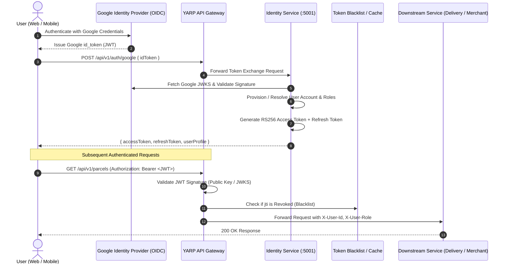

# Authentication Architecture Specification

> **Status:** Draft  
> **Version:** 1.0  
> **Last Updated:** October 2026  

---

## 1. Overview

SwiftDrop implements a federated, token-based authentication architecture designed to support both human interactive users (web SPAs, mobile applications) and automated machine-to-machine (M2M) merchant enterprise integrations. 

1. **Human Users (Customers, Couriers, Dispatchers, Admins, Merchants):** Authenticate via **Google OpenID Connect (OIDC)**. The Identity Service validates the Google ID token and issues SwiftDrop-scoped, cryptographically signed JSON Web Tokens (JWT).
2. **Merchant Enterprise Systems:** Authenticate via high-entropy **API Keys** (`sk_live_...` / `sk_test_...`) transmitted via HTTP headers, validated against salted SHA-256 hashes stored in the Merchant database.



---

## 2. Authentication Methods & User Onboarding

### 2.1. Hybrid Authentication Model
SwiftDrop supports a hybrid authentication architecture:
1. **Google OpenID Connect (OIDC):** Recommended passwordless flow for end-users and administrators. Users authenticate with Google credentials; the Identity Service validates the Google ID token and provisions/authenticates the account without storing local passwords.
2. **Local Email & Password Registration (SRS FR-C01):** Direct user onboarding where credentials are validated, salted, and hashed using **Argon2id** (stored in `Users.password_hash` in Identity DB).

### 2.2. Google OIDC Token Exchange Handshake
1. The client invokes Google Sign-In SDK with scopes `openid`, `email`, and `profile`.
2. The resulting `id_token` is sent to `POST /api/v1/auth/google`.
3. Identity Service verifies:
   - Signature against `https://www.googleapis.com/oauth2/v3/certs`.
   - Audience (`aud`) matches configured Google Client ID.
   - Issuer (`iss`) equals `accounts.google.com` or `https://accounts.google.com`.
   - Expiration time (`exp`) has not passed.
4. If valid, the user record is queried by `GoogleSubjectId` / `Email`. If absent, an account is auto-created with default role `Customer`.

---

## 3. JSON Web Token (JWT) Specification

SwiftDrop access tokens are signed using **RS256 (RSA Signature with SHA-256)** using a 2048-bit asymmetric key pair managed by the Identity Service. Downstream services and the YARP Gateway verify tokens using the cached public key without querying the Identity database on every request.

### 3.1. Token Header
```json
{
  "alg": "RS256",
  "typ": "JWT",
  "kid": "swiftdrop-auth-key-2026-v1"
}
```

### 3.2. Token Payload Claims
```json
{
  "iss": "https://identity.swiftdrop.io",
  "sub": "u_8849b3d0-6218-47f2-9c1a-9f5b61a9bc34",
  "aud": "https://api.swiftdrop.io",
  "exp": 1729037700,
  "nbf": 1729036800,
  "iat": 1729036800,
  "jti": "jwt_b7e92a83f1c447d9a102938475610293",
  "email": "sarah.perera@gmail.com",
  "name": "Sarah Perera",
  "role": "Customer",
  "permissions": [
    "parcels:create",
    "parcels:read_own",
    "parcels:cancel_own"
  ],
  "merchantId": null
}
```

### 3.3. Token Lifetime & Refresh Strategy
- **Access Token TTL:** 15 minutes (`900s`) in strict compliance with SRS NFR-05.
- **Refresh Token TTL:** 30 days (`2592000s`).
- **Refresh Token Rotation (RTR):** Every time a refresh token is presented at `POST /api/v1/auth/refresh`, it is immediately invalidated and replaced with a newly minted refresh token. If a previously invalidated refresh token is reused, the entire token family is revoked (indicative of token theft).
- **Session Revocation:** Logout calls (`POST /api/v1/auth/logout`) mark the refresh token revoked in PostgreSQL and publish the `jti` to Redis with an expiration matching the token's remaining lifetime.

---

## 4. Machine-to-Machine (M2M) Merchant API Key Authentication

Enterprise merchants integrating their ERPs, Shopify stores, or custom backends authenticate using opaque API Keys.

### 4.1. Key Anatomy
```
[REDACTED_STRIPE_KEY]
^^^^^^^ ^^^^^^^^^^^^^^^^^^^^^^^^^^^^^^^^^^^^^^^^
 Prefix  160-bit High-Entropy Cryptographic Random Secret
```

### 4.2. Storage & Validation Invariant
- **Never Stored in Plaintext:** The raw API key is displayed to the merchant **only once** upon generation.
- **Hashing:** Stored as `SHA256(raw_key + salt)` with a unique 32-byte per-merchant salt.
- **Validation:** When `X-API-Key` is passed in the request header, YARP/Merchant Service hashes the input with the tenant salt and performs constant-time string comparison (`CryptographicOperations.FixedTimeEquals`) to eliminate timing attack vectors.

---

## 5. JSON Web Key Set (JWKS) Discovery

The Identity Service exposes standard RFC 7517 discovery endpoints for gateway and internal service signature verification:

- **OpenID Configuration:** `GET /.well-known/openid-configuration`
- **JWKS Endpoint:** `GET /.well-known/jwks.json`

```json
{
  "keys": [
    {
      "kty": "RSA",
      "use": "sig",
      "alg": "RS256",
      "kid": "swiftdrop-auth-key-2026-v1",
      "n": "u1W5v6yX...[Base64Url Modulus]...",
      "e": "AQAB"
    }
  ]
}
```
Downstream services cache the JWKS for 24 hours, automatically refreshing upon receiving a token with an unrecognized `kid`.
