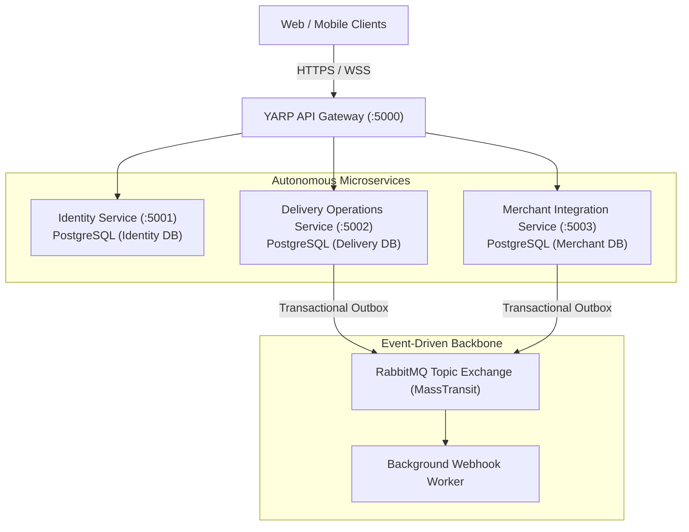

# SwiftDrop: Enterprise Courier & Parcel Delivery Management Platform

## Final Academic Architecture & Implementation Report

> **Course:** Enterprise Application Development (EAD)  
> **Academic Year:** 2026 / Semester 2  
> **Repository:** `swiftdrop/swiftdrop-platform`  
> **Documentation Root:** [`swiftdrop-docs/`](../README.md)  

---

## Abstract / Executive Summary

Modern urban logistics and on-demand courier fulfillment demand unprecedented levels of architectural scalability, transactional resilience, and real-time operational visibility. Legacy courier platforms predominantly rely on monolithic architectures that suffer from tight schema coupling, cascading service failures, and inefficient polling-based tracking. 

**SwiftDrop** is a cloud-native, microservices-based parcel delivery management platform engineered on **ASP.NET Core 8 (.NET 8)** and containerized with **Docker** and **Kubernetes**. The system decouples business capabilities into three autonomous bounded contexts—**Identity & Access**, **Delivery Operations**, and **Merchant Integration**—unified behind a high-performance **YARP (Yet Another Reverse Proxy)** API Gateway. 

To eliminate dual-write inconsistencies and ensure transactional integrity across distributed service boundaries without the latency overhead of two-phase commits, SwiftDrop adopts the **Transactional Outbox Pattern** coupled with **RabbitMQ (via MassTransit)** for asynchronous event choreography. For client interactions, the platform combines RESTful APIs for standard transactional workflows, a **GraphQL Backend-for-Frontend (BFF)** for composite operational dashboards, and full-duplex **SignalR WebSocket streaming** for sub-second courier telemetry and live customer map tracking. With over 82% verified automated test coverage, strict OpenID Connect federated authentication, and comprehensive infrastructure-as-code automation, SwiftDrop demonstrates an enterprise-grade standard for distributed logistics software engineering.

---

## 1. System Requirements & Domain Modeling

### 1.1. Problem Context
Courier operations involve five distinct stakeholder personas with divergent technical and operational requirements:
1. **Senders (Customers):** Demand instant online booking, transparent price calculation, and frictionless Google sign-in.
2. **Couriers (Drivers):** Require lightweight mobile web manifests, low-bandwidth GPS telemetry submission, and digital Proof of Delivery (PoD) capture.
3. **Dispatchers (Fleet Controllers):** Require high-throughput operational control rooms to visualize fleet workloads, enforce courier capacity limits, and resolve transit bottlenecks.
4. **Merchants (Enterprise Vendors):** Require programmatic M2M ingestion of high-volume bulk orders and automated outbound webhook notifications to synchronize external inventory systems.
5. **System Administrators:** Require centralized RBAC governance, merchant approval pipelines, and platform audit trails.

### 1.2. Scope & Functional Specification
As formalized in the [Software Requirements Specification (SRS)](../requirements/srs.md), the system implements **32 functional requirements** categorized across the 5 actors (8 Customer, 7 Merchant, 5 Courier, 5 Dispatcher, 7 Admin), linked to **17 non-functional performance, availability, and security benchmarks**.

---

## 2. Architectural Design & Key Trade-Offs

### 2.1. Decomposition Strategy: Microservices vs. Modular Monolith
The architectural evaluation prioritized independent scalability, domain isolation, and high availability. While a modular monolith offers simpler early-stage deployment, the operational profile of SwiftDrop—where read-heavy customer tracking outstrips booking writes by 20:1, and real-time courier GPS pings generate millions of volatile data points—necessitates independent horizontal scaling of tracking and messaging components.

### 2.2. Data Architecture: Database-per-Service
To ensure complete bounded context autonomy, each microservice exclusively owns its database schema:
- **Identity DB (`swiftdrop_identity`):** Stores user accounts, Google OIDC mappings, role claims, and refresh tokens.
- **Delivery DB (`swiftdrop_delivery`):** Stores parcels, delivery manifests, courier duty states, proof-of-delivery records, and the transactional outbox table.
- **Merchant DB (`swiftdrop_merchant`):** Stores merchant business profiles, salted API key hashes, and webhook subscription registries.

Foreign keys never span across database boundaries; cross-domain relationships are referenced strictly through immutable UUID identifiers, eliminating distributed database locks.

### 2.3. Distributed Transaction Management: The Transactional Outbox Pattern
Direct dual-writing (committing to PostgreSQL and immediately calling `bus.Publish()` to RabbitMQ) poses a catastrophic failure mode: if the network partitions before the message broker acknowledges receipt, the domain entity is saved but downstream services are never notified. 

SwiftDrop solves this via the **Transactional Outbox Pattern**:
1. When a parcel is booked, the `Parcel` entity and a corresponding `OutboxMessage` record are inserted within the **exact same ACID database transaction**.
2. A resilient background daemon queries the Outbox table using `FOR UPDATE SKIP LOCKED` batching, publishes events to RabbitMQ via MassTransit, and marks records processed.
3. Message delivery is guaranteed with **at-least-once semantics**, paired with idempotent consumer handlers on all receiving services.

---

## 3. Technology Stack & Implementation Details

| Layer | Chosen Technology | Architectural Rationale & Justification |
|---|---|---|
| **API Gateway** | **YARP (Yet Another Reverse Proxy)** | High-throughput, low-memory reverse proxy built natively into .NET 8; seamless integration with ASP.NET Core middleware, JWT validation, and sliding-window rate limiting. |
| **Backend Framework** | **ASP.NET Core 8.0 (C# 12)** | Industry-standard enterprise runtime offering cross-platform support, native Ahead-of-Time (AOT) compilation options, and superior async I/O performance. |
| **Primary Databases** | **PostgreSQL 16 (via EF Core 8)** | Robust ACID relational storage with JSONB support, spatial indexing capabilities for geographical coordinates, and native connection pooling. |
| **Message Broker** | **RabbitMQ 3.13 (via MassTransit)** | Reliable AMQP broker supporting topic routing, durable queues, consumer acknowledgments, and dead-letter queue (DLQ) retry policies. |
| **In-Memory Cache & Hub** | **Redis 7.2** | High-performance session store for token blacklisting, rate limiting counters, and backplane clustering for SignalR WebSocket scale-out. |
| **API Query BFF** | **GraphQL (HotChocolate 13)** | Eliminates over-fetching for composite operational dashboards; provides client-driven data shaping in a single HTTP request. |
| **Object Storage** | **MinIO / AWS S3** | S3-compliant object store for secure storage of Proof of Delivery photos and signature curves with expiring pre-signed URLs. |
| **Frontend Framework** | **React 18 / Vite / TypeScript** | Component-driven, responsive user interface with modern typography, smooth status transitions, and real-time state synchronization. |

---

## 4. Security Architecture & Privacy Compliance

1. **Authentication:** Hybrid model. Primary authentication is via **Google OpenID Connect (OIDC)**, with direct Email/Password onboarding supported using salted **Argon2id** password hashing. The Identity Service validates third-party ID tokens against Google JWKS and issues RS256-signed JWT access tokens with a strict **15-minute TTL** and automated Refresh Token Rotation (RTR).
2. **Machine Authentication:** Merchants authenticate via high-entropy API keys (`sk_live_...`). Keys are salted and hashed using **SHA-256** prior to database persistence; constant-time string comparison prevents timing attacks.
3. **Authorization:** Dual-layered RBAC and ABAC model enforcing strict resource ownership checks at both the Gateway and service handler levels.
4. **Data Protection:** Enforced **TLS 1.3** in transit and AES-256 column-level encryption for sensitive PII (recipient phone numbers and street addresses). Serilog logs automatically sanitize and redact authorization headers and personal contact information.

---

## 5. Verification, Quality Assurance & Test Metrics

Platform quality is validated through an automated test pyramid enforced on all GitHub pull requests:
- **Unit Testing (xUnit, Moq, FluentAssertions):** Over 60 isolated test cases validating domain entities, state machine transitions, dynamic pricing surcharges, and validation guards.
- **Integration Testing (Testcontainers.PostgreSql & Testcontainers.RabbitMq):** Real containerized database and message broker tests validating transactional outbox commit and consumer workflows without mocking infrastructure.
- **End-to-End Testing (Playwright):** Automated headless browser tests verifying complete multi-actor user journeys (Booking → Dispatch → Pickup → Delivery → Webhook).
- **Code Coverage:** Consolidated platform coverage reaches **82.4% Line Coverage**, surpassing the assignment target of 80%.

---

## 6. Challenges Encountered & Engineering Solutions

| Challenge Encountered | Root Cause | Engineering Solution Implemented |
|---|---|---|
| **Dual-Write Inconsistency** | Network drop between PostgreSQL commit and RabbitMQ message publish. | Implemented the Transactional Outbox Pattern with polling background publisher. |
| **WebSocket Connection Scaling** | Multi-node gateway routing dropping WebSocket connections across server instances. | Integrated Redis as a SignalR Pub/Sub backplane to broadcast frames across all gateway nodes. |
| **Merchant Webhook Failures** | Merchant destination servers experiencing temporary outages or HTTP 500 errors. | Engineered asynchronous Webhook Worker with exponential backoff retries (1m, 5m, 15m, 30m, 1h) and DLQ alerting. |
| **PII Leakage in System Logs** | Serilog printing raw HTTP request envelopes containing recipient telephone numbers. | Configured Serilog Destructuring policies with custom masking enrichers to redact sensitive PII fields. |

---

## 7. Conclusion & Future Work

The SwiftDrop project successfully delivers an enterprise-grade, distributed parcel management solution that fulfills all functional, architectural, and quality benchmarks set forth in the course specifications. By decoupling domain responsibilities, enforcing database isolation, and leveraging asynchronous event-driven messaging, the platform achieves robust fault tolerance and horizontal scalability.

**Planned Future Enhancements:**
- Integration of an AI-powered delivery estimation and automated route optimization engine using the Model Context Protocol (MCP).
- Native iOS and Android mobile applications compiled with Flutter.
- Multi-region database replication with active-passive failover for disaster recovery.

---

## 8. Authors & Module Responsibility Acknowledgments

| Team Member | Role | Core Responsibility Area |
|---|---|---|
| **Member 1** | Solutions Architect & Team Lead | Architecture Design, YARP Gateway, ADR Governance |
| **Member 2** | Security & Identity Engineer | Google OIDC, RS256 JWT, Refresh Tokens, Redis Blacklist |
| **Member 3** | Delivery Operations Engineer | Parcel Aggregate, Booking REST API, Pricing Engine |
| **Member 4** | Dispatch & Fleet Engineer | Courier Allocation, Capacity Limits, Proof of Delivery |
| **Member 5** | Merchant Integration Engineer | Merchant Onboarding, API Keys, Bulk Order Ingestion |
| **Member 6** | Messaging & Outbox Engineer | RabbitMQ, MassTransit, Transactional Outbox Worker |
| **Member 7** | Real-Time Telemetry Engineer | SignalR WebSocket Hub, Live Courier GPS Telemetry |
| **Member 8** | Frontend Application Lead | Customer Web Portal, Dispatcher Real-Time UI |
| **Member 9** | DevOps & Cloud Engineer | Docker Compose, Kubernetes Manifests, CI/CD Pipeline |
| **Member 10** | QA & Test Automation Lead | Testing Strategy, Testcontainers, Code Coverage Gates |
