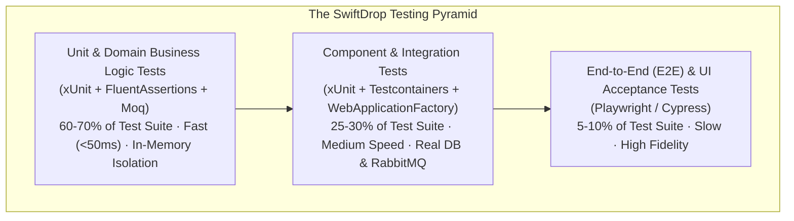

# Quality Assurance & Testing Strategy

> **Status:** Draft  
> **Version:** 1.0  
> **Last Updated:** October 2026  

---

## 1. Overview

The SwiftDrop testing strategy guarantees platform correctness, reliability, resilience, and performance across distributed microservices. To ensure rapid feedback and cost-effective defect prevention, testing follows the **Testing Pyramid model**, emphasizing automated unit tests at the base, real-dependency integration tests in the middle, and targeted End-to-End (E2E) flows at the apex.



---

## 2. Testing Levels & Tooling Matrix

| Level | Primary Target | Primary Tooling | Test Execution Speed | Target Code Coverage |
|---|---|---|---|---|
| **Unit Testing** | Domain entities, value objects, business rules, pricing calculators, validation logic | **xUnit**, **FluentAssertions**, **Moq**, **Bogus** (fake data) | < 50ms per test | **≥ 80%** line / branch |
| **Integration Testing** | Controller endpoints, EF Core queries, RabbitMQ consumers, Outbox processor | **xUnit**, **WebApplicationFactory**, **Testcontainers** (Docker Postgres & RabbitMQ) | 500ms – 2s per test | **≥ 60%** line coverage |
| **Contract Testing** | Protobuf gRPC contracts, Consumer-Driven Contracts (CDC) | **PactNet**, Protobuf schema linter (`buf`) | Fast | 100% of public RPC schemas |
| **End-to-End (E2E)** | Critical user journeys (Booking → Dispatch → Pickup → Delivery → Webhook) | **Playwright**, **Node.js / TypeScript** | 10s – 45s per journey | Key business happy/sad paths |
| **Performance Testing** | Rate limiting, bulk ingestion throughput, WebSocket scale under load | **k6**, **Grafana** | Scheduled / Nightly | Sustained 500 req/sec at p95 < 200ms |

---

## 3. Unit Testing Architecture

Unit tests validate pure business logic in complete isolation from external infrastructure (no real network or disk access).

### 3.1. Guidelines & Conventions
- **Naming Pattern:** `[MethodName]_[Scenario]_[ExpectedResult]` (e.g., `CalculateShippingFare_ExpressPackageAbove5Kg_AppliesWeightAndExpressSurcharges`).
- **AAA Pattern:** Strict adherence to `Arrange`, `Act`, `Assert`.
- **Domain Entity Testing:** Encapsulated domain methods (e.g., `parcel.AssignToCourier(...)`) must verify business invariants and domain event publication.

### 3.2. Example: Domain Unit Test (.NET 8)
```csharp
[Fact]
public void AssignCourier_WhenParcelIsCreated_TransitionsToAssignedAndRaisesEvent()
{
    // Arrange
    var parcel = Parcel.Create(
        senderId: "u_123", 
        pickup: SampleAddresses.Colombo, 
        destination: SampleAddresses.Kadawatha, 
        weightKg: 2.0);
    var courierId = "c_999";

    // Act
    parcel.AssignCourier(courierId);

    // Assert
    parcel.Status.Should().Be(ParcelStatus.Assigned);
    parcel.AssignedCourierId.Should().Be(courierId);
    parcel.DomainEvents.Should().ContainSingle(e => e is ParcelAssignedEvent);
}
```

---

## 4. Integration Testing with Testcontainers

Integration tests spin up lightweight, ephemeral Docker containers using **Testcontainers.PostgreSql** and **Testcontainers.RabbitMq**, ensuring tests run against the exact production database engine rather than inaccurate in-memory substitutes.

### 4.1. Lifecycle & Isolation
- Each test class collection shares a single container instance to minimize execution overhead.
- Before each test, the database schema is reset or encapsulated inside an uncommitted transaction rollback.

### 4.2. Example: Integration Test Fixture
```csharp
public class CustomWebApplicationFactory : WebApplicationFactory<Program>, IAsyncLifetime
{
    private readonly PostgreSqlContainer _dbContainer = new PostgreSqlBuilder()
        .WithImage("postgres:16-alpine")
        .WithDatabase("swiftdrop_test")
        .Build();

    public async Task InitializeAsync()
    {
        await _dbContainer.StartAsync();
    }

    protected override void ConfigureWebHost(IWebHostBuilder builder)
    {
        builder.ConfigureServices(services =>
        {
            // Reconfigure EF Core DbContext with dynamic Testcontainer connection string
            services.RemoveAll<DbContextOptions<DeliveryDbContext>>();
            services.AddDbContext<DeliveryDbContext>(options =>
                options.UseNpgsql(_dbContainer.GetConnectionString()));
        });
    }

    public new async Task DisposeAsync()
    {
        await _dbContainer.DisposeAsync();
    }
}
```

---

## 5. End-to-End (E2E) Testing Strategy

Playwright drives automated headless browser scenarios testing critical multi-role user flows across the full deployed stack:

1. **Journey 1: Customer Booking to Courier Delivery**
   - Customer logs in via mock Google OIDC.
   - Books standard delivery package.
   - Dispatcher assigns Courier via operations dashboard.
   - Courier mobile web view accepts order, updates status to `InTransit`, and completes delivery with signature PoD.
   - Customer tracking timeline verifies `Delivered` status.
2. **Journey 2: Merchant Bulk Booking to Webhook Dispatch**
   - Merchant posts batch of 10 orders using API Key.
   - Verification of asynchronous HTTP webhook arrival at a test webhook receiver server.

---

## 6. Continuous Integration (CI) Test Pipeline

Tests are enforced on every GitHub pull request via GitHub Actions:
1. **Stage 1 (Fast Feedback - ~2 min):** Static linting (`dotnet format`), security audit (`dotnet list package --vulnerable`), and unit tests.
2. **Stage 2 (Integration - ~5 min):** Docker container spin-up, database migrations verification, integration test suite execution with Coverlet code coverage.
3. **Stage 3 (Coverage Gate):** Build fails if overall unit test coverage drops below **80%** or integration coverage falls below **60%**.
